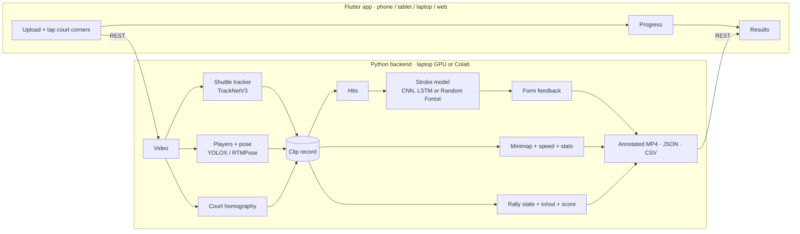

# ShuttleSense

**A Computer Vision Framework for Badminton Stroke Classification, Shuttlecock Tracking, and Match Analysis Using Deep Convolutional Neural Networks and Pose Estimation**


ShuttleSense turns a badminton rally (singles or doubles), from an uploaded video or a live camera feed, into coaching and match insights. It tracks the shuttlecock frame by frame, draws pose skeletons on every player, detects every hit, classifies each stroke, gives simple form feedback, and maps the rally onto a top-down court view with estimated shuttle speed, an assisted scoreboard and automated in/out calls. A session summary lists the top things to fix, and a coach chat answers questions from your own session data.

Results are viewed in one **Flutter app** that runs on a phone, a tablet, a laptop or in a browser. The heavy computer vision runs on a **Python backend** on a laptop GPU or in Google Colab.

> **Status:** in development (3-week build, November 2026). Features ship in priority tiers: P1 core, P2 analysis, P3 referee, live mode and coaching. See the [phased task plan](docs/PHASES.md).

---

## Table of contents

- [Features](#features)
- [Demo](#demo)
- [How it works](#how-it-works)
- [Repository structure](#repository-structure)
- [Quick start](#quick-start)
- [Usage](#usage)
- [Datasets](#datasets)
- [Models](#models)
- [Evaluation](#evaluation)
- [Roadmap](#roadmap)
- [Limitations](#limitations)
- [Ethics and privacy](#ethics-and-privacy)
- [Documentation](#documentation)
- [Team](#team)
- [Acknowledgments and references](#acknowledgments-and-references)
- [License](#license)

---

## Features

**Courtside depth (record 1.6):** persistent referee decision history, an explicitly
controlled interval timer, saved player-filter practice goals and a post-session recap.
These are code features; real-camera and model-backed acceptance remains open.
See [Phase 13](docs/phases/phase-13-courtside-depth.md) for verification and remaining work.

### P1: Core pipeline and app
- [ ] **Video input:** phone or broadcast footage (MP4, MOV, AVI; 720p or 1080p; 25 to 60 fps)
- [ ] **Shuttlecock tracking:** per-frame shuttle position with a fading trajectory trail (TrackNetV3)
- [ ] **Player detection:** bounding boxes with stable near/far player IDs (four players in doubles)
- [ ] **Pose estimation:** skeleton overlay on every player
- [ ] **Hit detection:** on-screen hit marker at every racket contact
- [ ] **Stroke classification:** smash, clear, drop, net shot, lift or serve, with confidence
- [ ] **Annotated video export:** MP4 with toggleable overlays
- [ ] **Cross-device app:** connect to the backend, upload, follow progress, watch results on phone, tablet, laptop or web

### P2: Analysis layer
- [ ] **Form feedback:** rule-based tips per stroke (contact height, elbow angle, arm extension)
- [ ] **Court calibration:** tap 4 court corners once in the app; court outline overlay
- [ ] **Court minimap:** top-down view of both players and the shuttle, synced to playback
- [ ] **Shuttle speed:** estimated km/h, per stroke and peak
- [ ] **Stroke counter:** running stroke count per rally
- [ ] **Stats export:** rally summary and per-hit table as JSON and CSV, shareable from the app

### P3: Referee layer, live mode and coaching
- [ ] **Upload or Live:** pick a clip, or point a camera at the court and see results while the rally is played
- [ ] **Rally state:** "In play" or "Between rallies", rally timer and shot count
- [ ] **Line calls:** IN / OUT per landing with margin and confidence; calls near a line are UNCERTAIN and ask you to confirm or override
- [ ] **Assisted scoreboard:** BWF 21-point rally scoring with manual correction in the app
- [ ] **Match play:** one game or best of 3, who serves from which service court, interval at 11, change of ends, game and match point; award a missed point and undo
- [ ] **Courtside referee:** join a match in game 2 or 3, record a let, a fault or a service fault, end a match on a retirement, one Undo for every decision, keyboard keys on a laptop, the screen kept on during a live session; exports list games, decisions and points won on serve
- [ ] **Session coaching notes:** pattern-level cues ("bent hitting arm on 4 of 6 smashes") and the top 3 fixes, each linked to the moments that show it
- [ ] **Live coaching:** after each rally, what it showed (strokes, length, peak speed, form tips) and the running top 3 fixes
- [ ] **Coach chat:** ask about your session; answers come only from the clip record and cite moments you can tap to seek

The code for every feature above is on `main` with tests. A box is ticked at release (T7.8), once the feature has been checked on real footage with the trained models.

---

## Demo

> Courtside controls rendered with synthetic data: [phone preview](docs/media/courtside-360.png) · [desktop preview](docs/media/courtside-1280.png). The live camera demo remains part of T7.8.

The results screen mirrors the reference demo and adapts to the device:

| Zone | Content | Phone | Tablet / laptop |
| --- | --- | --- | --- |
| Main video | Court outline, skeletons, player boxes, shuttle trail, hit markers, stroke labels | Top, full width | Left, main area |
| Status bar | Rally state, estimated speed, stroke count | Under the video | Under the video |
| Minimap | Top-down court with players and shuttle | Tab | Right panel |
| Scoreboard | Score per side (player or pair) with correction buttons | Tab | Right panel |
| Stroke timeline | Time, player, stroke, confidence, speed and form tip for every hit; tap to seek | Tab | Below the video |

---

## How it works



Live mode uses the same stages frame by frame: the app streams camera frames over a WebSocket (`WS /live`), the backend runs TrackNetV3 and pose on each frame and the hit, stroke, referee and line-call stages on a sliding window, and sends events back. The coach chat sends a text digest of the clip record (never video) to the Claude API when the backend has a key ([docs/PRIVACY.md](docs/PRIVACY.md)).

1. **Capture and upload.** Record a rally on a phone, pick it in the app and upload it to the backend. Optionally tap the 4 court corners on the first frame.
2. **Perception.** TrackNetV3 locates the shuttle in each frame. YOLOX detects players and RTMPose estimates their keypoints. Court corners map image positions to the court plane.
3. **Shared record.** All output goes into one JSON clip record per video ([format](docs/DATA_FORMAT.md)). Every downstream module reads from it, so modules are developed and tested independently.
4. **Analysis.** Hits are detected where the shuttle changes direction near a player's wrist. A 1D CNN classifies each hit from a window of pose and shuttle features. Positions are projected onto the court for the minimap and speed estimates. The referee layer finds rally boundaries and in/out calls.
5. **Results.** The backend renders an annotated MP4 and JSON/CSV summaries; the app plays the video and draws the minimap, status bar, timeline and scoreboard for whatever screen it runs on.

---

## Repository structure

```
ShuttleSense/
├── app/                        # Flutter client (Android, iOS/iPadOS, Web, Windows)
│   ├── lib/
│   │   ├── core/               # config, router, theme, responsive breakpoints + adaptive shell
│   │   ├── data/               # API client, JSON models, repositories
│   │   ├── features/           # connect, mode, upload, live, calibration, processing, results, chat, history, settings
│   │   └── shared/             # reusable widgets
│   ├── test/
│   └── android/ ios/ web/ windows/
├── backend/                    # Python CV pipeline + FastAPI server
│   ├── shuttlesense/
│   │   ├── io/                 # video loading and frame indexing (F1)
│   │   ├── tracking/           # TrackNetV3 wrapper, gap interpolation (F2)
│   │   ├── pose/               # player detection and pose estimation (F3, F4)
│   │   ├── court/              # calibration, homography (F9)
│   │   ├── hits/               # hit detection (F5)
│   │   ├── strokes/            # stroke classifier and labels (F6)
│   │   ├── feedback/           # rule-based form feedback (F8) and session notes (F21)
│   │   ├── analytics/          # positions, speed, counts, exports (F10–F13)
│   │   ├── referee/            # rally state, line calls, scoring (F14–F16, F20)
│   │   ├── stream/             # live sessions: per-frame perception, windowed analysis (F19)
│   │   ├── coach/              # coach chat over a digest of the record (F22)
│   │   ├── render/             # video overlays and export (F7)
│   │   ├── api/                # FastAPI app, job queue, WS /live, storage
│   │   ├── schema.py           # clip record (source of truth)
│   │   ├── pipeline.py         # stage orchestration
│   │   └── run.py              # CLI entry point
│   ├── configs/                # pipeline and training settings (YAML)
│   ├── scripts/                # download, clip extraction, features, training, Colab serving
│   ├── notebooks/              # Colab notebook (backend + tunnel)
│   ├── tests/
│   ├── requirements/           # base.txt, ml.txt, dev.txt
│   ├── data/ weights/ outputs/ storage/   # gitignored
│   └── pyproject.toml
├── docs/                       # PRD, architecture, data format, API, tech stack, setup, phases
├── samples/                    # consented demo clips (gitignored)
├── .github/                    # CI workflows, issue and PR templates
├── CONTRIBUTING.md
├── LICENSE
└── README.md
```

---

## Quick start

Full instructions, including Colab, weights, datasets and connecting a phone: **[docs/SETUP.md](docs/SETUP.md)**.

### Windows PowerShell: app and backend

From the repository root, set up the backend once (Python 3.13 is selected
explicitly so another default Python version does not affect the environment):

```powershell
cd backend
py -3.13 -m venv .venv
.\.venv\Scripts\python.exe -m pip install -r requirements/base.txt -e .
cd ..\app
flutter pub get
```

To run the app, open **two PowerShell terminals** at the repository root.
After installing the model dependencies and weights in [docs/SETUP.md](docs/SETUP.md#3-backend-on-a-laptop-primary), start the real backend in the first terminal:

```powershell
cd backend
Remove-Item Env:SHUTTLESENSE_FAKE_PIPELINE -ErrorAction SilentlyContinue
.\.venv\Scripts\python.exe -m uvicorn shuttlesense.api.main:app --host 127.0.0.1 --port 8000
```

Leave that terminal running. Check `http://127.0.0.1:8000/health` or open
`http://127.0.0.1:8000/docs` in a browser. In the second terminal:

```powershell
cd app
flutter run -d chrome
```

On the connect screen, enter `http://127.0.0.1:8000`. Press `Ctrl+C` in
each terminal to stop its process. To try the UI without models, set
`$env:SHUTTLESENSE_FAKE_PIPELINE = "1"` before starting the backend; demo mode
returns synthetic results rather than analyzing the video.
For a phone, see [connecting a device](docs/SETUP.md#8-connecting-a-phone-or-tablet-to-the-laptop).

**Backend** (Python 3.11–3.13; NVIDIA GPU recommended):

```bash
git clone --recurse-submodules https://github.com/Mist10148/ShuttleSense.git
cd ShuttleSense/backend
python -m venv .venv
source .venv/bin/activate          # Windows PowerShell: .venv\Scripts\Activate.ps1
pip install -r requirements/base.txt -r requirements/dev.txt
pip install -e .
uvicorn shuttlesense.api.main:app --host 0.0.0.0 --port 8000
```

**App** (Flutter 3.41):

```bash
cd ShuttleSense/app
flutter pub get
flutter run -d chrome              # or: -d windows, or an Android/iOS device id
```

In the app, enter the backend address (for example `http://192.168.1.20:8000`) on the connect screen.

---

## Usage

### In the app

1. Connect to the backend (laptop on the same Wi-Fi, or the Colab tunnel URL with its token).
2. Choose **Upload clip** or **Go live** (the app remembers it; switch any time from the app bar or Settings).
3. **Upload:** pick a rally video, tap the 4 court corners (or skip; court features turn off), choose overlays and start processing.
4. For **Live**, put the camera on a tripod, tap **Calibrate court** and the 4 corners on a still (or start without court), then **Go live**. In **Referee**, review the oldest uncertain call or select a different rally from the queue; the selected landing is highlighted on the court map. In **Coach**, choose Both, Near, or Far for between-rally cues. Expand **Recent completed rallies** to see the last three and pin a practice cue for the selected filter. Both views show the score and session status. **Stop** ends capture and saves a replay to History with coaching notes and chat when configured.
5. Review the annotated video, minimap, stroke timeline, line calls and form tips. Confirm or override UNCERTAIN calls; the score follows.
6. Open the **Coach** tab for the top 3 things to fix (tap a time to watch it), and **Ask your coach** questions about the session (needs a Claude API key on the backend).
7. Share or download the MP4, JSON and CSV; delete the job from the server when done.

### From the command line

```bash
cd backend
python -m shuttlesense.run --video ../samples/rally01.mp4 --out outputs/rally01
```

| Flag | Description |
| --- | --- |
| `--video` | Path to the input video |
| `--corners` | Court corners as `x1,y1,x2,y2,x3,y3,x4,y4` (enables P2 and P3 features) |
| `--calibrate` | Opens a window to click the 4 court corners instead of `--corners` (needs `pip install opencv-python`) |
| `--overlays` | Comma-separated: `trail,pose,boxes,hits,strokes,court,minimap,speed,score` (default: all) |
| `--no-referee` | Skip the referee layer (rally state, line calls, score) |
| `--stroke-model` | Stroke classifier: `cnn`, `lstm` or `rf` (default: `stages.strokes.algorithm` in the pipeline YAML) |
| `--tracking-csv` | Use a TrackNetV3 `predict.py` CSV instead of running the tracker |
| `--fake` | Return the golden record scaled to the video (no models; for app and demo testing) |
| `--config` | Pipeline YAML to use instead of `configs/pipeline.yaml` |
| `--device` | `cpu` or `cuda` (default: CUDA when available) |
| `--out` | Output folder for the annotated video and JSON/CSV files |

### Train the stroke classifier

```bash
cd backend
# The shipped weights: pre-extracted ShuttleSet features published with BST (no videos needed).
# Download and extract dataset_npy.rar first, see docs/SETUP.md section 6.
python scripts/import_bst_features.py --src data/bst_download/extracted/dataset_npy
python scripts/train_stroke_classifier.py --algorithm cnn  --seeds 1,2,3
python scripts/train_stroke_classifier.py --algorithm lstm --seeds 1,2,3
python scripts/train_stroke_classifier.py --algorithm rf   --seeds 1,2,3
python scripts/train_stroke_classifier.py --algorithm cnn  --seeds 1,2,3 --pose-only   # ablation
python scripts/make_figures.py             # docs/results/strokes.md + figures
```

To train on your own clips instead, cut and extract them first (`download_shuttleset.py`,
`extract_clips.py`, `extract_features.py`) and add `--splits configs/splits.json`.

---

## Datasets

| Dataset | Used for | Notes |
| --- | --- | --- |
| [ShuttleSet](https://arxiv.org/abs/2306.04948) (KDD 2023) | Training and testing the stroke classifier | 44 elite singles matches, 36,492 expert-annotated strokes in 18 types (the released CSVs hold 36,484, some marked unknown), merged into 6 classes; split by match |
| Shuttlecock Trajectory Dataset | Through TrackNetV3's pretrained weights | Not retrained |
| Team-recorded phone footage | Evaluation and demo only | 5 to 10 rallies, recorded with consent and labeled by hand |

Datasets and match videos are **not** included in this repository. Use the download scripts and follow each dataset's terms of use.

---

## Models

| Component | Method | Weights |
| --- | --- | --- |
| Shuttle tracking | TrackNetV3 (heatmap CNN + trajectory rectification) | Pretrained |
| Player detection | RTMLib's YOLOX person detector with near/far ID assignment | Pretrained |
| Pose estimation | RTMPose, COCO-17 keypoints (via rtmlib) | Pretrained |
| Hit detection | Shuttle direction change near a wrist keypoint | Rule-based |
| Stroke classification | A choice per clip: 1D CNN, LSTM or Random Forest, all over the same pose + shuttle window around each hit | Trained by the team on public ShuttleSet features; weights in the repo |
| Court mapping | OpenCV homography from 4 tapped corners | Rule-based |
| Speed and scoring | Court-plane displacement; BWF rally scoring rules | Rule-based |

---

## Evaluation

Results are filled in as experiments complete. Targets are the team's own goals, not published benchmarks.

| Metric | Test set | Target | Result |
| --- | --- | --- | --- |
| Shuttle detection accuracy (within 4 px) | Trajectory test clips | ≥ 85% | TBD |
| Hit detection F1 (±3 frames) | ShuttleSet test matches | ≥ 0.75 | TBD |
| Stroke macro accuracy, 6 classes | ShuttleSet test matches (BST feature split, 3,136 strokes) | ≥ 70% | 1D CNN 91.2% ± 0.6%, LSTM 90.2% ± 0.5%, Random Forest 84.7% ± 0.3% ([strokes.md](docs/results/strokes.md)); with rally and court context on the shipped weights 93.4%, 92.3% and 89.5%, and 93.8% for the ensemble of the three ([stroke_context.md](docs/results/stroke_context.md)) |
| Stroke accuracy | Team phone footage | ≥ 55% | TBD |
| Stroke count error per rally | Team phone footage | ≤ 1 | TBD |
| Rally boundary accuracy (P3) | Team phone footage | ≥ 80% | TBD |
| Line calls: IN/OUT precision and recall, near-line false-call rate (P3) | Labelled landings (ShuttleSet + team clips) | Reported as measured | Not measured: no labelled landings yet (`scripts/eval_line_calls.py` is ready) |
| Live provisional overlay latency, p95 (P3) | RTX 4050, 720p, 30 fps, models installed | ≤ 300 ms | Not measured: TrackNetV3 and pose weights are not installed on the team laptop yet |
| Live pipeline overhead without models, p95 (P3) | Fake perception, in-process, RTX 4050 laptop | Report | 26.2 ms round trip, 22.9 ms server side in the paced synthetic run ([live_latency.md](docs/results/live_latency.md)); 36.7 / 31.0 ms in the Nov 12 300-frame run ([live_latency_fake.md](docs/results/live_latency_fake.md)) |
| Processing time, 1-min 720p clip | Colab T4 / RTX 4050 | < 5 min | TBD |
| Full app flow | Android phone, tablet, Windows, Chrome | All pass | TBD |

**Ablation:** pose only 77.5% ± 0.7% against 91.2% ± 0.6% with the shuttle (1D CNN). These numbers are on broadcast matches; accuracy on phone footage is not measured yet.

---

## Roadmap

Detailed tasks, owners and dates: [docs/PHASES.md](docs/PHASES.md) (overview, workload, critical path, cut lines) and one file per phase in [docs/phases/](docs/phases/). Every task in Phases 0–11 is also a GitHub issue under its phase milestone.

- [ ] **Phase 0 (Oct 29 – Nov 1):** repo structure, docs, backend and app skeletons, CI are in place; team setup, shared assets and the phase gate remain
- [ ] **Phase 1 (Nov 2 – 3):** freeze data format and API, TrackNetV3 + pose running, app connects on all platforms
- [ ] **Phase 2 (Nov 2 – 6):** P1 perception and overlay video
- [ ] **Phase 3 (Nov 3 – 13):** ShuttleSet clips, hit detection, stroke classifier and ablation
- [ ] **Phase 4 (Nov 5 – 13):** app MVP on phone, tablet, laptop and web
- [ ] **Phase 5 (Nov 9 – 17):** court calibration, minimap, speed, feedback, exports
- [ ] **Phase 6 (Nov 16 – 18):** referee layer
- [ ] **Phase 8 (Nov 9 – 18):** live mode, line calls, session coaching notes, coach chat
- [ ] **Phase 7 (Nov 18 – 20):** feature freeze, evaluation, release builds, final demo
- [ ] **Phase 9 (from Nov 12):** doubles support: four-player tracking, hitter attribution, doubles service order, four players in the app ([plan](docs/phases/phase-9-doubles.md))
- [x] **Phase 10 (Nov 14):** review fixes, the doubles service order in every game, a job-finished notification and the remaining code-only steps ([plan](docs/phases/phase-10-hardening.md))
- [ ] **Phase 11 (Nov 14 – 17):** the stroke classifier as a choice of 1D CNN, LSTM or Random Forest per job; code and trained weights are in, a run on a real clip with the perception models remains ([plan](docs/phases/phase-11-stroke-models.md))
- [ ] **Phase 12 (Nov 14):** courtside referee and coach fixes, joining a match under way, let, fault and retirement; code is in, device checks remain ([plan](docs/phases/phase-12-courtside.md))
- [ ] **Phase 13 (Nov 15):** live command recovery, decision history, interval clock, practice goals and the saved recap; code is in, courtside verification remains ([plan](docs/phases/phase-13-courtside-depth.md))

What is left needs footage, devices, accounts or the team: [the owner's list](docs/PHASES.md#left-for-the-owner-needs-github-admin-hardware-data-or-the-team).

### Future work
- Automatic court line detection (no taps)
- Doubles accuracy: label doubles rallies and measure ID switches, hitter attribution and service order (T9.2, T9.12); a drive stroke class trained on doubles (T9.7)
- On-device processing on phones and edge devices (live mode streams to the backend)
- Multi-camera line calls
- Fine-tuning on amateur footage from local courts
- A transformer stroke model (the released BST weights fit our pose and shuttle data) and a learned hit detector

---

## Limitations

- **Camera angle:** the pretrained models learned from elevated, behind-the-court broadcast footage. Side-view phone clips will be less accurate; film from an elevated position behind the baseline for best results.
- **Speed is estimated:** one camera gives a 2D court-plane approximation, so speed is underestimated when the shuttle travels toward or away from the camera.
- **Line calls are automated estimates, not official calls:** with one camera they are not Hawk-Eye-level officiating and are never labelled "official" or "certified". Each call shows its confidence; calls inside the uncertainty band (set from calibration and tracking error) are UNCERTAIN until you confirm them, and every call and point can be overridden.
- **Live latency.** The RTX 4050 smoke run with models measured 201.4 ms p95 frame round trip and 7.6 fps sequential throughput on generated video. Hits and line calls need look-ahead. In the fake-perception benchmark, hit events took roughly 0.7 s and line calls 1.7 s. The team footage and physical-device measurements are still open. [Evaluation](docs/EVALUATION.md)
- **Live from a browser or Windows webcam is lower frame rate** than from a phone, which reduces tracking quality.
- **Needs a backend:** phones and tablets do not run the models; they need the laptop backend on the same network or the Colab tunnel.
- **Doubles is new and unmeasured** ([Phase 9](docs/phases/phase-9-doubles.md)): four-player tracking, crediting a hit to one partner and the doubles service order work on synthetic and fixture data, but have not been measured on labelled doubles footage. From one camera behind the baseline the far partners often overlap; a hit the app cannot attribute is shown for the side. The stroke model learned from singles, so doubles form tips are given only on strokes it is sure of. The game winners choose who serves first in the next game, so after each game the app asks; once named, the service order is followed for that game too.

---

## Ethics and privacy

- Only record people who have agreed to be filmed.
- Uploaded videos are processed on the team's own machine or in your own Colab session and are not kept by this project; jobs can be deleted from the app.
- Form feedback, session notes and coach chat answers are heuristic guidance, not professional coaching or injury advice; the chat refuses to diagnose injuries.
- The coach chat sends a text digest of the clip record (stroke table, form results, rally stats, line calls, notes) to the Claude API when the backend owner sets an API key. No video, frames or images are sent. See [docs/PRIVACY.md](docs/PRIVACY.md).

---

## Documentation

| Document | What it covers |
| --- | --- |
| [docs/PRD.md](docs/PRD.md) | Product requirements: goals, scope, functional and non-functional requirements, metrics, risks |
| [docs/ARCHITECTURE.md](docs/ARCHITECTURE.md) | Client/server design, pipeline stages, module ownership, job lifecycle, responsive layout |
| [docs/DATA_FORMAT.md](docs/DATA_FORMAT.md) | Clip record schema, conventions, exports, training data layout |
| [docs/API.md](docs/API.md) | REST endpoints between the app and the backend |
| [docs/TECH_STACK.md](docs/TECH_STACK.md) | Every library and tool, versions, licenses, rationale |
| [docs/SETUP.md](docs/SETUP.md) | Installing and running backend and app, weights, datasets, connecting devices |
| [docs/PHASES.md](docs/PHASES.md) · [docs/phases/](docs/phases/) | Phase overview plus one file per phase with a detailed card for each of the 162 tasks (steps, tests, acceptance criteria) |
| [docs/PRIVACY.md](docs/PRIVACY.md) | What stays on your backend and exactly what the coach chat sends to the Claude API |
| [docs/FEEDBACK_RULES.md](docs/FEEDBACK_RULES.md) | Form feedback rules per stroke: measured angles, thresholds, tips and sources |
| [docs/DECISIONS.md](docs/DECISIONS.md) | Decision log: what was chosen, the alternatives and why |
| [docs/RELEASE.md](docs/RELEASE.md) | Release checklist: version bump, builds, signing, smoke tests, tagging |
| [CONTRIBUTING.md](CONTRIBUTING.md) | Branches, commits, PRs, code style, definition of done |

---

## Team

BSCS 2-A

| Member | Role |
| --- | --- |
| Mist | Project lead, integration, backend API |
| Member 2 | Shuttle tracking, court calibration, minimap, speed |
| Member 3 | Data pipeline, form feedback rules, rally state and scoring |
| Member 4 | Data pipeline, label mapping, evaluation set |
| Member 5 | Pose estimation, hit detection, stroke classifier |
| Member 6 | Flutter app, documentation |

---

## Acknowledgments and references

- Wang, W.-Y., Huang, Y.-C., Ik, T.-U., & Peng, W.-C. (2023). *ShuttleSet: A Human-Annotated Stroke-Level Singles Dataset for Badminton Tactical Analysis.* KDD 2023. [arXiv:2306.04948](https://arxiv.org/abs/2306.04948)
- Chen, Y.-J., & Wang, Y.-S. (2023). *TrackNetV3: Enhancing ShuttleCock Tracking with Augmentations and Trajectory Rectification.* MMAsia 2023. [Code](https://github.com/qaz812345/TrackNetV3)
- Jiang, T. et al. (2023). *RTMPose: Real-Time Multi-Person Pose Estimation based on MMPose.* [arXiv:2303.07399](https://arxiv.org/abs/2303.07399) · [rtmlib](https://github.com/Tau-J/rtmlib)
- *BST: Badminton Stroke-type Transformer for Skeleton-based Action Recognition in Racket Sports.* [arXiv:2502.21085](https://arxiv.org/abs/2502.21085)
- Badminton World Federation, *Laws of Badminton*.

---

## License

This project is released under the [MIT License](LICENSE). Third-party components keep their own licenses: TrackNetV3 is MIT, rtmlib is Apache-2.0, Flutter and its packages are BSD/MIT. AGPL components such as Ultralytics YOLO are deliberately not used; check any new dependency's license before adding it (see [docs/TECH_STACK.md](docs/TECH_STACK.md)).
