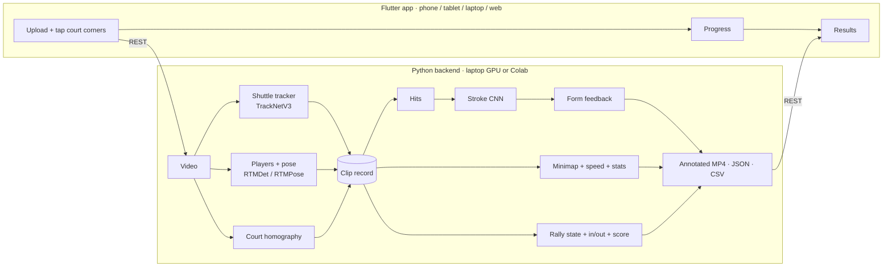

# ShuttleSense

**A Computer Vision Framework for Badminton Stroke Classification, Shuttlecock Tracking, and Match Analysis Using Deep Convolutional Neural Networks and Pose Estimation**


ShuttleSense turns a single video of a badminton singles rally into coaching and match insights. It tracks the shuttlecock frame by frame, draws pose skeletons on both players, detects every hit, classifies each stroke, gives simple form feedback, and maps the rally onto a top-down court view with estimated shuttle speed and an assisted scoreboard.

Results are viewed in one **Flutter app** that runs on a phone, a tablet, a laptop or in a browser. The heavy computer vision runs on a **Python backend** on a laptop GPU or in Google Colab.

> **Status:** in development (3-week build, November 2026). Features ship in priority tiers: P1 core, P2 analysis, P3 referee. See the [phased task plan](docs/PHASES.md).

---

## Table of contents

- [Features](#features)
- [Demo](#demo)
- [How it works](#how-it-works)
- [Repository structure](#repository-structure)
- [Quick start](#quick-start)
- [Usage](#usage)
- [Datasets](#datasets)
- [Models](#models)
- [Evaluation](#evaluation)
- [Roadmap](#roadmap)
- [Limitations](#limitations)
- [Ethics and privacy](#ethics-and-privacy)
- [Documentation](#documentation)
- [Team](#team)
- [Acknowledgments and references](#acknowledgments-and-references)
- [License](#license)

---

## Features

### P1: Core pipeline and app
- [ ] **Video input:** phone or broadcast footage (MP4, MOV, AVI; 720p or 1080p; 25 to 60 fps)
- [ ] **Shuttlecock tracking:** per-frame shuttle position with a fading trajectory trail (TrackNetV3)
- [ ] **Player detection:** bounding boxes with stable near/far player IDs
- [ ] **Pose estimation:** skeleton overlay on both players
- [ ] **Hit detection:** on-screen hit marker at every racket contact
- [ ] **Stroke classification:** smash, clear, drop, net shot, lift or serve, with confidence
- [ ] **Annotated video export:** MP4 with toggleable overlays
- [ ] **Cross-device app:** connect to the backend, upload, follow progress, watch results on phone, tablet, laptop or web

### P2: Analysis layer
- [ ] **Form feedback:** rule-based tips per stroke (contact height, elbow angle, arm extension)
- [ ] **Court calibration:** tap 4 court corners once in the app; court outline overlay
- [ ] **Court minimap:** top-down view of both players and the shuttle, synced to playback
- [ ] **Shuttle speed:** estimated km/h, per stroke and peak
- [ ] **Stroke counter:** running stroke count per rally
- [ ] **Stats export:** rally summary and per-hit table as JSON and CSV, shareable from the app

### P3: Referee layer (stretch goals)
- [ ] **Rally state:** "In play" or "Between rallies"
- [ ] **Landing and in/out:** estimated landing point with a confidence value
- [ ] **Assisted scoreboard:** BWF 21-point rally scoring with manual correction in the app

---

## Demo

> Screenshots of the phone and laptop layouts and a demo GIF will be added once the P1 pipeline is complete (task T7.8).

The results screen mirrors the reference demo and adapts to the device:

| Zone | Content | Phone | Tablet / laptop |
| --- | --- | --- | --- |
| Main video | Court outline, skeletons, player boxes, shuttle trail, hit markers, stroke labels | Top, full width | Left, main area |
| Status bar | Rally state, estimated speed, stroke count | Under the video | Under the video |
| Minimap | Top-down court with players and shuttle | Tab | Right panel |
| Scoreboard | Score per player with correction buttons | Tab | Right panel |
| Stroke timeline | Time, player, stroke, confidence, speed and form tip for every hit; tap to seek | Tab | Below the video |

---

## How it works



1. **Capture and upload.** Record a rally on a phone, pick it in the app and upload it to the backend. Optionally tap the 4 court corners on the first frame.
2. **Perception.** TrackNetV3 locates the shuttle in every frame. RTMDet and RTMPose find both players and their skeletons. The court corners give a homography from the image to the court plane.
3. **Shared record.** All output goes into one JSON clip record per video ([format](docs/DATA_FORMAT.md)). Every downstream module reads from it, so modules are developed and tested independently.
4. **Analysis.** Hits are detected where the shuttle changes direction near a player's wrist. A 1D CNN classifies each hit from a window of pose and shuttle features. Positions are projected onto the court for the minimap and speed estimates. The referee layer finds rally boundaries and in/out calls.
5. **Results.** The backend renders an annotated MP4 and JSON/CSV summaries; the app plays the video and draws the minimap, status bar, timeline and scoreboard for whatever screen it runs on.

---

## Repository structure

```
ShuttleSense/
├── app/                        # Flutter client (Android, iOS/iPadOS, Web, Windows)
│   ├── lib/
│   │   ├── core/               # config, router, theme, responsive breakpoints + adaptive shell
│   │   ├── data/               # API client, JSON models, repositories
│   │   ├── features/           # connect, upload, calibration, processing, results, history, settings
│   │   └── shared/             # reusable widgets
│   ├── test/
│   └── android/ ios/ web/ windows/
├── backend/                    # Python CV pipeline + FastAPI server
│   ├── shuttlesense/
│   │   ├── io/                 # video loading and frame indexing (F1)
│   │   ├── tracking/           # TrackNetV3 wrapper, gap interpolation (F2)
│   │   ├── pose/               # player detection and pose estimation (F3, F4)
│   │   ├── court/              # calibration, homography (F9)
│   │   ├── hits/               # hit detection (F5)
│   │   ├── strokes/            # stroke classifier and labels (F6)
│   │   ├── feedback/           # rule-based form feedback (F8)
│   │   ├── analytics/          # positions, speed, counts, exports (F10–F13)
│   │   ├── referee/            # rally state, in/out, scoring (F14–F16)
│   │   ├── render/             # video overlays and export (F7)
│   │   ├── api/                # FastAPI app, job queue, storage
│   │   ├── schema.py           # clip record (source of truth)
│   │   ├── pipeline.py         # stage orchestration
│   │   └── run.py              # CLI entry point
│   ├── configs/                # pipeline and training settings (YAML)
│   ├── scripts/                # download, clip extraction, features, training, Colab serving
│   ├── notebooks/              # Colab notebook (backend + tunnel)
│   ├── tests/
│   ├── requirements/           # base.txt, ml.txt, dev.txt
│   ├── data/ weights/ outputs/ storage/   # gitignored
│   └── pyproject.toml
├── docs/                       # PRD, architecture, data format, API, tech stack, setup, phases
├── samples/                    # consented demo clips (gitignored)
├── .github/                    # CI workflows, issue and PR templates
├── CONTRIBUTING.md
├── LICENSE
└── README.md
```

---

## Quick start

Full instructions, including Colab, weights, datasets and connecting a phone: **[docs/SETUP.md](docs/SETUP.md)**.

**Backend** (Python 3.11–3.13; NVIDIA GPU recommended):

```bash
git clone --recurse-submodules https://github.com/Mist10148/ShuttleSense.git
cd ShuttleSense/backend
python -m venv .venv
source .venv/bin/activate          # Windows PowerShell: .venv\Scripts\Activate.ps1
pip install -r requirements/base.txt -r requirements/dev.txt
pip install -e .
uvicorn shuttlesense.api.main:app --host 0.0.0.0 --port 8000
```

**App** (Flutter 3.41):

```bash
cd ShuttleSense/app
flutter pub get
flutter run -d chrome              # or: -d windows, or an Android/iOS device id
```

In the app, enter the backend address (for example `http://192.168.1.20:8000`) on the connect screen.

---

## Usage

### In the app

1. Connect to the backend (laptop on the same Wi-Fi, or the Colab tunnel URL with its token).
2. Pick a rally video and upload it.
3. Tap the 4 court corners (or skip; court features turn off).
4. Choose overlays and start processing.
5. Review the annotated video, minimap, stroke timeline and form tips.
6. Share or download the MP4, JSON and CSV; delete the job from the server when done.

### From the command line

```bash
cd backend
python -m shuttlesense.run --video ../samples/rally01.mp4 --out outputs/rally01
```

| Flag | Description |
| --- | --- |
| `--video` | Path to the input video |
| `--corners` | Court corners as `x1,y1,x2,y2,x3,y3,x4,y4` (enables P2 and P3 features) |
| `--calibrate` | Opens a window to click the 4 court corners instead of `--corners` |
| `--overlays` | Comma-separated: `trail,pose,boxes,hits,strokes,court,minimap,speed,score` (default: all) |
| `--no-referee` | Skip the P3 referee layer |
| `--out` | Output folder for the annotated video and JSON/CSV files |

### Train the stroke classifier

```bash
cd backend
python scripts/download_shuttleset.py      # annotations + match list
python scripts/extract_clips.py            # cut per-stroke clips
python scripts/extract_features.py         # pose + shuttle features per clip
python scripts/train_stroke_classifier.py --config configs/stroke_cnn.yaml
```

---

## Datasets

| Dataset | Used for | Notes |
| --- | --- | --- |
| [ShuttleSet](https://arxiv.org/abs/2306.04948) (KDD 2023) | Training and testing the stroke classifier | 44 elite singles matches, 36,492 expert-annotated strokes in 18 types, merged into 6 classes; split by match |
| Shuttlecock Trajectory Dataset | Through TrackNetV3's pretrained weights | Not retrained |
| Team-recorded phone footage | Evaluation and demo only | 5 to 10 rallies, recorded with consent and labeled by hand |

Datasets and match videos are **not** included in this repository. Use the download scripts and follow each dataset's terms of use.

---

## Models

| Component | Method | Weights |
| --- | --- | --- |
| Shuttle tracking | TrackNetV3 (heatmap CNN + trajectory rectification) | Pretrained |
| Player detection | RTMDet person detector with near/far ID assignment | Pretrained (COCO) |
| Pose estimation | RTMPose, COCO-17 keypoints (via rtmlib) | Pretrained |
| Hit detection | Shuttle direction change near a wrist keypoint | Rule-based |
| Stroke classification | 1D CNN over pose + shuttle features around each hit | Trained from scratch by the team |
| Court mapping | OpenCV homography from 4 tapped corners | Rule-based |
| Speed and scoring | Court-plane displacement; BWF rally scoring rules | Rule-based |

---

## Evaluation

Results are filled in as experiments complete. Targets are the team's own goals, not published benchmarks.

| Metric | Test set | Target | Result |
| --- | --- | --- | --- |
| Shuttle detection accuracy (within 4 px) | Trajectory test clips | ≥ 85% | TBD |
| Hit detection F1 (±3 frames) | ShuttleSet test matches | ≥ 0.75 | TBD |
| Stroke accuracy, 6 classes | ShuttleSet test matches | ≥ 70% | TBD |
| Stroke accuracy | Team phone footage | ≥ 55% | TBD |
| Stroke count error per rally | Team phone footage | ≤ 1 | TBD |
| Rally boundary accuracy (P3) | Team phone footage | ≥ 80% | TBD |
| Processing time, 1-min 720p clip | Colab T4 / RTX 4050 | < 5 min | TBD |
| Full app flow | Android phone, tablet, Windows, Chrome | All pass | TBD |

**Ablation:** pose-only vs pose + shuttle trajectory for stroke classification (TBD).

---

## Roadmap

Detailed tasks, owners and dates: [docs/PHASES.md](docs/PHASES.md) (overview, workload, critical path, cut lines) and one file per phase in [docs/phases/](docs/phases/). Every task is also a GitHub issue under its phase milestone.

- [x] **Phase 0 (Oct 29 – Nov 1):** repo structure, docs, backend and app skeletons, CI
- [ ] **Phase 1 (Nov 2 – 3):** freeze data format and API, TrackNetV3 + pose running, app connects on all platforms
- [ ] **Phase 2 (Nov 2 – 6):** P1 perception and overlay video
- [ ] **Phase 3 (Nov 3 – 13):** ShuttleSet clips, hit detection, stroke classifier and ablation
- [ ] **Phase 4 (Nov 5 – 13):** app MVP on phone, tablet, laptop and web
- [ ] **Phase 5 (Nov 9 – 17):** court calibration, minimap, speed, feedback, exports
- [ ] **Phase 6 (Nov 16 – 18):** referee layer (stretch)
- [ ] **Phase 7 (Nov 18 – 20):** feature freeze, evaluation, release builds, final demo

### Future work
- Automatic court line detection (no taps)
- Doubles support
- On-device or real-time processing on phones and edge devices
- Fine-tuning on amateur footage from local courts
- Transformer-based stroke model and a learned hit detector

---

## Limitations

- **Camera angle:** the pretrained models learned from elevated, behind-the-court broadcast footage. Side-view phone clips will be less accurate; film from an elevated position behind the baseline for best results.
- **Speed is estimated:** one camera gives a 2D court-plane approximation, so speed is underestimated when the shuttle travels toward or away from the camera.
- **In/out calls are not official:** close calls are flagged as uncertain, and the scoreboard always allows manual correction.
- **Needs a backend:** phones and tablets do not run the models; they need the laptop backend on the same network or the Colab tunnel.
- **Singles only** in this version.

---

## Ethics and privacy

- Only record people who have agreed to be filmed.
- Uploaded videos are processed on the team's own machine or in your own Colab session and are not kept by this project; jobs can be deleted from the app.
- Form feedback is heuristic guidance, not professional coaching or injury advice.

---

## Documentation

| Document | What it covers |
| --- | --- |
| [docs/PRD.md](docs/PRD.md) | Product requirements: goals, scope, functional and non-functional requirements, metrics, risks |
| [docs/ARCHITECTURE.md](docs/ARCHITECTURE.md) | Client/server design, pipeline stages, module ownership, job lifecycle, responsive layout |
| [docs/DATA_FORMAT.md](docs/DATA_FORMAT.md) | Clip record schema, conventions, exports, training data layout |
| [docs/API.md](docs/API.md) | REST endpoints between the app and the backend |
| [docs/TECH_STACK.md](docs/TECH_STACK.md) | Every library and tool, versions, licenses, rationale |
| [docs/SETUP.md](docs/SETUP.md) | Installing and running backend and app, weights, datasets, connecting devices |
| [docs/PHASES.md](docs/PHASES.md) · [docs/phases/](docs/phases/) | Phase overview plus one file per phase with a detailed card for each of the 96 tasks (steps, tests, acceptance criteria) |
| [docs/FEEDBACK_RULES.md](docs/FEEDBACK_RULES.md) | Form feedback rules per stroke: measured angles, thresholds, tips and sources |
| [docs/DECISIONS.md](docs/DECISIONS.md) | Decision log: what was chosen, the alternatives and why |
| [CONTRIBUTING.md](CONTRIBUTING.md) | Branches, commits, PRs, code style, definition of done |

---

## Team

BSCS 2-A

| Member | Role |
| --- | --- |
| Mist | Project lead, integration, backend API |
| Member 2 | Shuttle tracking, court calibration, minimap, speed |
| Member 3 | Data pipeline, rally state and scoring |
| Member 4 | Data pipeline, label mapping, evaluation set |
| Member 5 | Pose estimation, hit detection, stroke classifier |
| Member 6 | Flutter app, form feedback, documentation |

---

## Acknowledgments and references

- Wang, W.-Y., Huang, Y.-C., Ik, T.-U., & Peng, W.-C. (2023). *ShuttleSet: A Human-Annotated Stroke-Level Singles Dataset for Badminton Tactical Analysis.* KDD 2023. [arXiv:2306.04948](https://arxiv.org/abs/2306.04948)
- Chen, Y.-J., & Wang, Y.-S. (2023). *TrackNetV3: Enhancing ShuttleCock Tracking with Augmentations and Trajectory Rectification.* MMAsia 2023. [Code](https://github.com/qaz812345/TrackNetV3)
- Jiang, T. et al. (2023). *RTMPose: Real-Time Multi-Person Pose Estimation based on MMPose.* [arXiv:2303.07399](https://arxiv.org/abs/2303.07399) · [rtmlib](https://github.com/Tau-J/rtmlib)
- *BST: Badminton Stroke-type Transformer for Skeleton-based Action Recognition in Racket Sports.* [arXiv:2502.21085](https://arxiv.org/abs/2502.21085)
- Badminton World Federation, *Laws of Badminton*.

---

## License

This project is released under the [MIT License](LICENSE). Third-party components keep their own licenses: TrackNetV3 is MIT, rtmlib is Apache-2.0, Flutter and its packages are BSD/MIT. AGPL components such as Ultralytics YOLO are deliberately not used; check any new dependency's license before adding it (see [docs/TECH_STACK.md](docs/TECH_STACK.md)).
