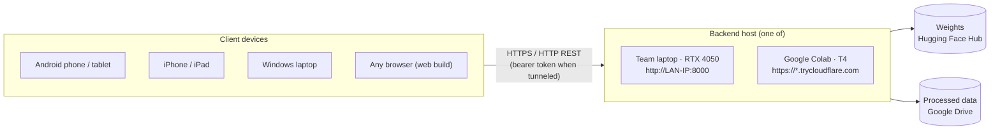
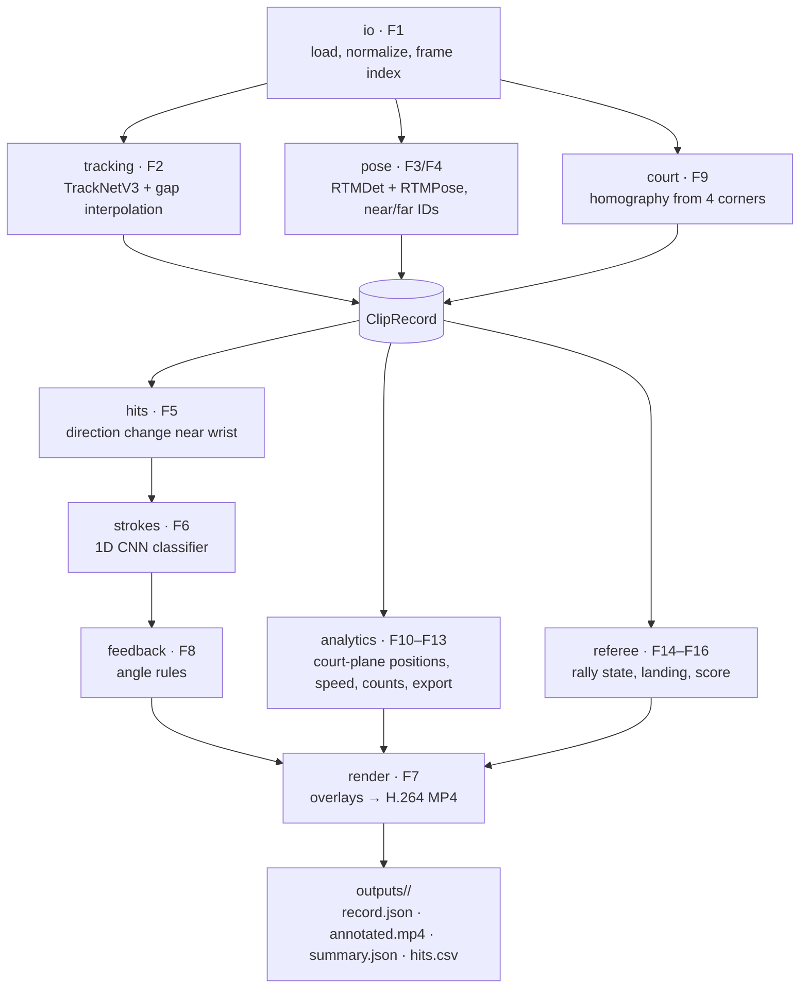
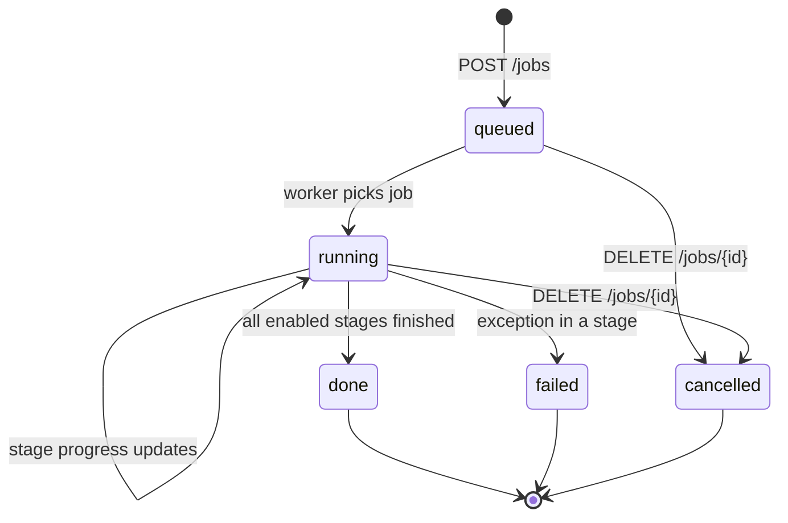

# Architecture

How ShuttleSense is put together: the client/server split, the pipeline stages, module boundaries in both codebases, the job lifecycle and the responsive layout rules for the app. Requirements live in the [PRD](PRD.md); the record schema in [DATA_FORMAT.md](DATA_FORMAT.md); the REST contract in [API.md](API.md).

## 1. System context



- **One Flutter codebase** (`app/`) builds for Android, iOS/iPadOS, Web and Windows. It never runs models; it uploads, collects input (court corners, overlay choices, score corrections) and presents results.
- **One Python backend** (`backend/`) holds the CV pipeline and a FastAPI server. It runs on any NVIDIA GPU machine (primary: the team laptop) or inside Colab, where `scripts/serve_colab.py` opens a cloudflared tunnel.
- Communication is plain REST + JSON, with file upload/download for videos. Polling (every 1 to 2 s) is used for job progress; it works through tunnels and on every Flutter platform without extra plumbing.

### Why client/server and not on-device

TrackNetV3, RTMPose and the stroke CNN need a GPU to hit the "1-minute clip in under 5 minutes" target. Porting them to TFLite/Core ML/ONNX-web for four platforms is a project on its own. Keeping inference on one Python backend means the ML team works in one environment and the app team works against a stable contract.

## 2. Pipeline



Rules every stage follows:

1. **Input and output is the `ClipRecord`** (`backend/shuttlesense/schema.py`). A stage reads the fields it needs and fills its own fields. It never changes fields owned by another stage.
2. **Stages are pure functions** with the shape `run(record: ClipRecord, ctx: StageContext) -> ClipRecord`. `StageContext` carries the config, the video reader, the device and a progress callback.
3. **Stages can be disabled.** `pipeline.py` builds the stage list from `configs/pipeline.yaml` and the job request. If court corners are missing, `court`, the court-dependent part of `analytics`, and `referee` are skipped and their fields stay `null`.
4. **Heavy imports are lazy.** `torch`, `onnxruntime`, `rtmlib` are imported inside functions, so the API server, the tests and CI run without ML dependencies installed.
5. **Each stage caches its output** under `outputs/<job_id>/cache/<stage>.json` so re-rendering with different overlays does not re-run tracking or pose.

### Stage ownership

| Stage | Module | Fills in `ClipRecord` | Owner | Feature |
| --- | --- | --- | --- | --- |
| io | `shuttlesense/io` | `clip_id`, `fps`, `width`, `height`, `num_frames`, `frames[].frame` | Mist | F1 |
| tracking | `shuttlesense/tracking` | `frames[].shuttle` | Member 2 | F2 |
| pose | `shuttlesense/pose` | `frames[].players` | Member 5 | F3, F4 |
| court | `shuttlesense/court` | `court`, `frames[].court_positions` | Member 2 | F9 |
| hits | `shuttlesense/hits` | `hits[]` (frame, player) | Member 5 | F5 |
| strokes | `shuttlesense/strokes` | `hits[].stroke`, `hits[].confidence` | Member 5 | F6 |
| feedback | `shuttlesense/feedback` | `hits[].feedback` | Member 6 | F8 |
| analytics | `shuttlesense/analytics` | `hits[].speed_kmh`, `frames[].shuttle_speed_kmh`, `summary` | Member 2 | F10–F13 |
| referee | `shuttlesense/referee` | `rallies[]`, `score` | Member 3 | F14–F16 |
| render | `shuttlesense/render` | writes `annotated.mp4` | Member 2 / Mist | F7 |

## 3. Backend layout

```
backend/
├── pyproject.toml              # package metadata, ruff + pytest config
├── requirements/
│   ├── base.txt                # API + light processing (CI installs this)
│   ├── ml.txt                  # torch, onnxruntime, rtmlib (GPU host only)
│   └── dev.txt                 # pytest, httpx, ruff
├── configs/
│   ├── pipeline.yaml           # stage toggles, thresholds, overlay defaults
│   └── stroke_cnn.yaml         # classifier training hyperparameters
├── shuttlesense/
│   ├── schema.py               # ClipRecord and friends (pydantic) — source of truth
│   ├── config.py               # YAML loading
│   ├── pipeline.py             # stage registry, ordering, progress, available_stages()
│   ├── cache.py                # per-stage cache in out_dir/cache (chained config hash)
│   ├── fake.py                 # golden record scaled to a clip (SHUTTLESENSE_FAKE_PIPELINE)
│   ├── evaluation.py           # hit / tracking / rally metrics for the eval scripts
│   ├── run.py                  # CLI: python -m shuttlesense.run
│   ├── io/ tracking/ pose/ court/ hits/ strokes/ feedback/ analytics/ referee/ render/
│   └── api/
│       ├── main.py             # FastAPI app factory, CORS, auth dependency
│       ├── settings.py         # env-driven settings (SHUTTLESENSE_*)
│       ├── storage.py          # per-video / per-job folders on disk
│       ├── jobs.py             # in-memory job registry + single GPU worker thread
│       └── routes.py           # endpoints from API.md
├── scripts/                    # weights/data download, clip extraction, training, Colab serving
├── notebooks/                  # Colab notebook (runs the backend with a tunnel)
├── third_party/TrackNetV3/     # git submodule (added in Phase 1)
└── tests/
```

### Job lifecycle



- One worker thread processes one job at a time (one GPU). Extra jobs wait in a FIFO queue; `GET /jobs/{id}` reports `queue_position`.
- Job state lives in memory and is mirrored to `storage/jobs/<job_id>/job.json` so a restarted server can list finished jobs.
- Files: `storage/videos/<video_id>/source.<ext>` for uploads, `storage/jobs/<job_id>/` for `record.json`, `annotated.mp4`, `summary.json`, `hits.csv`, `cache/`.
- `DELETE /jobs/{id}` and `DELETE /videos/{id}` remove the files (privacy requirement).

## 4. App layout

```
app/lib/
├── main.dart                   # bootstraps media_kit, ProviderScope, runs App
├── app.dart                    # MaterialApp.router, themes
├── core/
│   ├── config/                 # persisted server settings (URL, token)
│   ├── router/                 # go_router routes
│   ├── theme/                  # light/dark ColorScheme, player colors
│   └── responsive/
│       ├── breakpoints.dart    # compact / medium / expanded
│       └── adaptive_shell.dart # bottom nav vs navigation rail
├── data/
│   ├── api_client.dart         # dio wrapper for every endpoint in API.md
│   ├── models/                 # Dart mirrors of the JSON in DATA_FORMAT.md / API.md
│   └── repositories/           # job/video repositories used by controllers
├── features/
│   ├── connect/                # C1 server URL + token, health check
│   ├── upload/                 # C2 pick file, upload with progress, overlay options
│   ├── calibration/            # F9 tap 4 corners on first frame, zoom/pan
│   ├── processing/             # C2 per-stage progress
│   ├── results/                # C3 player, status bar, minimap, timeline, scoreboard
│   ├── history/                # list of jobs on the server, delete
│   └── settings/               # server URL/token, theme, about
└── shared/widgets/             # reusable widgets (section card, empty state, …)
```

State management is **Riverpod**; each feature has a `*_screen.dart` (widgets only) and, where it needs state, a `*_controller.dart` (Notifier). Screens never call `dio` directly; they go through repositories so tests can override providers with fakes.

### Navigation

| Route | Screen | Shell destination |
| --- | --- | --- |
| `/connect` | Server connection (shown first if no server saved) | — |
| `/` | Home: new analysis (upload) | Analyze |
| `/videos/:videoId/calibrate` | Court calibration | Analyze |
| `/jobs/:jobId` | Processing progress | Analyze |
| `/jobs/:jobId/results` | Results | Analyze |
| `/history` | Past jobs | History |
| `/settings` | Server and app settings | Settings |

### Responsive layout

Breakpoints follow Material 3 window size classes and are defined once in `core/responsive/breakpoints.dart`.

| Class | Width | Devices | Navigation | Results screen |
| --- | --- | --- | --- | --- |
| compact | < 600 dp | Phones (portrait) | Bottom `NavigationBar` | Video on top, status strip, then tabs: Timeline · Minimap · Score |
| medium | 600–1023 dp | Tablets, phones in landscape, narrow windows | `NavigationRail` | Video (left) + side panel (minimap, scoreboard); timeline below video |
| expanded | ≥ 1024 dp | Laptops, desktops, large tablets in landscape | Extended `NavigationRail` | Three zones from the PRD: video + status bar, right panel (minimap, scoreboard), full-width timeline |

Other cross-device rules:

- Touch targets ≥ 48 dp; every action also has a keyboard/mouse path (tooltips, hover states on desktop/web).
- Court calibration supports pinch-zoom on touch and scroll-zoom on desktop; corner handles can be dragged after placement.
- Playback overlays drawn by the app (minimap, live status) sync to the player position via `frame = position * fps`.
- File access: `file_picker` on all platforms; downloads use the share sheet on Android/iOS, a save dialog on Windows and an anchor download on web.
- Video: `media_kit` gives the same player on Android, iOS, Windows and Web; the backend always encodes H.264 + yuv420p so every platform can decode it.

## 5. Configuration and environments

| Setting | Where | Default |
| --- | --- | --- |
| `SHUTTLESENSE_HOST` / `SHUTTLESENSE_PORT` | backend env | `0.0.0.0` / `8000` |
| `SHUTTLESENSE_STORAGE_DIR` | backend env | `backend/storage` |
| `SHUTTLESENSE_TOKEN` | backend env | unset (no auth); **set it whenever a tunnel is used** |
| `SHUTTLESENSE_DEVICE` | backend env | `cuda` if available, else `cpu` |
| `SHUTTLESENSE_CORS_ORIGINS` | backend env | `*` |
| Server URL + token | app, saved with `shared_preferences` | entered on the connect screen |
| `API_BASE_URL` | app, `--dart-define` | optional pre-fill for builds |

## 6. Testing strategy

| Layer | Tooling | What is covered |
| --- | --- | --- |
| Schema | pytest | `ClipRecord` round-trips the example in DATA_FORMAT.md |
| Pure logic | pytest | homography, speed, hit rules, scoring rules, label mapping — tested with synthetic arrays, no GPU |
| API | pytest + FastAPI `TestClient` | upload → job → record round trip with the stub pipeline |
| Models | notebooks + `scripts/` | metrics from the PRD on held-out data, logged to `docs/` results tables |
| App logic | `flutter test` | JSON model parsing, breakpoint selection, repositories with fake API |
| App UI | widget tests | shell switches navigation at each breakpoint; screens render without overflow at 360, 800, 1280 dp |
| End-to-end | manual checklist ([T7.4](phases/phase-7-release.md#t74)) | full flow on Android phone, tablet, Windows, Chrome |

CI (`.github/workflows/`) runs backend lint + tests and app analyze + tests + web build on every push and PR.
