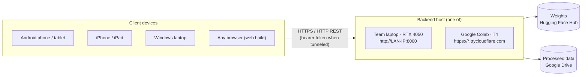
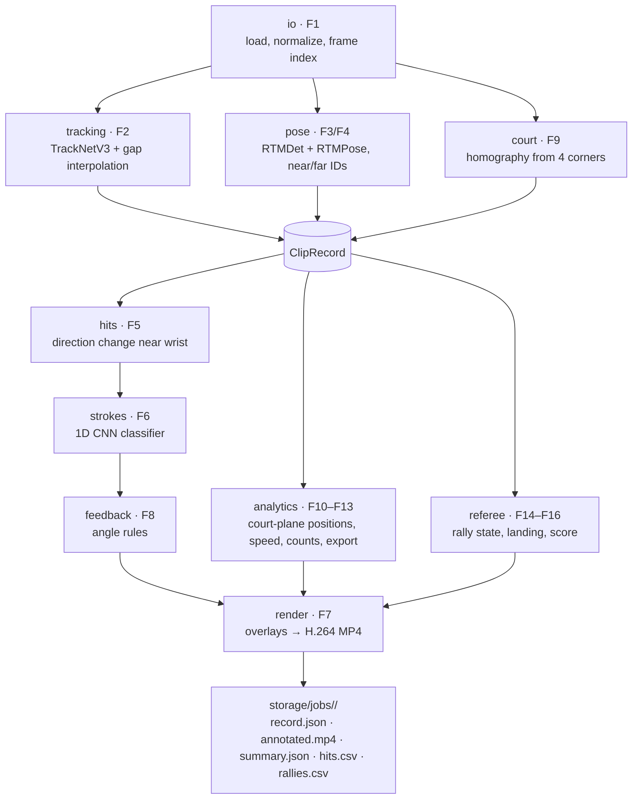
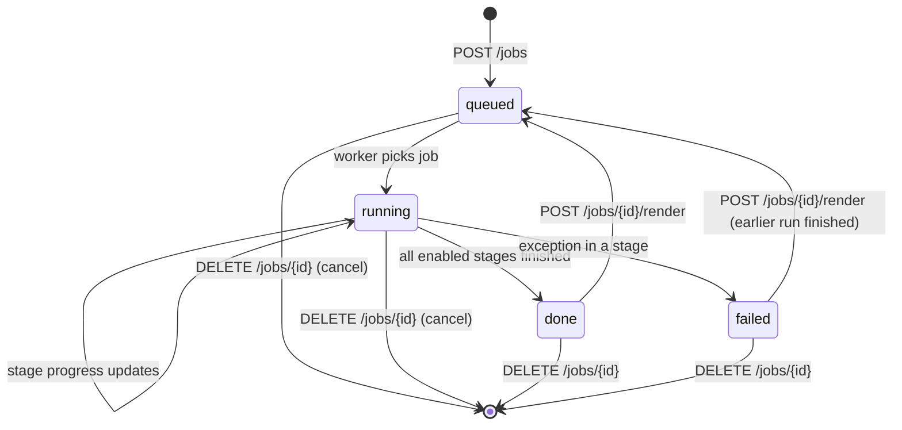
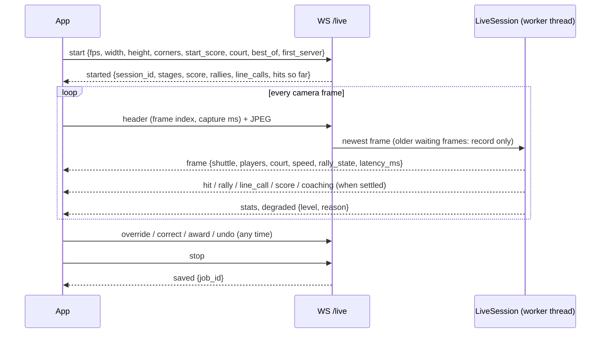

# Architecture

How ShuttleSense is put together: the client/server split, the pipeline stages, module boundaries in both codebases, the job lifecycle and the responsive layout rules for the app. Requirements live in the [PRD](PRD.md); the record schema in [DATA_FORMAT.md](DATA_FORMAT.md); the REST contract in [API.md](API.md).

## 1. System context



- **One Flutter codebase** (`app/`) builds for Android, iOS/iPadOS, Web and Windows. It never runs models; it uploads, collects input (court corners, overlay choices, score corrections) and presents results.
- **One Python backend** (`backend/`) holds the CV pipeline and a FastAPI server. It runs on any NVIDIA GPU machine (primary: the team laptop) or inside Colab, where `scripts/serve_colab.py` opens a cloudflared tunnel.
- Communication is plain REST + JSON, with file upload/download for videos. Polling (every 1 to 2 s) is used for job progress; it works through tunnels and on every Flutter platform without extra plumbing.
- **Live mode** (D16) adds one WebSocket, `WS /live`: the app sends JPEG camera frames and gets JSON events back (see [Live sessions](#live-sessions)). The coach chat (D18) is the only call that leaves the backend: a text digest of the record goes to the Claude API, and only when the backend has an API key ([PRIVACY.md](PRIVACY.md)).

### Why client/server and not on-device

TrackNetV3, RTMPose and the stroke CNN need a GPU to hit the "1-minute clip in under 5 minutes" target. Porting them to TFLite/Core ML/ONNX-web for four platforms is a project on its own. Keeping inference on one Python backend means the ML team works in one environment and the app team works against a stable contract.

## 2. Pipeline



Rules every stage follows:

1. **Input and output is the `ClipRecord`** (`backend/shuttlesense/schema.py`). A stage reads the fields it needs and fills its own fields. It never changes fields owned by another stage.
2. **Stages are pure functions** with the shape `run(record: ClipRecord, ctx: StageContext) -> ClipRecord`. `StageContext` carries the config, the video reader, the device and a progress callback.
3. **Stages can be disabled.** `pipeline.py` builds the stage list from `configs/pipeline.yaml` and the job request. If court corners are missing, `court`, the court-dependent part of `analytics`, and `referee` are skipped and their fields stay `null`.
4. **Heavy imports are lazy.** `torch`, `onnxruntime`, `rtmlib` are imported inside functions, so the API server, the tests and CI run without ML dependencies installed.
5. **Each stage caches its output** under `<job folder>/cache/<stage>.json` so re-rendering with different overlays does not re-run tracking or pose. The key covers the stage's config block (without display-only keys such as `trail_length`) and any other block it reads (pose reads `court`), see `cache.py`.

### Stage ownership

| Stage | Module | Fills in `ClipRecord` | Owner | Feature |
| --- | --- | --- | --- | --- |
| io | `shuttlesense/io` | `clip_id`, `fps`, `width`, `height`, `num_frames`, `frames[].frame` | Mist | F1 |
| tracking | `shuttlesense/tracking` | `frames[].shuttle` | Member 2 | F2 |
| pose | `shuttlesense/pose` | `frames[].players` | Member 5 | F3, F4 |
| court | `shuttlesense/court` | `court` | Member 2 | F9 |
| hits | `shuttlesense/hits` | `hits[]` (frame, player) | Member 5 | F5 |
| strokes | `shuttlesense/strokes` | `hits[].stroke`, `hits[].confidence`, `hits[].class_probs` | Member 5 | F6 |
| feedback | `shuttlesense/feedback` | `hits[].feedback` | Member 6 | F8 |
| analytics | `shuttlesense/analytics` | `hits[].speed_kmh`, `frames[].court_positions`, `frames[].shuttle_speed_kmh`, `summary` | Member 2 | F10–F13 |
| referee | `shuttlesense/referee` | `rallies[]`, `score`, `hits[].rally_index`, `frames[].rally_state` | Member 3 | F14–F16 |
| render | `shuttlesense/render` | writes `annotated.mp4` | Member 2 / Mist | F7 |

## 3. Backend layout

```
backend/
├── pyproject.toml              # package metadata, ruff + pytest config
├── requirements/
│   ├── base.txt                # API + light processing (CI installs this)
│   ├── ml.txt                  # torch, onnxruntime, rtmlib (GPU host only)
│   └── dev.txt                 # pytest, httpx, ruff
├── configs/
│   ├── pipeline.yaml           # stage toggles, thresholds, overlay defaults
│   └── stroke_cnn.yaml         # classifier training hyperparameters
├── shuttlesense/
│   ├── schema.py               # ClipRecord and friends (pydantic) — source of truth
│   ├── config.py               # YAML loading
│   ├── pipeline.py             # stage registry, ordering, progress, available_stages()
│   ├── cache.py                # per-stage cache in out_dir/cache (chained config hash)
│   ├── fake.py                 # golden record scaled to a clip (SHUTTLESENSE_FAKE_PIPELINE)
│   ├── evaluation.py           # hit / tracking / rally metrics for the eval scripts
│   ├── run.py                  # CLI: python -m shuttlesense.run
│   ├── io/ tracking/ pose/ court/ hits/ strokes/ feedback/ analytics/ referee/ render/
│   ├── stream/                 # live: perception per frame, windowed analyzer, session, fake source
│   └── api/
│       ├── main.py             # FastAPI app factory, CORS, job manager startup
│       ├── settings.py         # env-driven settings (SHUTTLESENSE_*)
│       ├── storage.py          # per-video / per-job folders on disk
│       ├── jobs.py             # in-memory job registry + single GPU worker thread
│       ├── live.py             # WS /live: live sessions, resume, saving to a job
│       └── routes.py           # endpoints from API.md, token check
├── scripts/                    # weights/data download, clip extraction, training, Colab serving
├── notebooks/                  # Colab notebook (runs the backend with a tunnel)
├── third_party/TrackNetV3/     # git submodule (added in Phase 1)
└── tests/
```

### Job lifecycle



A cancelled job is deleted with its files, so `cancelled` is never stored or returned (docs/API.md). A re-render saves the last run's overlays and stage states to `previous.json`; a failure or a server restart puts them back, since the outputs on disk are still those of that run.

- One worker thread processes one job at a time (one GPU). Extra jobs wait in a FIFO queue; `GET /jobs/{id}` reports `queue_position`. A live session holds the same GPU lock: it cannot start while a job runs (`busy`), and queued jobs wait until it ends.
- Job state lives in memory and is mirrored to `storage/jobs/<job_id>/job.json` so a restarted server can list finished jobs.
- Files: `storage/videos/<video_id>/source.<ext>` + `meta.json` for uploads, `storage/jobs/<job_id>/` for `job.json`, `record.json`, `annotated.mp4`, `summary.json`, `hits.csv`, `rallies.csv`, `tracking.csv`, `timings.json`, `corrections.json` (score corrections), `line_call_overrides.json` (confirmed or overridden calls), `previous.json` (the last run's overlays and stage states while a re-render runs), `cache/` (per-stage fields: the referee entry holds hits, rallies, score, line calls and rally events).
- `DELETE /jobs/{id}` and `DELETE /videos/{id}` remove the files (privacy requirement). `job.json` / `meta.json` go first; a file Windows keeps locked (e.g. a video still streaming) is removed at the next server start.

### Live sessions



- **Shared stage code (D20).** `stream/perception.py` runs the offline models frame by frame: TrackNetV3 on a sliding window of its last `seq_len` frames (`tracking.tracknet.track_windows`, also used by the offline stage) and the pose detector with the same near/far tracker. `stream/analyzer.py` then runs the *offline* `hits`, `strokes`, `feedback`, `analytics` and `referee` stage functions on a window of frames since the last finished rally, every `live.tick_every` frames, and commits what has settled. `tests/test_stream.py::test_offline_live_parity` checks that a clip gives the same hits, rallies, line calls and score both ways.
- **Live-only differences.** The TrackNet background median comes from the first `live.background_frames` frames (offline: the whole clip); InpaintNet, outlier removal, gap filling and centred keypoint smoothing are off because they need future frames; court positions and speed are computed per frame without centred smoothing.
- **Latency budget.** The `frame` event (provisional overlay) is sent as soon as perception finishes on that frame; the target is p95 ≤ `live.budget_ms` (300 ms) from arrival on the team GPU. Hits are committed `hit_lag` frames later (the largest look-ahead of hit suppression, the stroke window, feedback and hit speed: 17 frames ≈ 0.57 s at 30 fps), plus at most one tick. A line call waits for the referee's rest rule (the shuttle still for `stationary_frames_end` = 20 frames ≈ 0.67 s) and then for `lost_frames_end` plus `hit_lag` more frames (about 1.6 s at 30 fps), since offline treats a rest followed by a hit within `lost_frames_end` as noise. Measured numbers are in [EVALUATION.md](EVALUATION.md).
- **Frame rate.** The app announces the rate its camera actually manages (at most 15 fps). A camera faster than `live.max_fps` is thinned to it by capture time, so the recording and every time in the record match the announced rate.
- **Degrade path.** Frames are processed newest first: while one frame is in perception, any that arrive meanwhile are decoded and recorded but skipped (they appear in the record without a shuttle, and the windowed stages wait for the next processed frame). At `live.max_queue_frames`, a newer capture replaces the oldest waiting capture in its own batch; a control message closes that batch. Discarded captures leave unobserved slots between retained images. Every `check_every` processed frames the session compares p95 latency with the budget and the skipped or dropped share with `max_drop_rate`, steps the perception input scale down (1.0 → 0.75 → 0.5) or back up, and sends `degraded {level, reason}`; the app shows "Reduced quality". Perception always returns full-size pixel coordinates, whatever scale it ran at.
- **Disconnects.** A socket that drops without `stop` leaves the session waiting `SHUTTLESENSE_LIVE_SESSION_TTL_S` (60 s) for `resume {session_id}`; after that it is saved as if stopped. A server-side error mid-session does the same (`internal` error, then the socket closes), so a session never keeps the GPU without a client. The server only notices an abrupt drop at its next ping, so the app keeps retrying a refused resume for about half a minute. Only one session runs at a time.
- **Saving.** `stop` writes the recording to `storage/videos/<id>/source.mp4`, the record (`mode: "live"`) and exports to a new job folder, registers a job with `mode: "live"`, and renders `annotated.mp4` in the background. The job then shows in History like an upload. Re-rendering a live job re-analyses the recording with the offline pipeline.
- **Fake mode.** With `SHUTTLESENSE_FAKE_PIPELINE=1` the camera image is ignored and synthetic rallies (`stream/synthetic.py`) are replayed on a synthetic court, through the same analyzer, so CI and the app can be tested without a GPU, weights or camera. `python -m shuttlesense.live_replay` replays a video or synthetic frames into a running server and reports latency.

## 4. App layout

```
app/lib/
├── main.dart                   # bootstraps media_kit, ProviderScope, runs App
├── app.dart                    # MaterialApp.router, themes
├── core/
│   ├── config/                 # persisted server settings (URL, token)
│   ├── router/                 # go_router routes
│   ├── theme/                  # light/dark ColorScheme, player colors
│   └── responsive/
│       ├── breakpoints.dart    # compact / medium / expanded
│       └── adaptive_shell.dart # bottom nav vs navigation rail
├── data/
│   ├── api_client.dart         # dio wrapper for every endpoint in API.md
│   ├── models/                 # Dart mirrors of the JSON in DATA_FORMAT.md / API.md
│   └── repositories/           # job/video repositories used by controllers
├── features/
│   ├── connect/                # C1 server URL + token, health check
│   ├── mode/                   # F18 Upload clip or Go live, remembered on the device
│   ├── upload/                 # C2 pick file, upload with progress, overlay options
│   ├── live/                   # C5 camera frames over WS /live, live results, resume
│   ├── chat/                   # C6 coach chat with tap-to-seek citations
│   ├── calibration/            # F9 tap 4 corners on first frame, zoom/pan
│   ├── processing/             # C2 per-stage progress
│   ├── results/                # C3 player, status bar, minimap, timeline, scoreboard,
│   │                           #    line-call banner, session summary (Coach tab)
│   ├── history/                # list of jobs on the server, delete
│   └── settings/               # server URL/token, theme, about
└── shared/widgets/             # reusable widgets (section card, empty state, …)
```

State management is **Riverpod**; each feature has a `*_screen.dart` (widgets only) and, where it needs state, a `*_controller.dart` (Notifier). Screens never call `dio` directly; they go through repositories so tests can override providers with fakes.

### Navigation

| Route | Screen | Shell destination |
| --- | --- | --- |
| `/connect` | Server connection (shown first if no server saved) | — |
| `/mode` | Upload clip or Go live (shown after connecting) | — |
| `/` | Home: new analysis (upload), or the live screen when the remembered mode is live | Analyze |
| `/videos/:videoId/calibrate` | Court calibration | Analyze |
| `/jobs/:jobId` | Processing progress | Analyze |
| `/jobs/:jobId/results` | Results (a saved live session too) | Analyze |
| `/jobs/:jobId/results/chat` | Coach chat; a citation chip goes back to the results and seeks | Analyze |
| `/history` | Past jobs | History |
| `/settings` | Server and app settings | Settings |

### Responsive layout

Breakpoints follow Material 3 window size classes and are defined once in `core/responsive/breakpoints.dart`.

| Class | Width | Devices | Navigation | Results screen |
| --- | --- | --- | --- | --- |
| compact | < 600 dp | Phones (portrait) | Bottom `NavigationBar` | Video and status strip (scrolls when a line-call banner is up), then tabs: Timeline · Minimap · Score · Coach |
| medium | 600–1023 dp | Tablets, phones in landscape, narrow windows | `NavigationRail` | Video (left) + side panel (coach, minimap, scoreboard); timeline below video |
| expanded | ≥ 1024 dp | Laptops, desktops, large tablets in landscape | Extended `NavigationRail` | Three zones from the PRD: video + status bar, right panel (coach, minimap, scoreboard), full-width timeline |

The live screen keeps the last matched capture and overlay together while waiting for fresh analysis. It shows the rally timer, server latency and reduced quality status next to the camera. The Referee view highlights the selected landing on the minimap, and the Coach view can pin a practice cue for each player filter.

Other cross-device rules:

- Touch targets ≥ 48 dp; every action also has a keyboard/mouse path (tooltips, hover states on desktop/web).
- Court calibration supports pinch-zoom on touch and scroll-zoom on desktop; corner handles can be dragged after placement.
- Playback overlays drawn by the app (minimap, live status) sync to the player position via `frame = position * fps`.
- File access: `file_picker` on all platforms; downloads use the share sheet on Android/iOS, a save dialog on Windows and an anchor download on web.
- Video: `media_kit` gives the same player on Android, iOS, Windows and Web; the backend always encodes H.264 + yuv420p so every platform can decode it.

## 5. Configuration and environments

| Setting | Where | Default |
| --- | --- | --- |
| Host / port | `uvicorn` flags | `--host 0.0.0.0 --port 8000` (see SETUP.md) |
| `SHUTTLESENSE_STORAGE_DIR` | backend env | `backend/storage` |
| `SHUTTLESENSE_TOKEN` | backend env | unset (no auth); **set it whenever a tunnel is used** |
| `SHUTTLESENSE_DEVICE` | backend env | `cuda` if available, else `cpu` |
| `SHUTTLESENSE_CORS_ORIGINS` | backend env | `*` |
| `SHUTTLESENSE_MAX_UPLOAD_MB` | backend env | `1024` |
| `SHUTTLESENSE_CONFIG` | backend env | `backend/configs/pipeline.yaml` |
| `SHUTTLESENSE_FAKE_PIPELINE` | backend env | unset (real pipeline) |
| Server URL + token | app, saved with `shared_preferences` | entered on the connect screen |
| `API_BASE_URL` | app, `--dart-define` | optional pre-fill for builds |

## 6. Testing strategy

| Layer | Tooling | What is covered |
| --- | --- | --- |
| Schema | pytest | `ClipRecord` round-trips the example in DATA_FORMAT.md |
| Pure logic | pytest | homography, speed, hit rules, scoring rules, label mapping — tested with synthetic arrays, no GPU |
| API | pytest + FastAPI `TestClient` | upload → job → record round trip with the stub pipeline |
| Models | notebooks + `scripts/` | metrics from the PRD on held-out data, logged to `docs/` results tables |
| App logic | `flutter test` | JSON model parsing, breakpoint selection, repositories with fake API |
| App UI | widget tests | shell switches navigation at each breakpoint; screens render without overflow at 360, 800, 1280 dp |
| End-to-end | manual checklist ([T7.4](phases/phase-7-release.md#t74)) | full flow on Android phone, tablet, Windows, Chrome |

CI (`.github/workflows/`) runs backend lint + tests and app analyze + tests + web build on every push and PR.
