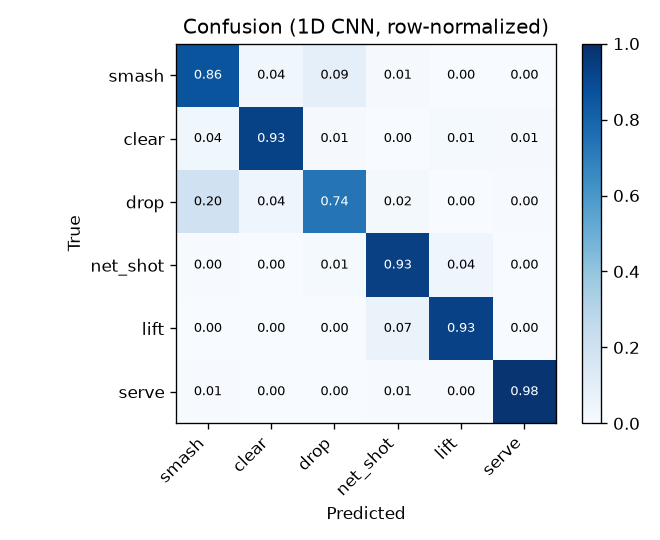

## III. RESULTS

### 3.1 Comparative Algorithm Performance

The stroke classifiers were evaluated on 3,136 strokes from five broadcast singles matches in the BST split of ShuttleSet. The models used 30-frame windows of pre-extracted RTMPose keypoints and TrackNetV3 shuttle positions. The 1D CNN and bidirectional LSTM processed the sequences directly, while the Random Forest used window summary statistics. The test set included six stroke classes. [Evaluation protocol](EVALUATION.md#3-method)

**Table 1. Test-set performance with pose and shuttle features, mean ± standard deviation over three seeds.**

| Model | Overall accuracy | Macro accuracy | Macro F1-score |
| --- | ---: | ---: | ---: |
| 1D CNN | 91.9% ± 0.5% | 91.2% ± 0.6% | 91.0% ± 0.6% |
| Bidirectional LSTM | 91.1% ± 0.5% | 90.2% ± 0.5% | 90.0% ± 0.6% |
| Random Forest | 86.7% ± 0.2% | 84.7% ± 0.3% | 85.5% ± 0.2% |

Overall accuracy measures the proportion of correct predictions. Macro accuracy averages class recall, and macro F1-score averages class F1. The CNN led all three measures in the November 16 comparison. All three models exceeded the project target of 70% macro accuracy. A separate November 20 rerun raised Random Forest macro accuracy to **85.3% ± 0.2%**, with **86.2% macro F1**. Tables 1–3 use the November 16 comparison consistently. The same test split was consulted across multiple rounds, and these scores apply to broadcast-derived stroke windows. End-to-end stroke accuracy on phone footage remains unmeasured. [Three-seed comparison](results/strokes.md), [later Random Forest rerun](results/strokes_cv.md#test-split-fourth-read)

### 3.2 Confusion Matrix and Per-Class Performance

**Table 2. Mean per-class F1-score over three seeds.**

| Stroke | 1D CNN | LSTM | Random Forest |
| --- | ---: | ---: | ---: |
| Smash | 86.0% | 84.4% | 80.3% |
| Clear | 93.5% | 92.3% | 88.6% |
| Drop | 80.1% | 77.2% | 69.4% |
| Net shot | 94.5% | 93.9% | 90.1% |
| Lift | 94.3% | 94.0% | 88.0% |
| Serve | 97.5% | 98.5% | 96.8% |

The CNN led five of the six classes. The LSTM had the highest serve F1-score. Serve was the highest-scoring class for all three models, and drop was the lowest. In the CNN matrix, **16.7% of actual drops were classified as smashes**, **9.2% of smashes as drops**, and **5.9% of lifts as net shots**. The LSTM and Random Forest also confused drops with smashes, at **18.2%** and **30.2%**, respectively. [Per-class report](results/strokes.md#per-class-f1), [source counts](results/strokes.json)

*Figure 1. CNN confusion matrix for pose and shuttle inputs. Rows are actual classes and columns are predicted classes. Counts are pooled across the three seeds and normalized by actual class. The same 3,136 strokes were evaluated for each seed.* [Figure generation script](../backend/scripts/make_figures.py)

### 3.3 Ablation Study: Pose-Only vs. Combined Features

**Table 3. CNN performance with and without shuttle features on the same split and seeds.**

| Metric | Pose only | Pose and shuttle | Gain (percentage points) |
| --- | ---: | ---: | ---: |
| Overall accuracy | 78.4% ± 0.8% | 91.9% ± 0.5% | +13.5 |
| Macro accuracy | 77.5% ± 0.7% | 91.2% ± 0.6% | +13.7 |
| Macro F1-score | 77.1% ± 0.7% | 91.0% ± 0.6% | +13.9 |

Adding shuttle features improved F1 in all six classes. The largest gains were for clear (67.9% to 93.5%) and drop (60.9% to 80.1%). The fraction of drops predicted as clears fell from **17.8% to 2.5%**. Shuttle trajectories helped distinguish strokes in these broadcast windows. The magnitude of the gain under motion blur, occlusion, or different camera angles remains unmeasured. [Ablation report](results/strokes.md), [source counts](results/strokes.json)

### 3.4 System Implementation and Demonstration Results

- **Watch & Analyze.** The recorded workflow accepts a video, playback mode, match format, and court calibration. *Real time* plays the recording while analysis runs in the background. *Analyze every frame* waits for analysis of each normalized frame before advancing. The saved session opens annotated playback and an analysis dashboard with available stroke counts, a seekable hit timeline, and rally summaries. [Watch implementation](../app/lib/features/watch/watch_screen.dart), [Results dashboard](../app/lib/features/results/results_screen.dart)
- **Go live.** The app streams camera frames to the backend and displays returned detections and events during the session. A calibrated setup supports player overlays, court mapping, and assisted line calls. Stop and save makes the session available in History. In a 120-frame model-backed smoke test using a generated clip, the RTX 4050 setup recorded a **109.8 ms median** and **201.4 ms p95** frame round trip, with **7.6 fps** sequential throughput. Labelled courtside performance remains unmeasured. [Live implementation](../app/lib/features/live/live_screen.dart), [smoke-test conditions](EVALUATION.md#4-results)
- **Tracking and court visualization.** Available overlays include the shuttle trail, player boxes and pose skeletons, and hit markers. Calibrated player positions feed a top-down court view and an occupancy heatmap that accumulates time spent in court cells during play. A small singles spot check measured median court-position errors of **0.128 m near-side** and **0.178 m far-side** on the available detections from one held-out broadcast clip. Some labelled positions were missed. [Court visualization](../app/lib/features/results/widgets/court_minimap.dart), [position spot check](EVALUATION.md#court-placement-spot-check-nov-22)
- **AI Coach.** The recorded-practice interface provides Overall Summary, Detailed Analysis with replayable observations, and Follow-up Questions. Retrieval-augmented generation uses saved observations and retrieved badminton guidance. The opt-in general practice preview follows a selected player and reports visible wrist and elbow measurements. A Gemini integration smoke test on synthetic session data produced a report and returned three recorded hits with matching timestamps in chat. Coaching accuracy on real practice footage remains unmeasured. [Practice workflow](AI_COACH.md), [provider smoke test](results/upload_doubles_lift_coach.md#gemini-coach-and-ui)

### 3.5 Processing and Rendering Results

The backend renders stored annotations onto the recording. The Results screen can request a re-render with changed overlays and download the resulting MP4, JSON summary, and hit and rally CSVs when available. In an export benchmark using one saved doubles Watch segment (525 frames, 1280 × 720, 25 fps), `libx264` took a median **2.816 s** and `h264_nvenc` took **2.819 s** across two runs each. Both produced 525 decodable H.264 frames with 40 ms timestamp spacing. `libx264` remained the default after the trial. These timings cover export only and do not establish equivalent perceived quality. [Results export controls](../app/lib/features/results/results_screen.dart), [export benchmark](results/watch_phase6_export_benchmark.md)

In a separate fixed-section Flutter experiment, the same 525-frame workload took **89.911 s** median from analysis to save with frame prefetch off and **91.719 s** with depth-two prefetch. Those measurements include the application and analysis path, so they cover more stages than the export benchmark. Synthetic integration tests verified frame order and partial saves. Real-model smoke checks exercised CPU and GPU processing, while representative testing of the full workflow, tracking accuracy, and rendering performance remains open. [Watch delivery experiment](results/watch_phase2_delivery.md), [integration validation](results/watch_phase7_validation_report.md)
