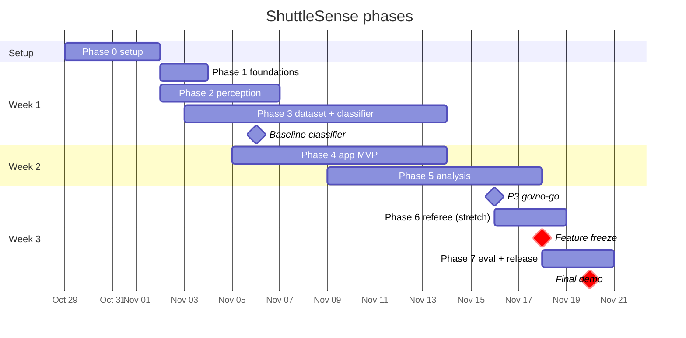
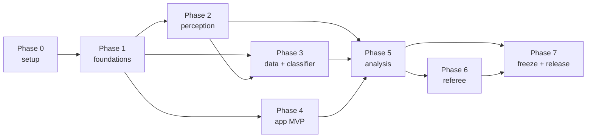
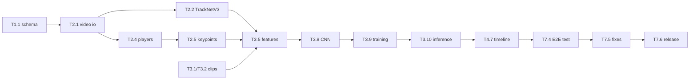

# Phased task plan

The 3-week build is split into 8 phases (0–7) and **96 tasks**. This page is the overview. Each phase has its own file with a full **task card** per task: goal, inputs, implementation steps, outputs, tests, acceptance criteria and risks. Every task is also a GitHub issue titled `[T<id>] <title>`, labelled with its phase, owner and area, under the phase milestone.

| Phase | File | Dates (2026) | Tasks | Gate to exit |
| --- | --- | --- | --- | --- |
| 0 | [Project setup](phases/phase-0-setup.md) | Oct 29 – Nov 1 | 12 | Every member runs backend tests and the app on their own device |
| 1 | [Foundations](phases/phase-1-foundations.md) | Nov 2 – Nov 3 | 11 | Clip record + API frozen (tags); TrackNetV3 and pose run; app connects on 4 platforms |
| 2 | [P1 perception](phases/phase-2-perception.md) | Nov 2 – Nov 6 | 11 | `record.json` has shuttle + both players; overlay video renders; < 5 min per 1-min clip |
| 3 | [Dataset and classifier](phases/phase-3-classifier.md) | Nov 3 – Nov 13 | 14 | Hit F1 ≥ 0.75, stroke macro accuracy ≥ 70%, ablation done, strokes in video and app |
| 4 | [App MVP](phases/phase-4-app-mvp.md) | Nov 5 – Nov 13 | 13 | Full P1 flow on phone, tablet, Windows, Chrome |
| 5 | [P2 analysis](phases/phase-5-analysis.md) | Nov 9 – Nov 17 | 14 | Calibration, minimap, speed, counter, feedback, exports |
| 6 | [P3 referee (stretch)](phases/phase-6-referee.md) | Nov 16 – Nov 18 | 7 | Rally state + scoreboard with correction, or formally cut |
| 7 | [Freeze, evaluation, release](phases/phase-7-release.md) | Nov 18 – Nov 20 | 14 | `v1.0.0` release, README results, demo delivered |

**Key dates:** work starts Mon Nov 2 · Week 1 baseline classifier Fri Nov 6 · P3 go/no-go Mon Nov 16 · **feature freeze Wed Nov 18** · final demo Fri Nov 20.

---

## How to read a task card

```
### T2.2 · TrackNetV3 wrapper stage
Owner · Estimate · Priority · Area · Refs · Depends on · Blocks
Goal       one or two sentences
Inputs     files, data, config keys and APIs it consumes
Steps      ordered checklist naming the files and functions to touch
Outputs    what exists when it is done (files, record fields, endpoints, screens)
Tests      named test cases to add
Acceptance criteria   measurable "done when", tied to the PRD
Risks      known pitfalls and the fallback
```

- **Priority:** `P1` core (must ship) · `P2` analysis · `P3` stretch · `C` client app.
- **Area:** `backend`, `ml`, `data`, `app`, `docs`, `infra`; used as the GitHub label.
- **Refs:** feature (F#), client feature (C#) and requirement (FR-#) IDs from the [PRD](PRD.md).
- **Status:** ⬜ open · ✅ done. Flip it in the PR that completes the task and close the issue (`Closes #<n>` in the PR body).
- Steps are a guide, not a contract: if a better approach appears, do it and note why in the PR (and in `docs/DECISIONS.md` if it changes a design choice).

## Owners

| Code | Member | Main role |
| --- | --- | --- |
| M1 | Mist | Lead, integration, backend API, pipeline, releases |
| M2 | Member 2 | Shuttle tracking, rendering, court mapping, speed, exports |
| M3 | Member 3 | Data pipeline A, hit-detection evaluation, feedback rules, referee layer |
| M4 | Member 4 | Data pipeline B, labels and splits, app tests and polish, phone-footage evaluation |
| M5 | Member 5 | Pose, hit detection, feature extraction, stroke classifier |
| M6 | Member 6 | Flutter app, minimap and results UI, README, slides, demo video |

Until teammates share their GitHub usernames, owners are tracked with `owner:M1` … `owner:M6` labels.

## Timeline



Shift every date together if the start moves.

## Dependencies between phases



Phases overlap on purpose: the app (Phase 4) is built against the stub and fake pipelines (T1.10) while models are still being trained.

### Critical path

A delay on any of these tasks delays the demo. Review them at every stand-up.



## Workload

Estimates are in hours of focused work. Capacity is about **60 h per member** from Nov 2 to Nov 20 (≈ 20 h/week).

| Member | Phase 0 | 1 | 2 | 3 | 4 | 5 | 6 | 7 | Nov 2–20 total | vs. 60 h |
| --- | --- | --- | --- | --- | --- | --- | --- | --- | --- | --- |
| M1 | 32 (done) | 16 | 19 | 0 | 0 | 8 | 3 | 16 | **62** | OK |
| M2 | 3 | 5 | 28 | 4 | 0 | 28 | 3 | 4 | **72** | ⚠ over |
| M3 | 3 | 5 | 3 | 17 | 0 | 8 | 19 | 8 | **60** | OK |
| M4 | 5 | 0 | 0 | 22 | 11 | 5 | 0 | 14 | **52** | spare |
| M5 | 3 | 6 | 13 | 41 | 0 | 0 | 0 | 10 | **70** | ⚠ over |
| M6 | 3 | 6 | 0 | 0 | 44 | 10 | 4 | 17 | **81** | ⚠ over |

Overload plan:
- **M6:** M4 (spare capacity) takes over T4.8 History or T4.9 states if M6 is behind on Nov 10.
- **M5:** M3 already owns hit evaluation (T3.7). If training slips, M4 runs the ablation runs (T3.9) from M5's script.
- **M2:** if Phase 2 runs late, M1 takes T5.3 court outline and T5.14 minimap overlay.
- If more is needed, apply the cut lines below. Re-check this table at every phase gate.

## Cut lines

If the schedule slips, cut in this order (first = first to go) and record it in the PRD's Future work:

1. Phase 6 entirely (P3 referee: T6.1–T6.7).
2. T5.12 re-render from the app (overlays are chosen once before processing).
3. T5.14 minimap in the rendered video (the app minimap stays).
4. T5.11 summary chart (downloads stay).
5. T4.11 accessibility extras beyond text scaling; T4.13 icon and splash.
6. iOS build (Android, Windows and Web remain).
7. T2.3 InpaintNet rectification (keep simple interpolation).

**Never cut:** T2.1–T2.8 perception, T3.5–T3.10 hits and strokes, T4.1–T4.7 app MVP, T7.2–T7.6 evaluation, testing and release.

## Working rhythm

- **Daily:** async stand-up in the team chat (done / next / blocked). Mention task IDs.
- **Mon, Wed, Fri:** 30-minute sync. Walk the board, then the critical path.
- **Phase gates:** each phase file ends with a gate checklist. Run it as a short live demo before the phase is marked done.
- **Pull requests:** follow [CONTRIBUTING.md](../CONTRIBUTING.md). Reference the task (`Refs T2.2`), flip the status here, close the issue.

## All tasks

| Phase | Tasks |
| --- | --- |
| [0](phases/phase-0-setup.md) | T0.1 Repo structure · T0.2 Design docs · T0.3 Backend skeleton · T0.4 Flutter skeleton · T0.5 CI · T0.6 Board, labels, issues · T0.7 Protect main · T0.8 Member setup · T0.9 HF + Drive · T0.10 Test rallies · T0.11 Env check script · T0.12 Working agreements |
| [1](phases/phase-1-foundations.md) | T1.1 Freeze schema · T1.2 Freeze API · T1.3 TrackNetV3 submodule · T1.4 Weights + checksums · T1.5 Pose spike · T1.6 ML stack · T1.7 Colab tunnel · T1.8 App on 4 platforms · T1.9 ShuttleSet download · T1.10 Golden record · T1.11 Decision log |
| [2](phases/phase-2-perception.md) | T2.1 Video io · T2.2 TrackNetV3 stage · T2.3 Rectification + gaps · T2.4 Players + IDs · T2.5 Keypoints · T2.6 Overlay renderer · T2.7 H.264 export · T2.8 Pipeline cache + progress · T2.9 Benchmark · T2.10 Tracking accuracy · T2.11 Pose quality check |
| [3](phases/phase-3-classifier.md) | T3.1 Clips 1–22 · T3.2 Clips 23–44 · T3.3 Label mapping · T3.4 Splits · T3.5 Features · T3.6 Hit detector · T3.7 Hit evaluation · T3.8 CNN + training script · T3.9 Training + ablation · T3.10 Stroke inference · T3.11 Hit/stroke overlays · T3.12 Figures · T3.13 Dataset stats · T3.14 Inference latency |
| [4](phases/phase-4-app-mvp.md) | T4.1 Connect · T4.2 Upload · T4.3 Options + start · T4.4 Processing · T4.5 Results layout · T4.6 Video player · T4.7 Timeline · T4.8 History · T4.9 States + theming · T4.10 Platform config · T4.11 Accessibility · T4.12 Widget tests · T4.13 Icon + splash |
| [5](phases/phase-5-analysis.md) | T5.1 Calibration UI · T5.2 Homography stage · T5.3 Court overlay · T5.4 Court positions · T5.5 App minimap · T5.6 Speed · T5.7 Stroke counter · T5.8 Feedback rules · T5.9 Tips in app · T5.10 Exports · T5.11 Downloads + chart · T5.12 Re-render · T5.13 Speed sanity · T5.14 Minimap overlay |
| [6](phases/phase-6-referee.md) | T6.1 Rally state · T6.2 Landing in/out · T6.3 Scoring · T6.4 Correction API · T6.5 App scoreboard · T6.6 Score overlays · T6.7 Rally evaluation |
| [7](phases/phase-7-release.md) | T7.1 Phone footage labels · T7.2 Phone evaluation · T7.3 Final metrics · T7.4 E2E test · T7.5 Bug fixes · T7.6 Release builds · T7.7 Tag v1.0.0 · T7.8 README final · T7.9 Slides + evaluation · T7.10 Backup video · T7.11 Rehearsal · T7.12 Docs = shipped · T7.13 License audit · T7.14 Release checklist |
