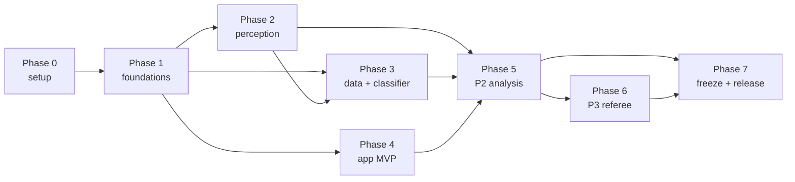

# Phased task plan

The build is split into 8 phases (0 to 7). Each task has an ID, an owner, the PRD feature/requirement it serves, dependencies and a **done when** criterion. Status is ⬜ (open) or ✅ (done); flip it to ✅ in the PR that completes the task (see [CONTRIBUTING.md](../CONTRIBUTING.md#definition-of-done)). Every task is also a GitHub issue titled `[T<id>] <task>` on the project board.

Owners: **M1** Mist (lead/integration) · **M2** Member 2 (tracking → court/minimap/speed) · **M3** Member 3 (data A → referee) · **M4** Member 4 (data B → evaluation set) · **M5** Member 5 (pose/hits/classifier) · **M6** Member 6 (Flutter app, feedback rules, docs).

Priority tags: **P1** core (must ship) · **P2** analysis · **P3** stretch · **C** client.

## Timeline at a glance

| Phase | Name | Dates (2026) | Gate to exit |
| --- | --- | --- | --- |
| 0 | Project setup | Oct 29 – Nov 1 | Every member can run backend tests and the app locally |
| 1 | Foundations | Nov 2 – Nov 3 | Clip record + API contract frozen; TrackNetV3 and pose library run on one clip |
| 2 | P1 perception | Nov 2 – Nov 6 | `record.json` has shuttle + both players' poses for a full clip; overlay video renders |
| 3 | Dataset and stroke classifier | Nov 3 – Nov 13 | Classifier ≥ 70% macro accuracy on ShuttleSet test, hit F1 ≥ 0.75, ablation done |
| 4 | App MVP | Nov 5 – Nov 13 | Upload → progress → results (video + timeline) works on phone, tablet, Windows, Chrome |
| 5 | P2 analysis | Nov 9 – Nov 17 | Calibration, minimap, speed, counter, feedback and exports in app and video |
| 6 | P3 referee (stretch) | Nov 16 – Nov 18 | Rally state + scoreboard with correction, or moved to Future work |
| 7 | Freeze, evaluation, release | Nov 18 – Nov 20 | Release builds, results tables, slides, backup video, demo delivered |

---

## Phase 0 — Project setup (Oct 29 – Nov 1)

Goal: a repo everyone can clone, run and contribute to.

| ID | Task | Owner | Ref | Depends | Done when |
| --- | --- | --- | --- | --- | --- |
| ✅ T0.1 | Structure repo: `backend/`, `app/`, `docs/`, single root README | M1 | — | — | This scaffold is on `main` |
| ✅ T0.2 | Refine PRD for Flutter client + Python backend; write architecture, data format, API, tech stack, setup docs | M1 | — | T0.1 | Docs merged in `docs/` |
| ✅ T0.3 | Backend skeleton: package, stub stages, FastAPI job server, tests | M1 | — | T0.1 | `pytest` passes; `/health` responds |
| ✅ T0.4 | Flutter skeleton for Android, iOS, Web, Windows with responsive shell and stub screens | M1 | C1–C3 | T0.1 | `flutter analyze` clean, `flutter test` passes |
| ✅ T0.5 | CI for backend and app; issue and PR templates | M1 | — | T0.3, T0.4 | Actions green on `main` |
| ⬜ T0.6 | Create GitHub Project board, labels (`P1`/`P2`/`P3`/`C`, `backend`/`app`/`data`), one issue per task in this file | M1 | — | — | Board lists every task with owner |
| ⬜ T0.7 | Protect `main`: PR required, 1 review, CI must pass | M1 | — | T0.5 | Direct push to `main` is rejected |
| ⬜ T0.8 | Each member: clone, set up backend venv and Flutter, run tests, run app on own device | All | — | T0.3, T0.4 | Each member posts a screenshot of the app + passing `pytest` |
| ⬜ T0.9 | Create Hugging Face weights repo and Google Drive data folder; share access | M1 | — | — | Links pinned in team chat and in SETUP.md |
| ⬜ T0.10 | Record 2 short consented test rallies (phone on tripod, elevated, behind baseline) | M4 | — | — | Clips in Drive `samples/` folder |

## Phase 1 — Foundations (Nov 2 – Nov 3)

Goal: freeze the contracts and prove the two pretrained perception models run on our hardware.

| ID | Task | Owner | Ref | Depends | Done when |
| --- | --- | --- | --- | --- | --- |
| ⬜ T1.1 | Review and freeze clip record v1.0 (`schema.py`, Dart models, DATA_FORMAT.md) | M1 + all | NFR Modularity | T0.3 | Team sign-off in the PR; tag `schema-v1.0` |
| ⬜ T1.2 | Review and freeze API contract (API.md, `routes.py`, `api_client.dart`) | M1 + M6 | C1–C4 | T0.3, T0.4 | Team sign-off; tag `api-v1.0` |
| ⬜ T1.3 | Add TrackNetV3 as git submodule in `backend/third_party/TrackNetV3`, pin commit | M2 | F2 | — | `git submodule status` shows pinned commit |
| ⬜ T1.4 | `download_weights.py`: fetch TrackNetV3 + InpaintNet checkpoints, verify checksums | M2 | F2 | T1.3, T0.9 | Fresh clone + script yields `weights/tracknet/*.pt` |
| ⬜ T1.5 | Pose spike: rtmlib (RTMDet + RTMPose) vs torchvision Keypoint R-CNN on 2 test clips; measure fps on RTX 4050 and T4, eyeball quality | M5 | F3, F4 | T0.10 | Decision + numbers recorded in TECH_STACK.md |
| ⬜ T1.6 | Install `requirements/ml.txt` on the laptop and in Colab; fix pins that fail | M1 | NFR Reproducibility | — | Both environments import torch (CUDA), onnxruntime-gpu, rtmlib |
| ⬜ T1.7 | Colab notebook starts backend + cloudflared tunnel; app connects through it | M1 | C1 | T0.3 | Phone on mobile data reaches `/health` via tunnel with token |
| ⬜ T1.8 | App connects to laptop backend on Android phone, Android tablet (or emulator), Windows, Chrome | M6 | C1 | T0.4 | Screenshot of connected state on each platform |
| ⬜ T1.9 | Download ShuttleSet annotations; list 44 matches with video sources and lengths | M3 | Data | — | `data/shuttleset/` populated; match list in Drive |

## Phase 2 — P1 perception (Nov 2 – Nov 6)

Goal: one `record.json` per clip with shuttle and both players, plus an overlay video.

| ID | Task | Owner | Ref | Depends | Done when |
| --- | --- | --- | --- | --- | --- |
| ⬜ T2.1 | `io`: open MP4/MOV/AVI, read fps/size, normalize to 720p and ≤ 30 fps option, frame iterator, reject > 5 min | M1 | F1, FR-1 | T1.1 | Phone + broadcast clip both produce a frame index; tests for metadata |
| ⬜ T2.2 | `tracking`: TrackNetV3 wrapper over normalized frames, returns `(x, y, visible)` per frame; write `tracking.csv` | M2 | F2, FR-2 | T1.3, T1.4, T2.1 | Shuttle positions on 2 sample clips look right in overlay |
| ⬜ T2.3 | `tracking`: InpaintNet rectification + interpolation of gaps ≤ N frames (config) | M2 | F2 | T2.2 | Unit test on synthetic gaps; fewer missing frames on smash clips |
| ⬜ T2.4 | `pose`: detect people per frame, keep the two inside/near the court, assign near/far by image y (or court side once calibrated) | M5 | F3, FR-3 | T1.5, T2.1 | Both players keep IDs for a full rally on test clips |
| ⬜ T2.5 | `pose`: keypoints per player per frame (COCO-17) with scores; light temporal smoothing | M5 | F4, FR-4 | T2.4 | `frames[].players.*.keypoints` filled; smoothing test |
| ⬜ T2.6 | `render`: overlay framework (layer per overlay, toggles from job request) with trail, boxes, skeletons | M2 | F2–F4, F7 | T2.2, T2.5 | Annotated MP4 shows all three overlays |
| ⬜ T2.7 | `render`: H.264 export via ffmpeg (`yuv420p`, `+faststart`), fallback to mp4v if ffmpeg missing | M1 | F7, FR-7 | T2.6 | Output plays in VLC, Chrome and the app on Android + Windows |
| ⬜ T2.8 | `pipeline`: real stage wiring, per-stage progress callback, cache stage outputs, skip disabled stages | M1 | NFR Modularity | T2.1 | Job progress moves per stage in `/jobs/{id}`; re-render reuses cache |
| ⬜ T2.9 | Benchmark 1-min 720p clip on RTX 4050 and T4; log per-stage time | M1 | NFR Performance | T2.8 | Table in README Evaluation section; < 5 min or a plan to get there |

## Phase 3 — Dataset and stroke classifier (Nov 3 – Nov 13)

Goal: hit detection and a trained 6-class stroke classifier with an ablation.

| ID | Task | Owner | Ref | Depends | Done when |
| --- | --- | --- | --- | --- | --- |
| ⬜ T3.1 | `extract_clips.py`: cut per-stroke clips from match videos using ShuttleSet timestamps — matches 1–22 | M3 | F6 | T1.9 | Clips in Drive; count per match logged |
| ⬜ T3.2 | Same for matches 23–44 | M4 | F6 | T1.9 | Clips in Drive; count per match logged |
| ⬜ T3.3 | Finalize 18 → 6 label mapping (draft in DATA_FORMAT.md); handle drive-family strokes; class counts | M4 | F6 | T1.9 | Mapping table final in DATA_FORMAT.md; `strokes/labels.py` + tests |
| ⬜ T3.4 | Match-level train/val/test split (≈ 70/15/15), fixed seed, saved to `data/splits.json` | M4 | F6 | T3.3 | No match in two splits (test asserts it) |
| ⬜ T3.5 | `extract_features.py`: run pose + tracking on clips, build `T×F` windows around hits, save `.npz` | M5 | F6 | T2.2, T2.5, T3.1, T3.2 | `features/*.npz` for all matches |
| ⬜ T3.6 | `hits`: rule-based detector (direction change of shuttle + distance to hitter's wrist + min gap between hits) | M5 | F5, FR-5 | T2.3, T2.5 | Unit tests on synthetic trajectories |
| ⬜ T3.7 | Evaluate hit detection on ShuttleSet test matches (±3 frames); tune thresholds in config | M5 | F5 | T3.6, T3.4 | Hit F1 ≥ 0.75 or documented gap + tuning log |
| ⬜ T3.8 | `strokes`: 1D CNN model + dataset loader + training script (`configs/stroke_cnn.yaml`), class weighting | M5 | F6, FR-6 | T3.5 | Training runs end to end on a small batch (Week 1 baseline) |
| ⬜ T3.9 | Train full model (pose + trajectory) and pose-only ablation; save best checkpoint to HF Hub | M5 | F6 | T3.8 | Macro accuracy ≥ 70% on test; both numbers recorded |
| ⬜ T3.10 | `strokes` inference stage: classify each hit in a record, fill `stroke`, `confidence`, `class_probs` | M5 | F6 | T3.9, T2.8 | Labels appear in record and in the render overlay |
| ⬜ T3.11 | `render`: hit marker ("HIT" for ~0.5 s) and stroke label with confidence | M2 | F5, F6 | T3.10, T2.6 | Visible in annotated video |
| ⬜ T3.12 | Confusion matrix + per-class metrics notebook; figures exported for the write-up | M5 | Metrics | T3.9 | Figures in `docs/results/` |

## Phase 4 — App MVP (Nov 5 – Nov 13)

Goal: the full P1 flow on every device class. Built against the stub backend first, then the real pipeline.

| ID | Task | Owner | Ref | Depends | Done when |
| --- | --- | --- | --- | --- | --- |
| ⬜ T4.1 | Connect screen: URL + token fields, validate, `GET /health`, persist, show server device and stages | M6 | C1, FR-C1 | T1.2 | Works on 4 platforms; bad URL shows clear error |
| ⬜ T4.2 | Upload screen: pick video (file_picker), show name/size/duration, upload with progress and cancel | M6 | C2, FR-C2 | T4.1 | 1-minute clip uploads from Android phone and Chrome |
| ⬜ T4.3 | Overlay options (chips) + "skip calibration" path + start job | M6 | C2 | T4.2 | `POST /jobs` sent with chosen overlays |
| ⬜ T4.4 | Processing screen: poll job, per-stage progress list, queue position, error and retry, cancel | M6 | C2, FR-C2 | T4.3 | Progress updates ≤ 2 s; navigates to results on done |
| ⬜ T4.5 | Results screen layout for compact / medium / expanded (see ARCHITECTURE.md §4) | M6 | C3, FR-C3 | T4.4 | No overflow at 360, 800, 1280, 1920 dp (widget tests) |
| ⬜ T4.6 | Video player (media_kit) streaming `/jobs/{id}/video` with auth header; play/pause/seek, fullscreen | M6 | C3, F7 | T4.5, T2.7 | Plays on Android, Windows, Chrome (and iOS if a Mac is available) |
| ⬜ T4.7 | Stroke timeline: rows from `record.hits`, tap to seek, highlight current hit while playing | M6 | C3 | T4.6, T3.10 | Tapping a row seeks to that hit on all platforms |
| ⬜ T4.8 | History screen: list jobs, open results, delete job (privacy) | M6 | C2 | T4.4 | Delete removes it from server and list |
| ⬜ T4.9 | Error/empty/loading states, offline banner, light + dark theme check | M6 | NFR Usability | T4.1–T4.8 | Reviewed on phone and laptop |
| ⬜ T4.10 | Android manifest (cleartext for LAN), iOS Info.plist (local network, photos), app name + icon | M6 | NFR Platforms | — | Debug builds install and reach the LAN server |

## Phase 5 — P2 analysis (Nov 9 – Nov 17)

Goal: court-aware analytics in both the video and the app.

| ID | Task | Owner | Ref | Depends | Done when |
| --- | --- | --- | --- | --- | --- |
| ⬜ T5.1 | App calibration screen: show frame from `/videos/{id}/frames/0`, tap 4 corners in order, drag to adjust, pinch/scroll zoom | M6 | F9, FR-9 | T4.3 | Corners sent in normalized px; works with touch and mouse |
| ⬜ T5.2 | `court`: homography from corners, validate (convex, sane area), project points px ↔ m | M2 | F9, FR-9 | T1.1 | Unit tests on a synthetic court; bad corners → 400 |
| ⬜ T5.3 | `render`: court outline overlay from homography | M2 | F9 | T5.2, T2.6 | Lines align within a few px on test clips |
| ⬜ T5.4 | `analytics`: player foot point (ankle midpoint) and shuttle ground estimate → `court_positions` | M2 | F10, FR-10 | T5.2, T2.5 | Positions in court zones on review |
| ⬜ T5.5 | App minimap widget (CustomPainter court + players + shuttle), synced to playback | M6 | F10 | T5.4, T4.6 | Moves with the video on phone and laptop |
| ⬜ T5.6 | `analytics`: shuttle speed (smoothed court-plane displacement × fps), per-hit and peak, labeled estimated | M2 | F11, FR-11 | T5.4 | Smashes rank above drops on test clips; tests on synthetic tracks |
| ⬜ T5.7 | Stroke counter per rally + status bar (video overlay and app widget) | M2 + M6 | F12, FR-12 | T3.10 | Count matches manual count on test rallies |
| ⬜ T5.8 | `feedback`: ≥ 2 documented rules per stroke class (contact height vs head, elbow angle, arm extension, follow-through) with tips | M6 | F8, FR-8 | T2.5, T3.10 | Rules table in `docs/FEEDBACK_RULES.md`; unit tests per rule |
| ⬜ T5.9 | Show form tips in the timeline / hit detail sheet | M6 | F8 | T5.8, T4.7 | Tip visible per hit on all layouts |
| ⬜ T5.10 | `analytics`: `summary`, `summary.json`, `hits.csv` exports | M2 | F13, FR-13 | T5.6 | Files open in a spreadsheet and match the app |
| ⬜ T5.11 | App downloads/share: MP4, JSON, CSV (share sheet mobile, save dialog Windows, browser download web) + summary chart (fl_chart) | M6 | C4, FR-C4 | T5.10 | Each file saves and opens on each platform |
| ⬜ T5.12 | Re-render with different overlays (`POST /jobs/{id}/render`) from the results screen | M1 + M6 | F7 | T2.8 | New video without re-running perception |

## Phase 6 — P3 referee (Nov 16 – Nov 18, stretch)

Start only if Phases 2–5 are stable on Nov 16. Anything not stable at the freeze moves to Future work.

| ID | Task | Owner | Ref | Depends | Done when |
| --- | --- | --- | --- | --- | --- |
| ⬜ T6.1 | `referee`: rally state (start at serve hit, end when shuttle lost or stationary on floor for N frames) | M3 | F14, FR-14 | T3.6 | ≥ 80% rally boundaries correct on team footage |
| ⬜ T6.2 | `referee`: landing point on court plane + in/out with confidence, "uncertain" near lines | M3 | F15, FR-15 | T6.1, T5.2 | Clear cases correct on test rallies |
| ⬜ T6.3 | `referee`: BWF 21-point rally scoring (win by 2, cap 30), winner from landing side + in/out | M3 | F16, FR-16 | T6.2 | Unit tests for scoring rules incl. deuce and 29–29 |
| ⬜ T6.4 | `PATCH /jobs/{id}/score` correction + log; regenerate summary | M1 | F16 | T6.3 | API test passes; correction persists |
| ⬜ T6.5 | App scoreboard widget with correction buttons; status bar shows IN PLAY / BETWEEN RALLIES | M6 | F14, F16 | T6.4, T4.5 | Correction updates score on all layouts |
| ⬜ T6.6 | Scoreboard and rally-state overlays in the rendered video | M2 | F14, F16 | T6.3 | Visible in annotated MP4 |

## Phase 7 — Freeze, evaluation, release (Nov 18 – Nov 20)

**Feature freeze: Wednesday Nov 18.** Only fixes, evaluation and docs after this point.

| ID | Task | Owner | Ref | Depends | Done when |
| --- | --- | --- | --- | --- | --- |
| ⬜ T7.1 | Label team phone footage (5–10 rallies): hits, strokes, rally boundaries | M4 | Metrics | T0.10 | Labels CSV in Drive |
| ⬜ T7.2 | Evaluate on phone footage: stroke accuracy, stroke count error, rally boundary accuracy | M4 + M5 | Metrics | T7.1, freeze | Numbers in README Evaluation table |
| ⬜ T7.3 | Final ShuttleSet metrics: tracking accuracy, hit F1, stroke macro accuracy, ablation | M5 | Metrics | T3.9 | README Evaluation table has no TBD |
| ⬜ T7.4 | End-to-end manual test checklist on Android phone, tablet, Windows, Chrome (connect, upload, calibrate, process, review, download, delete) | M1 + M6 | All C | freeze | Checklist in PR with pass/fail per platform |
| ⬜ T7.5 | Bug-fix pass from T7.4 | All | — | T7.4 | No open P1 bugs |
| ⬜ T7.6 | Release builds: APK, Windows zip, web build; GitHub Release `v1.0.0` with notes | M1 | NFR Platforms | T7.5 | Release page has the three artifacts |
| ⬜ T7.7 | Pin and freeze all versions; tag `v1.0.0` | M1 | NFR Reproducibility | T7.6 | Tag on `main` |
| ⬜ T7.8 | README: demo GIF/screenshots (phone + laptop), results, limitations, license audit | M6 | Docs | T7.2, T7.3 | README has no placeholders |
| ⬜ T7.9 | Slides and written evaluation | M6 + M5 | Docs | T7.2, T7.3 | Shared with the team by Nov 19 |
| ⬜ T7.10 | Record backup demo video of the full flow on phone and laptop | M6 | Demo | T7.5 | Video in Drive |
| ⬜ T7.11 | Demo rehearsal with backend on laptop and Colab fallback ready | All | Demo | T7.10 | Dry run done on Nov 19 |
| ⬜ T7.12 | Move unfinished items to Future work in README and PRD | M1 | — | freeze | Docs reflect what actually shipped |

---

## Cut lines

If the schedule slips, cut in this order (latest first) and record it in the PRD's Future work:

1. Phase 6 entirely (P3 referee).
2. T5.12 re-render from the app (overlays chosen once before processing).
3. T5.11 summary chart (keep downloads).
4. iOS build (Android, Windows and Web remain).
5. T2.3 InpaintNet rectification (keep simple interpolation).

Never cut: T2.x perception, T3.6–T3.10 hits and strokes, T4.1–T4.7 app MVP, T7.2–T7.4 evaluation and testing.
