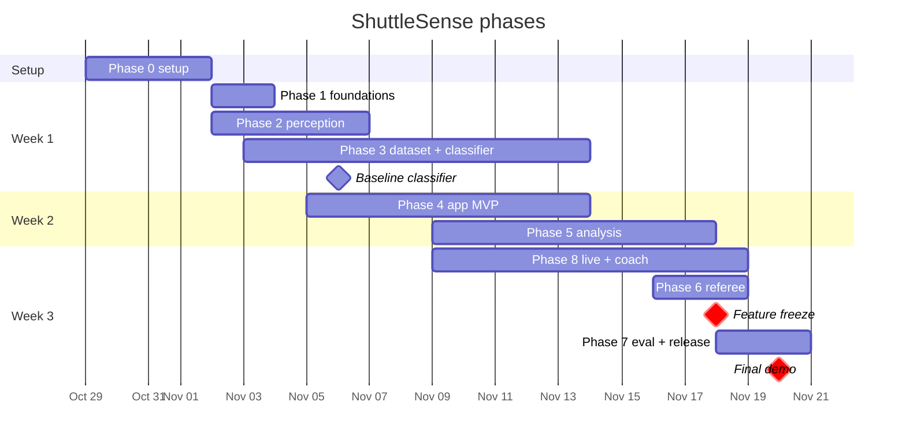
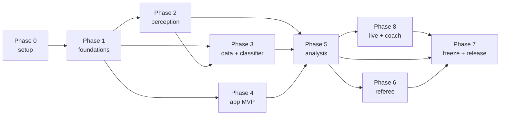
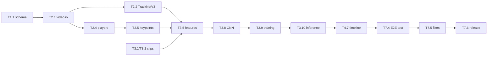

# Phased task plan

The 3-week build is split into 9 phases (0–8) and **108 tasks**. This page is the overview. Each phase has its own file with a full **task card** per task: goal, inputs, implementation steps, outputs, tests, acceptance criteria and risks. Every task in phases 0–7 is also a GitHub issue titled `[T<id>] <title>`, labelled with its phase, owner and area, under the phase milestone; Phase 8 issues are still to be created.

| Phase | File | Dates (2026) | Tasks | Gate to exit |
| --- | --- | --- | --- | --- |
| 0 | [Project setup](phases/phase-0-setup.md) | Oct 29 – Nov 1 | 12 | Every member runs backend tests and the app on their own device |
| 1 | [Foundations](phases/phase-1-foundations.md) | Nov 2 – Nov 3 | 11 | Clip record + API frozen (tags); TrackNetV3 and pose run; app connects on 4 platforms |
| 2 | [P1 perception](phases/phase-2-perception.md) | Nov 2 – Nov 6 | 11 | `record.json` has shuttle + both players; overlay video renders; < 5 min per 1-min clip |
| 3 | [Dataset and classifier](phases/phase-3-classifier.md) | Nov 3 – Nov 13 | 14 | Hit F1 ≥ 0.75, stroke macro accuracy ≥ 70%, ablation done, strokes in video and app |
| 4 | [App MVP](phases/phase-4-app-mvp.md) | Nov 5 – Nov 13 | 13 | Full P1 flow on phone, tablet, Windows, Chrome |
| 5 | [P2 analysis](phases/phase-5-analysis.md) | Nov 9 – Nov 17 | 14 | Calibration, minimap, speed, counter, feedback, exports |
| 6 | [P3 referee](phases/phase-6-referee.md) | Nov 16 – Nov 18 | 7 | Rally state + scoreboard with correction on team footage |
| 7 | [Freeze, evaluation, release](phases/phase-7-release.md) | Nov 18 – Nov 20 | 14 | `v1.0.0` release, README results, demo delivered |
| 8 | [Live mode, line calls and coaching](phases/phase-8-live-coach.md) | Nov 9 – Nov 18 | 12 | Upload and Live both end in a results view with line calls, coaching notes and chat; live runs against the fake source in CI |

**Key dates:** work starts Mon Nov 2 · Week 1 baseline classifier Fri Nov 6 · **feature freeze Wed Nov 18** · final demo Fri Nov 20. Since PRD v1.2 the referee layer is committed scope; the old P3 go/no-go on Nov 16 is gone ([D17](DECISIONS.md)).

---

## How to read a task card

```
### T2.2 · TrackNetV3 wrapper stage
Owner · Estimate · Priority · Area · Refs · Depends on · Blocks
Goal       one or two sentences
Inputs     files, data, config keys and APIs it consumes
Steps      ordered checklist naming the files and functions to touch
Outputs    what exists when it is done (files, record fields, endpoints, screens)
Tests      named test cases to add
Acceptance criteria   measurable "done when", tied to the PRD
Risks      known pitfalls and the fallback
```

- **Priority:** `P1` core (must ship) · `P2` analysis · `P3` referee, live mode and coaching (committed since PRD v1.2) · `C` client app.
- **Area:** `backend`, `ml`, `data`, `app`, `docs`, `infra`; used as the GitHub label.
- **Refs:** feature (F#), client feature (C#) and requirement (FR-#) IDs from the [PRD](PRD.md).
- **Status:** ⬜ open · ✅ done. Flip it in the PR that completes the task and close the issue (`Closes #<n>` in the PR body).
- Steps are a guide, not a contract: if a better approach appears, do it and note why in the PR (and in `docs/DECISIONS.md` if it changes a design choice).

## Owners

| Code | Member | Main role |
| --- | --- | --- |
| M1 | Mist | Lead, integration, backend API, pipeline, releases |
| M2 | Member 2 | Shuttle tracking, rendering, court mapping, speed, exports |
| M3 | Member 3 | Data pipeline A, hit-detection evaluation, feedback rules, referee layer |
| M4 | Member 4 | Data pipeline B, labels and splits, app tests and polish, phone-footage evaluation |
| M5 | Member 5 | Pose, hit detection, feature extraction, stroke classifier |
| M6 | Member 6 | Flutter app, minimap and results UI, README, slides, demo video |

Until teammates share their GitHub usernames, owners are tracked with `owner:M1` … `owner:M6` labels.

## Timeline



Shift every date together if the start moves.

## Dependencies between phases



Phases overlap on purpose: the app (Phase 4) is built against the stub and fake pipelines (T1.10) while models are still being trained.

### Critical path

A delay on any of these tasks delays the demo. Review them at every stand-up.



## Workload

Estimates are in hours of focused work. Capacity is about **60 h per member** from Nov 2 to Nov 20 (≈ 20 h/week).

| Member | Phase 0 | 1 | 2 | 3 | 4 | 5 | 6 | 7 | Nov 2–20 total | vs. 60 h |
| --- | --- | --- | --- | --- | --- | --- | --- | --- | --- | --- |
| M1 | 32 (done) | 16 | 19 | 0 | 0 | 8 | 3 | 16 | **62** | OK |
| M2 | 3 | 5 | 28 | 4 | 0 | 28 | 3 | 4 | **72** | ⚠ over |
| M3 | 3 | 5 | 3 | 17 | 0 | 8 | 19 | 8 | **60** | OK |
| M4 | 5 | 0 | 0 | 22 | 11 | 5 | 0 | 14 | **52** | spare |
| M5 | 3 | 6 | 13 | 41 | 0 | 0 | 0 | 10 | **70** | ⚠ over |
| M6 | 3 | 6 | 0 | 0 | 44 | 10 | 4 | 17 | **81** | ⚠ over |

Overload plan:
- **M6:** M4 (spare capacity) takes over T4.8 History or T4.9 states if M6 is behind on Nov 10.
- **M5:** M3 already owns hit evaluation (T3.7). If training slips, M4 runs the ablation runs (T3.9) from M5's script.
- **M2:** if Phase 2 runs late, M1 takes T5.3 court outline and T5.14 minimap overlay.
- If more is needed, apply the cut lines below. Re-check this table at every phase gate.

Phase 8 (about 70 h, see its file) is not in the table above yet: most of its code landed with the scope change on Oct 31, and what remains is evaluation (M4), device checks (M6) and tuning (M3). Re-balance at the Nov 13 gate.

## Cut lines

If the schedule slips, cut in this order (first = first to go) and record it in the PRD's Future work:

1. T8.8 + T8.11 coach chat (session notes stay; chat is already disabled when no API key is set).
2. Live mode on iOS and web (T8.9 on Android and Windows stays).
3. T5.12 re-render from the app (overlays are chosen once before processing).
4. T5.14 minimap in the rendered video (the app minimap stays).
5. T5.11 summary chart (downloads stay).
6. T4.11 accessibility extras beyond text scaling; T4.13 icon and splash.
7. iOS build (Android, Windows and Web remain).
8. T2.3 InpaintNet rectification (keep simple interpolation).

**Never cut:** T2.1–T2.8 perception, T3.5–T3.10 hits and strokes, T4.1–T4.7 app MVP, T7.2–T7.6 evaluation, testing and release.

## Working rhythm

- **Daily:** async stand-up in the team chat (done / next / blocked). Mention task IDs.
- **Mon, Wed, Fri:** 30-minute sync. Walk the board, then the critical path.
- **Phase gates:** each phase file ends with a gate checklist. Run it as a short live demo before the phase is marked done.
- **Pull requests:** follow [CONTRIBUTING.md](../CONTRIBUTING.md). Reference the task (`Refs T2.2`), flip the status here, close the issue.

## Implementation snapshot (Oct 30)

The parts of each task that need no data, GPU, devices or team decisions are already on `main`, with tests. Only the steps marked below remain. A task flips to ✅ only once its acceptance criteria are met; most still need a real clip, trained weights or a device check.

| Area | In code now | Still needed to close the task |
| --- | --- | --- |
| Tooling (T0.11, T1.1, T1.2, T1.4, T1.10, T1.11) | `scripts/check_env.py`, schema and OpenAPI snapshots, `/health` lists installed stages, checksum verification, golden record + fake pipeline, decision log | Review meeting and tags `schema-v1.0` / `api-v1.0`; real SHA-256 values once weights are on HF |
| Perception (T2.1–T2.11) | `FrameReader` (720p, ≤ 30 fps, 5-min limit, even sizes), pinned TrackNetV3 submodule and inference on normalized frames, optional InpaintNet pass, outlier filter + gap filling, tracking CSV import, benchmark and evaluation scripts, player IDs + keypoint smoothing, both pose backends, overlay layers, H.264 export, stage cache + weighted progress | Real TrackNet and InpaintNet weights; comparison with upstream predictions and visual checks on team and broadcast clips (T2.2–T2.3); pose spike numbers (T1.5); labelled frames for T2.10 |
| Hits and strokes (T3.1–T3.14) | `scripts/download_shuttleset.py` (44 matches, 36,484 strokes), Chinese → English → 6-class label table (D12), committed match split (`configs/splits.json`, D13), `scripts/eval_hits.py` (`--gt-offset` for ShuttleSet frames), `scripts/dataset_stats.py`, `scripts/bench_strokes.py`, `scripts/make_figures.py`, rule-based hit detector (per run of visible frames), feature windows, clip extraction, dataset + augmentation, configurable CNN, training script (`--seeds`, one checkpoint per seed), inference stage, hit/stroke overlays, metric functions | Drive upload of the annotations (T1.9), M4's call on drives, rush and push (T3.3; defaults kept), extraction and training runs, tuning on val matches, GPU latency (T3.14) |
| Analysis (T5.1–T5.14) | Calibration UI (drag, loupe, convexity check, frame scrubber) and CLI `--calibrate`, homography checks, court lines/outline, court positions, NaN-aware speed, stroke counter, 9 form rules (docs/FEEDBACK_RULES.md), exports with BOM + `rallies.csv`, re-render, minimap layer | Accuracy checks on team clips (T5.13); device checks |
| Referee (T6.1–T6.7) | `scripts/eval_rallies.py`, rally segmentation, landing in/out with confidence, BWF scoring with start score, correction API re-scoring later rallies (kept through re-renders), app scoreboard with corrections, score/landing overlays | Rally labels and evaluation on team footage (T6.7) |
| App (T4.1–T4.13) | Connect validation + recent servers, persisted stage-aware options, upload warnings, processing back-off/ETA/retry, results layout (landscape, side panel), playback speed/frame step/shortcuts, timeline filters + tips sheet, history filenames + delete video, theme mode, offline banner, platform config, fake API + widget and accessibility tests, end-to-end flow on a device (`integration_test/`, T7.4) | Runs on Android, tablet, Windows and Chrome (T1.8, T4.x acceptance); icon artwork (T4.13) |
| Evaluation and release (T7.1, T7.2, T7.4, T7.6, T7.9, T7.13, T7.14) | `scripts/label_clip.py`, `scripts/eval_phone.py`, `docs/results/` index and dataset counts, `docs/EVALUATION.md` outline, `release.yml` (draft release with APK, web and Windows builds on a `v*` tag), `docs/RELEASE.md`, license scan (direct and transitive) and media audit in TECH_STACK.md | Labelled team clips; the bundled media_kit/ffmpeg build licenses and the ML venv scan (T7.13); everything after the feature freeze |

### Phase 8 snapshot (Oct 31)

Live mode, line calls, session notes and coach chat are on `main` (see [Phase 8 status](phases/phase-8-live-coach.md)). Verified on Oct 31: backend `ruff check`, `ruff format --check` and `pytest -m "not gpu"` pass; app `flutter analyze`, `dart format --set-exit-if-changed` and `flutter test` (136 tests) pass; Windows and web release builds pass. Measured: live pipeline overhead without models (p95 20.7 ms, `docs/results/live_latency.md`). Not measured yet: live latency with TrackNetV3 and pose (no weights installed), line-call accuracy (no labelled landings), a session on a real camera.

### Fix pass (Nov 1)

A review of the Phase 8 code found and fixed these, each with tests:

- **Live sessions (backend):** a failed send, stage error or bad control message could leave a session attached with the GPU lock held, so every later live session and upload job got `busy` until a restart. Other fixes: coordinates doubled at the lowest quality level; a camera faster than `live.max_fps` was not thinned, so times and speeds were off; the frame queue was unbounded; live rallies closed sooner than offline ones.
- **API:** a re-render erased the coach chat. A score correction left `rally_events` stale. Whitespace-only chat messages were accepted. Parallel questions could pass the limit.
- **Referee:** a call just inside the uncertainty band could round to 0.5 and decide a rally.
- **Scripts:** `live_replay` could hang. `eval_line_calls` used the rally lines for serve-only rallies. `label_clip` dropped other tools' columns.
- **App, live mode:**
  - Try again leaked the camera and the server session.
  - A resume during the server's ping window was given up too early.
  - The frame list could drift from server frame numbers.
  - The app announced 15 fps whatever the camera managed.
  - The saved screen was a dead end with the camera still on.
- **App, other screens:**
  - Coach chat swallowed some errors, and leaving the screen mid-answer broke it.
  - An older uncertain call lost its banner.
  - A 1.0 backend still offered Live.
  - A failed live render could not be opened.

Also added: `scripts/label_landings.py` (T8.12), the pose spike notebook scaffold (T1.5), freeing the CUDA cache after TrackNet (T2.2), minimap screen-reader positions and contrast checks (T4.11), the video "not available" test (T4.6), and tests for the replay, benchmark and Colab tools. The app version now matches the backend (0.1.0).

Verified on Nov 1: backend `ruff check`, `ruff format --check` and `pytest -m "not gpu"` pass (263 tests, 1 GPU test deselected). App `flutter analyze`, `dart format` and `flutter test` (152 tests) pass. Release builds were not re-run.

### Fix pass (Nov 2)

A second review found and fixed these, each with a test unless noted:

- **Backend:**
  - A re-render that hit the referee cache restored empty `line_calls` and `rally_events`. That silently dropped line-call overrides and the `shots_out` notes. The cache now stores them, and a format number makes old caches miss.
  - A dropped live session was detached twice. After drop, resume and drop again, the first timer saved it before its TTL.
  - A text frame that was not JSON ended the live session. It now gets `bad_message`.
  - `POST /jobs` racing `DELETE /videos` left an orphan job. It now returns `404`.
  - A re-render during a coach answer could lose that answer. It now returns `409` while an answer is in flight.
  - Court positions ignored `stages.pose.min_keypoint_score`.
  - Live sessions ignored `stages.court.court_size_m`.
  - `label_clip` spun forever on an unreadable first frame.
- **App:**
  - After a resume, live mode sent the frames "missed" while reconnecting back to back. (No test: the pacing stopwatch runs on real time.)
  - Camera stills were never deleted.
  - Live could still be picked on a 1.0 backend from the app bar and Settings.
  - The peak speed lacked "(est.)".
  - A chat citation tapped while results loaded was lost. (No test: the results screen needs media_kit.)
- **Finished steps:**
  - T4.2: the upload state is in `UploadNotifier`, and clips over 5 minutes are flagged before sending.
  - T5.5: a heatmap toggle on the minimap.
  - T5.6: speeds are labelled "estimated" in the exports docs.
  - T6.2: the landing rule is recorded.
  - A "Game already under way" start score for upload and live. The backend accepted `start_score` before, but the app never sent it.
- **Docs:**
  - DATA_FORMAT.md: complete `rally_events` payloads, and the landing frame equals the rally's `end_frame`.
  - The job-folder file list in ARCHITECTURE.md.
  - The new `404` and `409` cases and `bad_message` in API.md.

Verified on Nov 2:
- Backend `ruff check`, `ruff format --check` and `pytest -m "not gpu"` pass (270 tests, 1 GPU test deselected).
- App `flutter analyze`, `dart format` and `flutter test` pass (162 tests).
- Release builds were not re-run.

### Left for M1 (needs GitHub admin, hardware, data or the team)

- **GitHub:**
  - Phase 8 milestone, `phase-8` label and T8.x issues.
  - Close the issues of ✅ tasks (#11, #22, #23, #31, #38, #60, #63, #79, #96).
  - Projects board (`gh auth refresh -s project`).
  - Squash-only merges and auto-delete branches.
- **Tags:** `schema-v1.0` and `api-v1.0`, after the T1.1 / T1.2 reviews.
- **Weights and data:**
  - HF repo and Drive folder (T0.9), with links in SETUP.md.
  - Upload the TrackNetV3 weights and fill `CHECKSUMS` (T1.4).
- **ML stack and benchmarks:**
  - Install CUDA torch, onnxruntime-gpu and rtmlib, and record the versions (T1.6).
  - Run the Colab tunnel (T1.7).
  - GPU benchmarks: `scripts/benchmark.py` (T2.9) and `scripts/bench_live.py` with models (T8.12).
- **Real-world checks:**
  - A live session on a real camera (T8.6).
  - One coach chat with a real API key (T8.8).
  - Device checks for T5.1, T5.12 and T7.4.
- **Release:**
  - Licenses of the bundled media_kit libmpv/FFmpeg, and the ML venv scan (T7.13).
  - After the freeze: T7.6 release builds and T7.7 tag `v1.0.0` (bump all three versions).
- **Team decisions:** M4 approves the T3.3 label mapping and the T4.13 icon art. M5 runs the pose spike notebook.

### Verification on Oct 30

- Backend: `ruff check .`, `ruff format --check .`, and `pytest -m "not gpu"` pass (194 tests, 1 GPU test deselected).
- App: `flutter analyze` and 105 widget tests pass. Windows and web release builds pass; the Windows integration test passes against the fake backend using a synthetic 60-frame clip.
- The fake CLI pipeline returns 3 hits on that clip. The real CLI pipeline completes with model stages skipped because weights are absent. The local environment has CPU PyTorch; `rtmlib`, ONNX Runtime, TrackNet weights, stroke weights, and consented rally footage are absent.
- T1.3 is complete: a fresh local recursive clone checks out the pinned TrackNetV3 source. T2.2–T2.3 remain open until predictions and quality are checked on real clips with the published weights.

## All tasks

| Phase | Tasks |
| --- | --- |
| [0](phases/phase-0-setup.md) | T0.1 Repo structure · T0.2 Design docs · T0.3 Backend skeleton · T0.4 Flutter skeleton · T0.5 CI · T0.6 Board, labels, issues · T0.7 Protect main · T0.8 Member setup · T0.9 HF + Drive · T0.10 Test rallies · T0.11 Env check script · T0.12 Working agreements |
| [1](phases/phase-1-foundations.md) | T1.1 Freeze schema · T1.2 Freeze API · T1.3 TrackNetV3 submodule · T1.4 Weights + checksums · T1.5 Pose spike · T1.6 ML stack · T1.7 Colab tunnel · T1.8 App on 4 platforms · T1.9 ShuttleSet download · T1.10 Golden record · T1.11 Decision log |
| [2](phases/phase-2-perception.md) | T2.1 Video io · T2.2 TrackNetV3 stage · T2.3 Rectification + gaps · T2.4 Players + IDs · T2.5 Keypoints · T2.6 Overlay renderer · T2.7 H.264 export · T2.8 Pipeline cache + progress · T2.9 Benchmark · T2.10 Tracking accuracy · T2.11 Pose quality check |
| [3](phases/phase-3-classifier.md) | T3.1 Clips 1–22 · T3.2 Clips 23–44 · T3.3 Label mapping · T3.4 Splits · T3.5 Features · T3.6 Hit detector · T3.7 Hit evaluation · T3.8 CNN + training script · T3.9 Training + ablation · T3.10 Stroke inference · T3.11 Hit/stroke overlays · T3.12 Figures · T3.13 Dataset stats · T3.14 Inference latency |
| [4](phases/phase-4-app-mvp.md) | T4.1 Connect · T4.2 Upload · T4.3 Options + start · T4.4 Processing · T4.5 Results layout · T4.6 Video player · T4.7 Timeline · T4.8 History · T4.9 States + theming · T4.10 Platform config · T4.11 Accessibility · T4.12 Widget tests · T4.13 Icon + splash |
| [5](phases/phase-5-analysis.md) | T5.1 Calibration UI · T5.2 Homography stage · T5.3 Court overlay · T5.4 Court positions · T5.5 App minimap · T5.6 Speed · T5.7 Stroke counter · T5.8 Feedback rules · T5.9 Tips in app · T5.10 Exports · T5.11 Downloads + chart · T5.12 Re-render · T5.13 Speed sanity · T5.14 Minimap overlay |
| [6](phases/phase-6-referee.md) | T6.1 Rally state · T6.2 Landing in/out · T6.3 Scoring · T6.4 Correction API · T6.5 App scoreboard · T6.6 Score overlays · T6.7 Rally evaluation |
| [8](phases/phase-8-live-coach.md) | T8.1 Scope docs · T8.2 Schema 1.1 · T8.3 Line calls · T8.4 Session notes · T8.5 Incremental stages · T8.6 Live socket · T8.7 Fake live source · T8.8 Coach chat API · T8.9 App mode + live · T8.10 App calls + summary · T8.11 App chat · T8.12 Line-call + latency eval |
| [7](phases/phase-7-release.md) | T7.1 Phone footage labels · T7.2 Phone evaluation · T7.3 Final metrics · T7.4 E2E test · T7.5 Bug fixes · T7.6 Release builds · T7.7 Tag v1.0.0 · T7.8 README final · T7.9 Slides + evaluation · T7.10 Backup video · T7.11 Rehearsal · T7.12 Docs = shipped · T7.13 License audit · T7.14 Release checklist |
