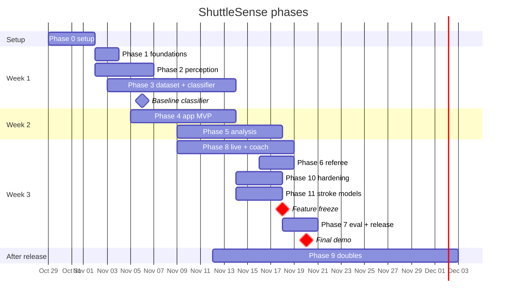
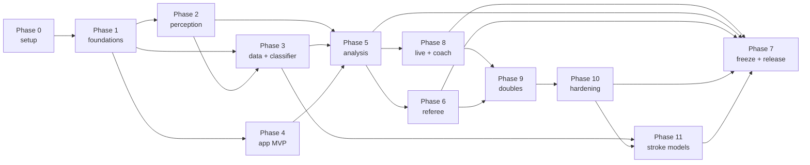
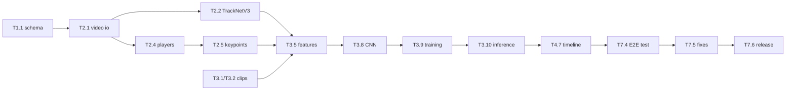

# Phased task plan

The 3-week build is split into 12 phases (0–11) and **146 tasks**. This page is the overview. Each phase has its own file with a full **task card** per task: goal, inputs, implementation steps, outputs, tests, acceptance criteria and risks. Every task is also a GitHub issue titled `[T<id>] <title>`, labelled with its phase, owner and area, under the phase milestone (Phase 8: #97–#112; Phase 9: #113–#125; Phase 10: #126–#133; Phase 11: #134–#146).

| Phase | File | Dates (2026) | Tasks | Gate to exit |
| --- | --- | --- | --- | --- |
| 0 | [Project setup](phases/phase-0-setup.md) | Oct 29 – Nov 1 | 12 | Every member runs backend tests and the app on their own device |
| 1 | [Foundations](phases/phase-1-foundations.md) | Nov 2 – Nov 3 | 11 | Clip record + API frozen (tags); TrackNetV3 and pose run; app connects on 4 platforms |
| 2 | [P1 perception](phases/phase-2-perception.md) | Nov 2 – Nov 6 | 11 | `record.json` has shuttle + both players; overlay video renders; < 5 min per 1-min clip |
| 3 | [Dataset and classifier](phases/phase-3-classifier.md) | Nov 3 – Nov 13 | 14 | Hit F1 ≥ 0.75, stroke macro accuracy ≥ 70%, ablation done, strokes in video and app |
| 4 | [App MVP](phases/phase-4-app-mvp.md) | Nov 5 – Nov 13 | 13 | Full P1 flow on phone, tablet, Windows, Chrome |
| 5 | [P2 analysis](phases/phase-5-analysis.md) | Nov 9 – Nov 17 | 14 | Calibration, minimap, speed, counter, feedback, exports |
| 6 | [P3 referee](phases/phase-6-referee.md) | Nov 16 – Nov 18 | 7 | Rally state + scoreboard with correction on team footage |
| 7 | [Freeze, evaluation, release](phases/phase-7-release.md) | Nov 18 – Nov 20 | 14 | `v1.0.0` release, README results, demo delivered |
| 8 | [Live mode, line calls and coaching](phases/phase-8-live-coach.md) | Nov 9 – Nov 18 | 16 | Upload and Live both end in a results view with line calls, coaching notes and chat; live runs against the fake source in CI |
| 9 | [Doubles support](phases/phase-9-doubles.md) | Nov 12 – after release | 13 | Doubles code on `main` with the singles path unchanged; ID switches, hitter attribution and service order measured on labelled doubles clips |
| 10 | [Hardening and courtside follow-ups](phases/phase-10-hardening.md) | Nov 14 – Nov 17 | 8 | Nov 14 review findings fixed with tests; doubles service order in every game; code-only steps of Phases 4, 5 and 7 done |
| 11 | [Selectable stroke models](phases/phase-11-stroke-models.md) | Nov 14 – Nov 17 | 13 | CNN, LSTM and Random Forest can be picked per job, each with trained weights and measured accuracy; Nov 14 review findings fixed with tests |

**Key dates:** work starts Mon Nov 2 · Week 1 baseline classifier Fri Nov 6 · **feature freeze Wed Nov 18** · final demo Fri Nov 20. Since PRD v1.2 the referee layer is committed scope; the old P3 go/no-go on Nov 16 is gone ([D17](DECISIONS.md)).

---

## How to read a task card

```
### T2.2 · TrackNetV3 wrapper stage
Owner · Estimate · Priority · Area · Refs · Depends on · Blocks
Goal       one or two sentences
Inputs     files, data, config keys and APIs it consumes
Steps      ordered checklist naming the files and functions to touch
Outputs    what exists when it is done (files, record fields, endpoints, screens)
Tests      named test cases to add
Acceptance criteria   measurable "done when", tied to the PRD
Risks      known pitfalls and the fallback
```

- **Priority:** `P1` core (must ship) · `P2` analysis · `P3` referee, live mode and coaching (committed since PRD v1.2) · `C` client app.
- **Area:** `backend`, `ml`, `data`, `app`, `docs`, `infra`; used as the GitHub label.
- **Refs:** feature (F#), client feature (C#) and requirement (FR-#) IDs from the [PRD](PRD.md).
- **Status:** ⬜ open · ✅ done. Flip it in the PR that completes the task and close the issue (`Closes #<n>` in the PR body).
- Steps are a guide, not a contract: if a better approach appears, do it and note why in the PR (and in `docs/DECISIONS.md` if it changes a design choice).

## Owners

| Code | Member | Main role |
| --- | --- | --- |
| M1 | Mist | Lead, integration, backend API, pipeline, releases |
| M2 | Member 2 | Shuttle tracking, rendering, court mapping, speed, exports |
| M3 | Member 3 | Data pipeline A, hit-detection evaluation, feedback rules, referee layer |
| M4 | Member 4 | Data pipeline B, labels and splits, app tests and polish, phone-footage evaluation |
| M5 | Member 5 | Pose, hit detection, feature extraction, stroke classifier |
| M6 | Member 6 | Flutter app, minimap and results UI, README, slides, demo video |

Until teammates share their GitHub usernames, owners are tracked with `owner:M1` … `owner:M6` labels.

## Timeline



Shift every date together if the start moves.

## Dependencies between phases



Phases overlap on purpose: the app (Phase 4) is built against the stub and fake pipelines (T1.10) while models are still being trained.

### Critical path

A delay on any of these tasks delays the demo. Review them at every stand-up.



## Workload

Estimates are in hours of focused work. Capacity is about **60 h per member** from Nov 2 to Nov 20 (≈ 20 h/week).

| Member | Phase 0 | 1 | 2 | 3 | 4 | 5 | 6 | 7 | Nov 2–20 total | vs. 60 h |
| --- | --- | --- | --- | --- | --- | --- | --- | --- | --- | --- |
| M1 | 32 (done) | 16 | 19 | 0 | 0 | 8 | 3 | 16 | **62** | OK |
| M2 | 3 | 5 | 28 | 4 | 0 | 28 | 3 | 4 | **72** | ⚠ over |
| M3 | 3 | 5 | 3 | 17 | 0 | 8 | 19 | 8 | **60** | OK |
| M4 | 5 | 0 | 0 | 22 | 11 | 5 | 0 | 14 | **52** | spare |
| M5 | 3 | 6 | 13 | 41 | 0 | 0 | 0 | 10 | **70** | ⚠ over |
| M6 | 3 | 6 | 0 | 0 | 44 | 10 | 4 | 17 | **81** | ⚠ over |

Overload plan:
- **M6:** M4 (spare capacity) takes over T4.8 History or T4.9 states if M6 is behind on Nov 10.
- **M5:** M3 already owns hit evaluation (T3.7). If training slips, M4 runs the ablation runs (T3.9) from M5's script.
- **M2:** if Phase 2 runs late, M1 takes T5.3 court outline and T5.14 minimap overlay.
- If more is needed, apply the cut lines below. Re-check this table at every phase gate.

Phases 8 (about 70 h), 9 (about 150 h, mostly after the release), 10 (about 39 h) and 11 are not in the table above. Phase 8 code landed with the scope change on Oct 31 and Phase 9 code on Nov 12; what remains there is evaluation (M4), device checks (M6) and tuning (M3). Phase 10 is review fixes and code-only steps (M1–M4, M6). Phase 11 (about 43 h) is the stroke models and a second review pass (M1, M5, M6). Re-balance at the Nov 13 gate.

## Cut lines

If the schedule slips, cut in this order (first = first to go) and record it in the PRD's Future work:

1. T8.8 + T8.11 coach chat (session notes stay; chat is already disabled when no API key is set).
2. Live mode on iOS and web (T8.9 on Android and Windows stays).
3. T5.12 re-render from the app (overlays are chosen once before processing).
4. T5.14 minimap in the rendered video (the app minimap stays).
5. T5.11 summary chart (downloads stay).
6. T4.11 accessibility extras beyond text scaling; T4.13 icon and splash.
7. iOS build (Android, Windows and Web remain).
8. T2.3 InpaintNet rectification (keep simple interpolation).

**Never cut:** T2.1–T2.8 perception, T3.5–T3.10 hits and strokes, T4.1–T4.7 app MVP, T7.2–T7.6 evaluation, testing and release.

## Working rhythm

- **Daily:** async stand-up in the team chat (done / next / blocked). Mention task IDs.
- **Mon, Wed, Fri:** 30-minute sync. Walk the board, then the critical path.
- **Phase gates:** each phase file ends with a gate checklist. Run it as a short live demo before the phase is marked done.
- **Pull requests:** follow [CONTRIBUTING.md](../CONTRIBUTING.md). Reference the task (`Refs T2.2`), flip the status here, close the issue.

## Implementation snapshot (Oct 30)

The parts of each task that need no data, GPU, devices or team decisions are already on `main`, with tests. Only the steps marked below remain. A task flips to ✅ only once its acceptance criteria are met; most still need a real clip, trained weights or a device check.

| Area | In code now | Still needed to close the task |
| --- | --- | --- |
| Tooling (T0.11, T1.1, T1.2, T1.4, T1.10, T1.11) | `scripts/check_env.py`, schema and OpenAPI snapshots, `/health` lists installed stages, checksum verification, golden record + fake pipeline, decision log | Review meeting and tags `schema-v1.0` / `api-v1.0`; real SHA-256 values once weights are on HF |
| Perception (T2.1–T2.11) | `FrameReader` (720p, ≤ 30 fps, 5-min limit, even sizes), pinned TrackNetV3 submodule and inference on normalized frames, optional InpaintNet pass, outlier filter + gap filling, tracking CSV import, benchmark and evaluation scripts, player IDs + keypoint smoothing, both pose backends, overlay layers, H.264 export, stage cache + weighted progress | Real TrackNet and InpaintNet weights; comparison with upstream predictions and visual checks on team and broadcast clips (T2.2–T2.3); pose spike numbers (T1.5); labelled frames for T2.10 |
| Hits and strokes (T3.1–T3.14) | `scripts/download_shuttleset.py` (44 matches, 36,484 strokes), Chinese → English → 6-class label table (D12), committed match split (`configs/splits.json`, D13), `scripts/eval_hits.py` (`--gt-offset` for ShuttleSet frames), `scripts/dataset_stats.py`, `scripts/bench_strokes.py`, `scripts/make_figures.py`, rule-based hit detector (per run of visible frames), feature windows, clip extraction, dataset + augmentation, configurable CNN, training script (`--seeds`, one checkpoint per seed), inference stage, hit/stroke overlays, metric functions | Drive upload of the annotations (T1.9), M4's call on drives, rush and push (T3.3; defaults kept), extraction and training runs, tuning on val matches, GPU latency (T3.14) |
| Analysis (T5.1–T5.14) | Calibration UI (drag, loupe, convexity check, frame scrubber) and CLI `--calibrate`, homography checks, court lines/outline, court positions, NaN-aware speed, stroke counter, 9 form rules (docs/FEEDBACK_RULES.md), exports with BOM + `rallies.csv`, re-render, minimap layer | Accuracy checks on team clips (T5.13); device checks |
| Referee (T6.1–T6.7) | `scripts/eval_rallies.py`, rally segmentation, landing in/out with confidence, BWF scoring with start score, correction API re-scoring later rallies (kept through re-renders), app scoreboard with corrections, score/landing overlays | Rally labels and evaluation on team footage (T6.7) |
| App (T4.1–T4.13) | Connect validation + recent servers, persisted stage-aware options, upload warnings, processing back-off/ETA/retry, results layout (landscape, side panel), playback speed/frame step/shortcuts, timeline filters + tips sheet, history filenames + delete video, theme mode, offline banner, platform config, fake API + widget and accessibility tests, end-to-end flow on a device (`integration_test/`, T7.4) | Runs on Android, tablet, Windows and Chrome (T1.8, T4.x acceptance); icon artwork (T4.13) |
| Evaluation and release (T7.1, T7.2, T7.4, T7.6, T7.9, T7.13, T7.14) | `scripts/label_clip.py`, `scripts/eval_phone.py`, `docs/results/` index and dataset counts, `docs/EVALUATION.md` outline, `release.yml` (draft release with APK, web and Windows builds on a `v*` tag), `docs/RELEASE.md`, license scan (direct and transitive) and media audit in TECH_STACK.md | Labelled team clips; the bundled media_kit/ffmpeg build licenses and the ML venv scan (T7.13); everything after the feature freeze |

### Phase 8 snapshot (Oct 31)

Live mode, line calls, session notes and coach chat are on `main` (see [Phase 8 status](phases/phase-8-live-coach.md)). Verified on Oct 31: backend `ruff check`, `ruff format --check` and `pytest -m "not gpu"` pass; app `flutter analyze`, `dart format --set-exit-if-changed` and `flutter test` (136 tests) pass; Windows and web release builds pass. Measured: live pipeline overhead without models (p95 20.7 ms, `docs/results/live_latency.md`). Not measured yet: live latency with TrackNetV3 and pose (no weights installed), line-call accuracy (no labelled landings), a session on a real camera.

### Fix pass (Nov 1)

A review of the Phase 8 code found and fixed these, each with tests:

- **Live sessions (backend):** a failed send, stage error or bad control message could leave a session attached with the GPU lock held, so every later live session and upload job got `busy` until a restart. Other fixes: coordinates doubled at the lowest quality level; a camera faster than `live.max_fps` was not thinned, so times and speeds were off; the frame queue was unbounded; live rallies closed sooner than offline ones.
- **API:** a re-render erased the coach chat. A score correction left `rally_events` stale. Whitespace-only chat messages were accepted. Parallel questions could pass the limit.
- **Referee:** a call just inside the uncertainty band could round to 0.5 and decide a rally.
- **Scripts:** `live_replay` could hang. `eval_line_calls` used the rally lines for serve-only rallies. `label_clip` dropped other tools' columns.
- **App, live mode:**
  - Try again leaked the camera and the server session.
  - A resume during the server's ping window was given up too early.
  - The frame list could drift from server frame numbers.
  - The app announced 15 fps whatever the camera managed.
  - The saved screen was a dead end with the camera still on.
- **App, other screens:**
  - Coach chat swallowed some errors, and leaving the screen mid-answer broke it.
  - An older uncertain call lost its banner.
  - A 1.0 backend still offered Live.
  - A failed live render could not be opened.

Also added: `scripts/label_landings.py` (T8.12), the pose spike notebook scaffold (T1.5), freeing the CUDA cache after TrackNet (T2.2), minimap screen-reader positions and contrast checks (T4.11), the video "not available" test (T4.6), and tests for the replay, benchmark and Colab tools. The app version now matches the backend (0.1.0).

Verified on Nov 1: backend `ruff check`, `ruff format --check` and `pytest -m "not gpu"` pass (263 tests, 1 GPU test deselected). App `flutter analyze`, `dart format` and `flutter test` (152 tests) pass. Release builds were not re-run.

### Fix pass (Nov 2)

A second review found and fixed these, each with a test unless noted:

- **Backend:**
  - A re-render that hit the referee cache restored empty `line_calls` and `rally_events`. That silently dropped line-call overrides and the `shots_out` notes. The cache now stores them, and a format number makes old caches miss.
  - A dropped live session was detached twice. After drop, resume and drop again, the first timer saved it before its TTL.
  - A text frame that was not JSON ended the live session. It now gets `bad_message`.
  - `POST /jobs` racing `DELETE /videos` left an orphan job. It now returns `404`.
  - A re-render during a coach answer could lose that answer. It now returns `409` while an answer is in flight.
  - Court positions ignored `stages.pose.min_keypoint_score`.
  - Live sessions ignored `stages.court.court_size_m`.
  - `label_clip` spun forever on an unreadable first frame.
- **App:**
  - After a resume, live mode sent the frames "missed" while reconnecting back to back. (No test: the pacing stopwatch runs on real time.)
  - Camera stills were never deleted.
  - Live could still be picked on a 1.0 backend from the app bar and Settings.
  - The peak speed lacked "(est.)".
  - A chat citation tapped while results loaded was lost. (No test: the results screen needs media_kit.)
- **Finished steps:**
  - T4.2: the upload state is in `UploadNotifier`, and clips over 5 minutes are flagged before sending.
  - T5.5: a heatmap toggle on the minimap.
  - T5.6: speeds are labelled "estimated" in the exports docs.
  - T6.2: the landing rule is recorded.
  - A "Game already under way" start score for upload and live. The backend accepted `start_score` before, but the app never sent it.
- **Docs:**
  - DATA_FORMAT.md: complete `rally_events` payloads, and the landing frame equals the rally's `end_frame`.
  - The job-folder file list in ARCHITECTURE.md.
  - The new `404` and `409` cases and `bad_message` in API.md.

Verified on Nov 2:
- Backend `ruff check`, `ruff format --check` and `pytest -m "not gpu"` pass (270 tests, 1 GPU test deselected).
- App `flutter analyze`, `dart format` and `flutter test` pass (162 tests).
- Release builds were not re-run.

### Live referee and coach pass (Nov 3)

New tasks T8.13–T8.16 ([phase 8](phases/phase-8-live-coach.md#t813)), on `main` with tests:

- **Match play (D21):** games and best of 3, who serves next and from which service court, the interval at 11, change of ends, game and match point. These are derived from the rally winners plus the user's `best_of` and `first_server`.
- **Referee controls:** award a point the system missed, clear a rally's winner, and undo the newest score change. These work live and on results.
- **Live coaching:** after each rally the coach panel shows the rally summary and the running top 3 fixes. A callout shows the newest hit, and a haptic tap marks each new line call.
- **Live snapshot:** `started` restores the score, rallies, calls and hits after a resume.
- **Event lag (T8.12):** `bench_live.py` now reports how late each event arrives. Fake run: hits come 19–21 frames after contact, calls 49–51 frames after landing.

Fixes found in the same review:

- **Backend:**
  - A non-object first message now gets `bad_request`.
  - A mid-session `internal` error closes with 1011.
  - Failed saves after the TTL are logged, and shutdown waits for a frame in progress.
  - The recording writer is checked.
  - The quality level follows the configured scales.
  - Per-frame stroke counting no longer rescans all hits.
  - Start scores above 29 are refused.
- **App:**
  - A decision made while reconnecting is refused with a message, not dropped. A `not_found` is shown.
  - Connecting never waits on a socket close. A fatal error releases the socket, so the server frees the GPU.
  - There is a Cancel button while connecting or reconnecting.
  - `calibrate` catches every error, and a second `saved` cannot throw.
  - Hits stay in frame order, and the frames analysed are shown.
  - A start score also counts without a court.
  - The heatmap is rebuilt every 30 live frames, not on every event.

Open at the time of that review:

- The doubles service order and partners: the tracker follows one player per side (planned in [Phase 9](phases/phase-9-doubles.md)). *Superseded: Phase 9 tracks four players and the service order (Nov 12).*
- The live timeline uses the announced fps, not capture time. *Superseded: frames are placed by capture time (Nov 5).*
- Under load, skipped frames can limit hit detection and delay a rally decision.
- On a portrait camera the overlay can be letterboxed against the preview. *Superseded: image and markers share one fitted rectangle (Nov 5); a real-camera check remains.*
- The 1.15 m serve height rule cannot be measured from 2D pose.

### Live reliability follow-up (Nov 4)

- Saved live jobs now re-render the saved analysis instead of running perception again. This
  preserves doubles line calls, score corrections and coaching data, including overrides.
- Frames skipped by live perception no longer count as evidence that the shuttle was lost or
  stationary. This is conservative: sustained skipping can delay a rally decision, and hits
  occurring in skipped frames can still be missed.
- Doubles partners and service order are not tracked (planned in [Phase 9](phases/phase-9-doubles.md); *superseded on Nov 12*); a single 2D camera cannot verify the
  1.15 m service-height rule. Line calls, speed and coaching remain estimates.
- Local environment check: the base stack is present, but PyTorch is CPU-only; ONNX Runtime,
  rtmlib, SciPy, model weights and sample footage are absent. Model-backed and real-footage
  evaluations therefore remain open.
- Verification: backend Ruff checks passed; the non-GPU suite passed 292 tests, and the
  additional skipped-frame window test passed separately. Flutter analysis and formatting
  checks passed, as did all 169 Flutter tests.

### Completion follow-up (Nov 5)

- Reduced-quality live pose detections now scale horizontal and vertical coordinates
  independently, accounting for rounding in resized frame dimensions. Live referee controls
  reject non-integer or negative IDs instead of coercing them to another rally or line call.
- Cancelling while the camera samples its initial frame rate no longer allows that abandoned
  attempt to start a live session. Stale camera and connection callbacks also cannot replace
  the state of a later attempt. The live widget suite covers cancellation during capture.
- Live frames with non-finite capture timestamps are rejected without ending the session.
  The app stops a session if captured dimensions change, and requires recalibration if
  the dimensions have changed since the calibration still. This prevents silent distortion;
  it does not establish alignment between a camera preview and its captured stills.
- The laptop has an RTX 4050, but its project environment has CPU-only PyTorch and no
  ONNX Runtime, rtmlib, SciPy, model weights or sample footage. Flutter detects Windows,
  Chrome and Edge, but no phone or tablet. Do not mark the model or physical-device gates done.
- Team priorities: obtain consented rallies and labels (T0.10, T7.1, T8.12); provision and
  verify model weights and the GPU stack (T0.9, T1.4–T1.6); settle the stroke mapping and
  train/evaluate on the prescribed splits (T3.3, T3.5–T3.9); perform platform, real-camera,
  line-call and latency checks (T1.8, T7.4, T8.6, T8.12, T8.14–T8.15); then complete the
  release audit, artifacts, demo and team review (T7.2–T7.14).

### Live workflow and startup pass (Nov 5)

- Capture timestamps now place images in the same frame slots used by the live events and the
  saved video. Missing slots repeat the last image for playback and contribute no new
  observations. Very long gaps are shortened to the resume window and reported in the app.
- The live overlay uses the exact analyzed capture. Its image and markers share a fitted
  rectangle. Orientation changes require a new calibration. Portrait and landscape
  alignment were exercised with a fake camera. Real-camera orientation, crop and mirroring
  still need device checks.
- Referee shows the oldest unresolved call first. Live commands wait for a matching score
  update or error. Coach opens with a cue from the last rally, followed by session notes and
  the rally details. Both views show the score and session status.
- The fake live recovery test checks an interrupted session through resume, decision
  and undo, save, History, and citation seeks in the rendered MP4. The launcher artwork
  and startup screens are implemented. M4's review and device startup checks remain open.
- Backend Ruff checks and 303 non-GPU tests passed. The live and stream suites were rerun
  after the corrupt-capture fix, and the additional queue-overflow regression passed.
  Dart formatting and Flutter analysis passed. The full Flutter suite passed 175 tests,
  including the live layouts at 360, 800 and 1280 dp and 200% text size. The additional
  History widget test verified navigation to a saved live replay.
- The web and Windows release builds passed startup smoke checks. The Android release
  build succeeded on retry with a smaller Gradle heap after the default JVM ran out of
  memory. The APK contains the launcher and splash resources and uses debug signing.
  Phone and tablet installation and iOS startup remain open.

### Courtside recovery and verification (Nov 6)

- The live reconnect snapshot restores the server frame position, rally timer, shot count, and
  review queue. On a missing referee acknowledgment, the app reconnects and refreshes the score
  before enabling decisions again. Tests cover both a lost reply after an award and a command
  that never reached the server.
- Referee shows the oldest unresolved call and the number awaiting review above the scoring
  controls. Coach can show cues and notes for Both, Near, or Far. The live stroke feed is
  read-only. Saved sessions still open from History and support citation seeks.
- In `backend/`, `ruff check .`, `ruff format --check .`, and `pytest -m "not gpu" -x -q`
  passed (305 tests). An initial run concurrent with other verification hit three render
  wait deadlines. The full retry passed.
- In `app/`, `dart format --output=none --set-exit-if-changed lib test integration_test`,
  `flutter analyze --no-pub`, and `flutter test --no-pub` passed (181 tests). Both roles
  were exercised at 360, 800, and 1280 dp in light and dark themes at 200% text size.
- `flutter build web --release` and `flutter build windows --release` passed. The Windows
  release process started and responded. The web index, bootstrap, and app script returned
  HTTP 200. The headless browser launch was blocked, and the desktop browser check stopped
  before navigation because the tool could not identify the browser's current URL.
- `flutter build apk --release` passed with Gradle's JVM heap set to 2 GB. `apksigner verify`
  confirmed the APK uses the Android Debug certificate. Device startup remains open.
- The Windows integration flow passed against a loopback fake backend and a synthetic MP4.
  Run `flutter test --no-pub integration_test -d windows` with the `E2E_SERVER` and
  `E2E_VIDEO` Dart defines. The test now selects Upload clip at the mode picker before
  checking upload, processing, results, and History.
- The paced synthetic benchmark measured 34.7 ms p95 frame round trip and 1.65 s p95 line-call
  lag. [Commands and results](results/live_latency.md)
- Local setup has CPU-only PyTorch, no ONNX Runtime, rtmlib or SciPy, and no model weights or
  attached Android device. The real-camera, calibrated accuracy and model-backed latency
  gates still need the team inputs listed below.

### Courtside verification (Nov 10)

- The fake live suite covers camera release on stop failures, referee queue selection and
  recovery after a lost acknowledgment, and coach filter retention across roles. Flutter
  analysis, Dart formatting and all 187 Flutter tests passed. The role layouts were exercised
  at 360, 800 and 1280 dp in both themes at 200% text size.
- Backend Ruff checks and all 305 non-GPU tests passed. The fake recovery test checks the
  saved score, History entry and seeks to the coaching citation frames in the rendered MP4.
- The web and Windows release builds passed. The Windows integration test connected to a
  local fake backend, uploaded a synthetic clip, opened its results, and found it in History.
- The Android release APK built with a 2 GB Gradle heap and passed signature verification
  with the Android Debug certificate. Device startup remains open.
- The paced synthetic run measured 26.2 ms p95 frame round trip and 1.733 s p95 line-call
  lag. [Benchmark report](results/live_latency.md)
- Start the remaining team checks with a consented real-camera session. Use its recording for
  rally and landing labels and the model-backed latency run. [Camera checklist](phases/phase-8-live-coach.md#courtside-review-and-coaching-follow-up-on-nov-10)

### Courtside reliability pass (Nov 12)

- Live analysis now keeps fresher frames when the queue fills, without reordering referee
  decisions. Skipped or discarded captures do not count as rally evidence, and the app
  keeps the last matched image and overlay while waiting for fresh analysis.
- Referee highlights the selected landing. Coach can pin a cue per player filter and keep
  it across reconnects. If a Stop reply is lost, the app checks the reserved replay ID
  before confirming a save.
- Ruff, 310 non-GPU backend tests, Dart formatting, Flutter analysis, and all 191 Flutter
  tests passed. Role layouts were checked at 360, 800, and 1280 dp, both themes, at 200%
  text size. Windows integration passed for upload and for live play through the real
  WebSocket using a substitute camera and fake perception. The live flow exercised
  Referee and Coach, call review, award and undo, reconnect, History, and replay.
- Web, Windows, and Android release builds passed. The web index, bootstrap, and app
  script served HTTP 200 locally. The Windows release reached startup idle. The Android
  APK passed signature verification with the Android Debug certificate; device
  installation and distribution signing remain open.
- The 300-frame paced [synthetic benchmark](results/live_latency_fake.md) reported p95
  36.7 ms round trip, 31.0 ms on the server, and 1.73 s line-call lag (two decisions).
  This checks the WebSocket and analysis path without tracking or pose models.
- The real-camera, device, model, and release gates remain open. Use the
  [courtside acceptance checklist](phases/phase-8-live-coach.md)
  to capture evidence for each device before marking those tasks complete.

### Doubles and fix pass (Nov 12, later)

- **Phase 9 code landed** ([plan](phases/phase-9-doubles.md), [D22](DECISIONS.md)):
  - clip record 1.2 with optional doubles fields, which singles records leave out;
  - `court` (and the doubles first server and receiver) on `POST /jobs` and the live start;
  - a four-player tracker using court position and shirt colour;
  - hits credited to one partner;
  - the doubles service order, with a pose cross-check that flags rallies for review;
  - per-partner stats, positions, notes and a formation note;
  - live doubles, including the fake source;
  - doubles overlays and lines;
  - four players in the app;
  - doubles labelling and `eval_doubles.py`.
- **Done:** T9.1, T9.3, T9.6, T9.8, T9.10 and T9.11.
- **Still open:** T9.2, T9.4, T9.5, T9.7, T9.9 and T9.12 need doubles footage, labels or a
  model-backed latency run; T9.13 needs the measured limits.
- **Bugs fixed, each with a regression test:**
  - REST undo dropped line-call overrides, so the score differed from a re-render.
  - Score edits checked the job status outside the job lock, so a re-render queued in
    between could drop the edit.
  - A live award during an open or settling rally counted that rally twice; it is now
    refused with `rally_in_play`, which the app shows without ending the session.
  - Live court positions were not clamped like offline ones.
  - The live start message accepted `best_of: true` and a non-text session name.
  - An upload failing outside the API left the screen stuck in "uploading".
  - Both scoreboards (app and overlay) counted awarded points from frame 0, or not until the
    end.
- **Verified:**
  - Ruff, 352 non-GPU backend tests, Dart formatting, Flutter analysis and 206 Flutter
    tests pass.
  - Web, Windows and Android release builds pass (the APK is debug-signed), so T4.10 is
    done. T4.8 is done: its 404 acceptance is covered by `test_api.py`.
- **Rule questions, settled on Nov 13:**
  - An undecided rally no longer clears the interval and change-of-ends flags of the rally
    before it.
  - A one-game match now flags a change of ends at 11, as the BWF Laws say for a match of
    one game (Laws 8.1.3 and the other-scoring-systems appendix).

### Doubles coach and redesign pass (Nov 13)

- **Live coach panel in doubles:** the Near / Far filter matched notes tagged exactly
  `near` or `far`, so partner notes (`near_1` … `far_2`) were hidden. It now matches on the
  side, keeps formation notes out of the focus list, and cues name the partner.
- **Coach chat in doubles:** the digest explains the partner ids, credits each hit to its
  partner and says who served and received each rally. Live rally summaries and rally
  events carry `hitter`.
- **Bugs fixed, each with a test:**
  - A doubles hit with an unknown partner had partner 1's pose graded; it now gets no form
    feedback.
  - `hits.csv` had no partner column; it now has `hitter`.
  - A chat answer that could not be saved ended the stream silently; it now sends an error
    event.
  - The chat box dropped a typed question when one was still being answered, and the list
    did not follow new messages.
  - The start score field said "player" in doubles.
- **App redesign:** design tokens and line-call colours that meet 4.5:1 in light and dark;
  the live screen split into widgets; a larger score with one point button per side; the
  next-rally cue set large in the coach view; consistent cards, empty states and mode
  cards. The principles are in the PRD under "Design principles".
- **T8.12:** ShuttleSet landing pixels are projected to court metres through the record's
  homography in `eval_line_calls.py`.
- **Not done:** the `drive` class (T9.7) changes the trained class list, so it waits for
  the doubles labels and a training run. The redesign was checked by widget tests and a web
  build, not on a phone or tablet.
- **Verification:** backend `ruff` and `pytest -m "not gpu"` pass (358 tests); app
  `flutter analyze` and 210 widget tests pass.

### Phase 10 pass (Nov 14)

[Phase 10](phases/phase-10-hardening.md) collects a review of `main` after the doubles code and the
Nov 13 redesign. All eight tasks are done:

- **Backend fixes, each with a test (T10.1):**
  - the doubles service check ignored awarded points, so it flagged a correctly placed server;
  - the fake pipeline failed a doubles job that set only `first_server`;
  - singles jobs and live sessions accepted doubles service slots (now `422` / `bad_request`);
  - a doubles line-call court in `pipeline.yaml` turned singles jobs into doubles;
  - `DELETE /jobs/{id}` during an edit could recreate the job folder;
  - a re-render and a coach answer could start in the same instant and lose the answer;
  - live frames skipped under load split the hit detector's runs, so hits were lost;
  - `eval_line_calls.py` could write `NaN` into JSON, and ShuttleSet rallies rarely matched.
- **App fixes, each with a test (T10.2):**
  - a live socket closed during the handshake waited 90 s (up to 7.5 min across reconnects);
  - Try again after a refused start lost the start score;
  - a failed chat question was lost;
  - the stroke chart legend overflowed in a narrow panel;
  - doubles tooltips and the heatmap said "player";
  - a doubles hit with no known partner was marked at partner 1;
  - a live doubles session drew the singles court until a partner was seen.
- **Doubles service in every game (T10.3, D23):** clip record 1.3 (`score.game_service`),
  `POST /jobs/{id}/score/service`, a live `service` message, and a "Who serves first in game N?"
  picker on the scoreboard.
- **Code-only steps of earlier phases:**
  - job-finished notification (T10.4, T4.4);
  - `scripts/speed_report.py` (T10.5, T5.13);
  - auth token tests (T10.6, T4.6);
  - docs synced, D24–D27 added and README links checked (T10.7, T7.8, T7.12);
  - media_kit native library sources recorded (T10.8, T7.13).
- **Verified:**
  - backend `ruff check`, `ruff format --check` and `pytest -m "not gpu"` pass (373 tests);
  - app `flutter analyze`, `dart format` and `flutter test` pass (225 tests);
  - web, Windows and Android release builds pass (the APK is debug-signed).
- **Not verified:** the notification and the game-service picker on a phone, tablet or Windows
  desktop; they join the device checklists.

### Phase 11 pass (Nov 14, later)

[Phase 11](phases/phase-11-stroke-models.md) makes the stroke classifier a choice between three
models and ships trained weights for all of them. All thirteen tasks are done:

- **Research (T11.1, D28–D31):** no pre-trained LSTM or Random Forest stroke classifier exists for
  COCO keypoints. The one solid pre-trained model, the BST transformer, is none of the three and
  needs inputs the pipeline does not build. The BST repository's pre-extracted ShuttleSet features
  use our pose and shuttle models, so the three models were trained on those.
- **Models (T11.2–T11.6):** `scripts/import_bst_features.py`; an LSTM; a Random Forest on summary
  features, saved as plain arrays so the server needs neither scikit-learn nor a pickled file;
  `train_stroke_classifier.py --algorithm cnn|lstm|rf`. Test macro accuracy on the BST split, three
  seeds: 1D CNN 89.5% ± 1.2%, LSTM 88.1% ± 0.6%, Random Forest 82.1% ± 0.3%. Ablation: pose only 77.1% ± 0.1% against 89.5% ± 1.2% with the shuttle (1D CNN). Weights are committed under `backend/weights/strokes/`.
- **Choice per job (T11.7–T11.9):** `stroke_model` on `POST /jobs` and the live start, `stroke_models`
  in `/health`, clip record 1.4 (`stroke_model`), `--stroke-model` on the CLI, and a selector in the
  app's upload options and live setup. Running a clip again with another model reuses the cached
  tracking, pose and hits.
- **Fixes, each with a test (T11.10–T11.12):**
  - a restart during a saved live session's render left a job that could not be opened;
  - deleting a live job did not stop its render;
  - two chat questions at the limit could both pass;
  - `POST /jobs/{id}/score/award` accepted any frame;
  - the access token appeared in the server logs;
  - a re-render failed on Windows while the old video was still playing;
  - per-job locks were never removed;
  - app tests called the real notifications plugin.
- **Docs (T11.13):** stale lines fixed (list in the task card) and `scripts/check_links.py` added to CI.
- **Verified:** backend `ruff check`, `ruff format --check` and `pytest -m "not gpu"` pass (404 tests);
  app `flutter analyze`, `dart format` and `flutter test` pass (236 tests).
- **Not verified:**
  - the three models on our own clips or phone footage. The numbers above are on broadcast matches
    from BST's split, not `configs/splits.json`, so T3.9 on our own clips and T7.2 stay open;
  - a full pipeline run with the stroke models on a real clip (no TrackNetV3 or pose weights here);
  - the selector on a phone, tablet or Windows desktop;
  - release builds, which were not re-run.

### Remaining phase work by dependency

| Tasks | Owners | Next action and evidence |
| --- | --- | --- |
| T0.6–T0.10, T1.1, T1.2, T1.4–T1.9 | M1 and team | Provision shared storage, record consented clips, review schema and API, and document GPU/Colab setup and device connections. Record teammate sign-offs, artifact checksums and platform results. |
| T2.2–T2.3, T2.9–T2.11, T3.1–T3.3, T3.5–T3.11, T3.13, T3.14 | M2–M5 | Install weights, agree on labels, extract features and train on the documented splits (the shipped stroke models were trained on the BST features instead, D29; T3.12 is done). Report tracking, hits, strokes, ablation and timings. |
| T4.1–T4.7, T4.9, T4.11, T4.13, T5.1, T5.3–T5.14 | M4, M6, M2 | Verify target devices in both themes and at 200% text size, sign off on the artwork, and publish the calibrated speed check on team clips. |
| T6.7, T8.3, T8.6, T8.8–T8.12, T8.14–T8.15 | M1–M4, M6 | Label rallies and landings, measure model latency and accuracy, and verify camera, chat and courtside controls. Save commands, metrics and the device checklist. |
| T9.2, T9.4, T9.5, T9.7, T9.9, T9.12, T9.13 | M1–M6 | Doubles ([Phase 9](phases/phase-9-doubles.md)): code tasks land first; record and label doubles rallies (T9.2), then measure ID switches, hitter attribution and service order (T9.12). |
| T10.1–T10.8 | M1–M4, M6 | Done Nov 14 ([Phase 10](phases/phase-10-hardening.md)); only device checks of the notification and the game-service picker remain, with the T4.4 and T8.14 checks. |
| T11.1–T11.13 | M1, M5, M6 | Done Nov 14 ([Phase 11](phases/phase-11-stroke-models.md)); what remains is a run on a real clip with the perception models installed and the device check of the selector, with the T4.3 and T7.2 checks. |
| T7.1–T7.13 | M1 and team | Review labelled phone footage, run final evaluations and device checks, audit licenses, and prepare demo and release artifacts. Rehearse and record clean installs before tagging. |

Verified on Nov 3 (an earlier pass, kept for the record):
- Backend `ruff check`, `ruff format --check` and `pytest -m "not gpu"` pass (291 tests).
- App `flutter analyze`, `dart format` and `flutter test` pass (169 tests).
- `flutter build web --release` passes. The Windows and APK builds were not re-run.

### Left for M1 (needs GitHub admin, hardware, data or the team)

- **GitHub:**
  - Projects board (`gh auth refresh -s project` is interactive).
  - Branch protection for `main` (T0.7), once direct pushes to `main` stop.
  - Done on Nov 2: the Phase 8 milestone, `phase-8` label and issues #97–#108 (#109–#112 added on Nov 3) (✅ ones closed); the issues of ✅ tasks closed; squash-only merges and auto-delete branches.
- **Tags:** `schema-v1.0` and `api-v1.0`, after the T1.1 / T1.2 reviews.
- **Weights and data:**
  - HF repo and Drive folder (T0.9), with links in SETUP.md.
  - Upload the TrackNetV3 weights and fill `CHECKSUMS` (T1.4).
  - The laptop venv (Nov 12) also lacks torchvision (so the Keypoint R-CNN pose fallback cannot run) and huggingface_hub; scikit-learn was added on Nov 14. The ShuttleSet annotations are already local in `backend/data/shuttleset/` (m01–m44).
- **ML stack and benchmarks:**
  - Install CUDA torch, onnxruntime-gpu and rtmlib, and record the versions (T1.6).
  - Run the Colab tunnel (T1.7).
  - GPU benchmarks: `scripts/benchmark.py` (T2.9) and `scripts/bench_live.py` with models (T8.12).
- **Real-world checks:**
  - A live session on a real camera (T8.6), including award/undo and the coach panel (T8.14, T8.15).
  - One coach chat with a real API key (T8.8).
  - Device checks for T5.1, T5.12 and T7.4.
- **Release:**
  - Licenses of the bundled media_kit libmpv/FFmpeg, and the ML venv scan (T7.13).
  - After the freeze: T7.6 release builds and T7.7 tag `v1.0.0` (bump all three versions).
- **Team decisions:** M4 approves the T3.3 label mapping and the T4.13 icon art. M5 runs the pose spike notebook.

### Verification on Oct 30

- Backend: `ruff check .`, `ruff format --check .`, and `pytest -m "not gpu"` pass (194 tests, 1 GPU test deselected).
- App: `flutter analyze` and 105 widget tests pass. Windows and web release builds pass; the Windows integration test passes against the fake backend using a synthetic 60-frame clip.
- The fake CLI pipeline returns 3 hits on that clip. The real CLI pipeline completes with model stages skipped because weights are absent. The local environment has CPU PyTorch; `rtmlib`, ONNX Runtime, TrackNet weights, stroke weights, and consented rally footage are absent.
- T1.3 is complete: a fresh local recursive clone checks out the pinned TrackNetV3 source. T2.2–T2.3 remain open until predictions and quality are checked on real clips with the published weights.

## All tasks

| Phase | Tasks |
| --- | --- |
| [0](phases/phase-0-setup.md) | T0.1 Repo structure · T0.2 Design docs · T0.3 Backend skeleton · T0.4 Flutter skeleton · T0.5 CI · T0.6 Board, labels, issues · T0.7 Protect main · T0.8 Member setup · T0.9 HF + Drive · T0.10 Test rallies · T0.11 Env check script · T0.12 Working agreements |
| [1](phases/phase-1-foundations.md) | T1.1 Freeze schema · T1.2 Freeze API · T1.3 TrackNetV3 submodule · T1.4 Weights + checksums · T1.5 Pose spike · T1.6 ML stack · T1.7 Colab tunnel · T1.8 App on 4 platforms · T1.9 ShuttleSet download · T1.10 Golden record · T1.11 Decision log |
| [2](phases/phase-2-perception.md) | T2.1 Video io · T2.2 TrackNetV3 stage · T2.3 Rectification + gaps · T2.4 Players + IDs · T2.5 Keypoints · T2.6 Overlay renderer · T2.7 H.264 export · T2.8 Pipeline cache + progress · T2.9 Benchmark · T2.10 Tracking accuracy · T2.11 Pose quality check |
| [3](phases/phase-3-classifier.md) | T3.1 Clips 1–22 · T3.2 Clips 23–44 · T3.3 Label mapping · T3.4 Splits · T3.5 Features · T3.6 Hit detector · T3.7 Hit evaluation · T3.8 CNN + training script · T3.9 Training + ablation · T3.10 Stroke inference · T3.11 Hit/stroke overlays · T3.12 Figures · T3.13 Dataset stats · T3.14 Inference latency |
| [4](phases/phase-4-app-mvp.md) | T4.1 Connect · T4.2 Upload · T4.3 Options + start · T4.4 Processing · T4.5 Results layout · T4.6 Video player · T4.7 Timeline · T4.8 History · T4.9 States + theming · T4.10 Platform config · T4.11 Accessibility · T4.12 Widget tests · T4.13 Icon + splash |
| [5](phases/phase-5-analysis.md) | T5.1 Calibration UI · T5.2 Homography stage · T5.3 Court overlay · T5.4 Court positions · T5.5 App minimap · T5.6 Speed · T5.7 Stroke counter · T5.8 Feedback rules · T5.9 Tips in app · T5.10 Exports · T5.11 Downloads + chart · T5.12 Re-render · T5.13 Speed sanity · T5.14 Minimap overlay |
| [6](phases/phase-6-referee.md) | T6.1 Rally state · T6.2 Landing in/out · T6.3 Scoring · T6.4 Correction API · T6.5 App scoreboard · T6.6 Score overlays · T6.7 Rally evaluation |
| [8](phases/phase-8-live-coach.md) | T8.1 Scope docs · T8.2 Schema 1.1 · T8.3 Line calls · T8.4 Session notes · T8.5 Incremental stages · T8.6 Live socket · T8.7 Fake live source · T8.8 Coach chat API · T8.9 App mode + live · T8.10 App calls + summary · T8.11 App chat · T8.12 Line-call + latency eval · T8.13 Match play · T8.14 Award + undo · T8.15 Live coaching · T8.16 Live snapshot |
| [9](phases/phase-9-doubles.md) | T9.1 Record v1.2 · T9.2 Doubles clips + labels · T9.3 Four-player tracker · T9.4 Appearance cue · T9.5 Hitter attribution · T9.6 Service order · T9.7 Doubles strokes · T9.8 Doubles feedback + analytics · T9.9 Live doubles · T9.10 Court choice in upload · T9.11 App four players · T9.12 Doubles evaluation · T9.13 Doubles docs |
| [10](phases/phase-10-hardening.md) | T10.1 Backend review fixes · T10.2 App review fixes · T10.3 Doubles service in every game · T10.4 Job-finished notification · T10.5 Speed report · T10.6 Auth token tests · T10.7 Docs sync · T10.8 media_kit licenses |
| [11](phases/phase-11-stroke-models.md) | T11.1 Research + decisions · T11.2 BST feature import · T11.3 Model registry · T11.4 LSTM · T11.5 Random Forest · T11.6 Training + comparison · T11.7 Stroke model per job (API) · T11.8 Stroke model selector (app) · T11.9 CLI flag · T11.10 Live job fixes · T11.11 API fixes · T11.12 Windows re-render + test notifier · T11.13 Docs sweep + link check |
| [7](phases/phase-7-release.md) | T7.1 Phone footage labels · T7.2 Phone evaluation · T7.3 Final metrics · T7.4 E2E test · T7.5 Bug fixes · T7.6 Release builds · T7.7 Tag v1.0.0 · T7.8 README final · T7.9 Slides + evaluation · T7.10 Backup video · T7.11 Rehearsal · T7.12 Docs = shipped · T7.13 License audit · T7.14 Release checklist |
