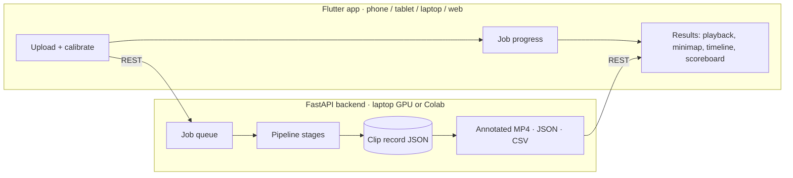
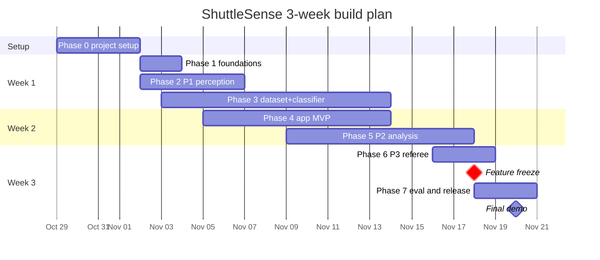

# ShuttleSense: Product Requirements Document

Version 1.1 · Oct 29, 2026 · Owner: Mist (project lead)

> **Changes from v1.0:** the demo client is now a cross-platform **Flutter app** (phone, tablet, laptop, browser) instead of a Gradio/Streamlit page. All computer vision runs on a **Python FastAPI backend** hosted on a team laptop GPU or in Google Colab. Open questions from v1.0 are resolved in [Decisions](#decisions-resolved-open-questions). Related docs: [Architecture](ARCHITECTURE.md) · [Data format](DATA_FORMAT.md) · [API](API.md) · [Tech stack](TECH_STACK.md) · [Phases](PHASES.md) · [Setup](SETUP.md).

## Overview

ShuttleSense is a computer vision system that turns a single video of a badminton singles rally into coaching and match insights: where the shuttle went, which stroke each player hit, how their form looked, and how the rally played out on court. It is built in 3 weeks by a team of 6 BSCS students using pretrained models and the expert-annotated ShuttleSet dataset.

**Full title:** ShuttleSense: A Computer Vision Framework for Badminton Stroke Classification, Shuttlecock Tracking, and Match Analysis Using Deep Convolutional Neural Networks and Pose Estimation

### Problem

- Amateur and student players rarely get stroke-by-stroke feedback; coaching is expensive and match video goes unanalyzed.
- The shuttlecock is tiny, fast and often motion-blurred, so generic object detectors lose it.
- Existing badminton analytics tools target elite broadcast footage, not a phone pointed at a local court.
- Players record on their phones but review on whatever is at hand (phone at the court, tablet on the bench, laptop at home), so the results need to be viewable on all of them.

### Reference demo

The target experience comes from a short reference clip of an AI badminton system running on side-view phone footage. It showed, on one screen:

- Pose skeletons drawn on both players, with a bounding box per player
- The shuttle tracked with a trajectory trail
- A hit marker ("TAP!") at each contact
- A highlighted court outline and a side minimap of player and shuttle positions
- A status bar with rally state (in play / between rallies), shuttle speed and a stroke counter
- An automatic scoreboard that updated after each rally (for example 10:8 to 11:9)

ShuttleSense covers every one of these features and adds stroke classification and form feedback, which the reference demo did not show. Features are tiered by priority (see Scope) so the core ships even if the referee features slip.

## Goals and users

### Goals

1. Track the shuttlecock frame by frame in singles match video and draw its trajectory.
2. Classify each stroke into 6 classes: smash, clear, drop, net shot, lift, serve.
3. Give per-stroke form feedback from pose angles (elbow height, arm extension, contact height).
4. Map players and shuttle onto a top-down court view with estimated shuttle speed.
5. Detect rally state and, as a stretch, keep score automatically.
6. Deliver results in one Flutter app that adapts to phone, tablet and laptop screens.
7. Ship a working demo, a public GitHub repo and a written evaluation within 3 weeks.

### Non-goals (this version)

- Doubles matches
- Live real-time streaming; processing is offline after upload
- On-device inference; phones and tablets are clients, the GPU backend does the processing
- Automatic court detection without user input
- Official line calls or certified coaching advice
- App store publishing (builds are distributed as APK, Windows zip and a web build)
- User accounts or cloud storage of videos

### Target users

| User | Need | What they use | Typical device |
| --- | --- | --- | --- |
| Student and amateur players | See which strokes they hit and how their form compares to simple rules | Stroke timeline, form feedback | Phone |
| PE instructors and club coaches | Review a rally without rewatching it frame by frame | Annotated video, rally summary | Tablet, laptop |
| Casual match organizers | Track score and rally stats for friendly games | Scoreboard, speed and stroke counts | Phone, tablet |
| Course panel and reviewers | Judge technical depth and evaluation | Metrics, README, demo | Laptop, browser |

## Scope and priorities

P1 features are the minimum shippable product and are finished by the end of Week 2. P2 builds on P1 data in Weeks 2 to 3. P3 is attempted only if P1 and P2 are stable by mid-Week 3; anything unfinished moves to Future work. C-features are the client (app) features that expose the pipeline on every device.

| ID | Feature | Priority | Origin |
| --- | --- | --- | --- |
| F1 | Video upload and preprocessing (phone or broadcast footage) | P1 | Reference demo |
| F2 | Shuttlecock tracking with trajectory trail (TrackNetV3) | P1 | Original idea |
| F3 | Player detection with bounding boxes (near and far player) | P1 | Reference demo |
| F4 | Pose estimation with skeleton overlay on both players | P1 | Both |
| F5 | Hit detection with on-screen hit marker | P1 | Reference demo |
| F6 | Stroke classification (6 classes) per hit | P1 | Original idea |
| F7 | Annotated video export | P1 | Reference demo |
| C1 | Server connection screen (LAN address or tunnel URL, health check) | P1 | Flutter client |
| C2 | Upload with progress, job progress per pipeline stage | P1 | Flutter client |
| C3 | Results screen: annotated playback and stroke timeline, responsive on phone/tablet/laptop | P1 | Flutter client |
| F8 | Rule-based form feedback per stroke | P2 | Original idea |
| F9 | Manual court calibration (tap 4 corners in the app) and court outline overlay | P2 | Reference demo |
| F10 | Top-down court minimap with player and shuttle positions | P2 | Reference demo |
| F11 | Estimated shuttle speed (per stroke and peak) | P2 | Reference demo |
| F12 | Stroke counter per rally | P2 | Reference demo |
| F13 | Rally summary and stats export (JSON/CSV) | P2 | Original idea |
| C4 | Download/share of MP4, JSON and CSV from the app | P2 | Flutter client |
| F14 | Rally state detection (in play / between rallies) | P3 | Reference demo |
| F15 | Landing point and in/out estimation | P3 | Reference demo |
| F16 | Assisted scoreboard with BWF rally scoring and manual correction | P3 | Reference demo |
| F17 | Automatic court line detection (no taps) | Future | Reference demo |

## Functional requirements

Each requirement maps to a feature ID from Scope. Acceptance criteria are what the team tests before marking it done.

### P1: Core pipeline

| Req | Description | Acceptance criteria |
| --- | --- | --- |
| FR-1 (F1) | Accept MP4/MOV/AVI uploads up to 5 minutes, 720p or 1080p, 25 to 60 fps; normalize resolution and frame rate | A 1-minute phone clip and a broadcast clip both load and produce a frame index without error |
| FR-2 (F2) | Run pretrained TrackNetV3 to output shuttle (x, y, visible) per frame; draw a fading trail of the last 8 to 15 positions | Trail follows the shuttle on sample clips; per-frame CSV saved |
| FR-3 (F3) | Detect the two players and assign stable IDs (near / far) across the rally | Each player keeps the same ID for the full rally on test clips |
| FR-4 (F4) | Extract 2D body keypoints (COCO-17) per player per frame; draw skeletons color-coded by player | Skeletons drawn on both players; keypoints saved per frame |
| FR-5 (F5) | Detect hit frames from shuttle direction changes near a player's wrist; show a "HIT" marker for about 0.5 s | Hit detection F1 score meets the target in Success metrics |
| FR-6 (F6) | Classify each hit into smash, clear, drop, net shot, lift or serve using a pose and trajectory window around the hit; show label and confidence | Classifier meets accuracy target on the held-out ShuttleSet test split |
| FR-7 (F7) | Export an annotated MP4 (H.264) with all enabled overlays plus a per-hit table | Output video plays in the app on every target platform and in a standard player; overlays can be toggled before processing |

### P1: Client

| Req | Description | Acceptance criteria |
| --- | --- | --- |
| FR-C1 (C1) | The user enters the backend URL (e.g. `http://192.168.1.20:8000` or a `trycloudflare.com` URL) and an optional access token; the app checks `GET /health` and remembers the server | Connection succeeds from an Android phone, a tablet, the Windows app and a browser on the same Wi-Fi; a bad URL shows a clear error |
| FR-C2 (C2) | Pick a video from the gallery/files, upload it with a progress bar, start a job and show per-stage progress (tracking, pose, hits, strokes, render) | A 1-minute clip uploads and its job progress updates at least every 2 s until done or failed |
| FR-C3 (C3) | Results screen with annotated playback and a stroke timeline (time, player, stroke, confidence); tapping a row seeks the video | Layout adapts at the compact/medium/expanded breakpoints in [Architecture](ARCHITECTURE.md#responsive-layout); no overflow from 360 px to 1920 px wide |

### P2: Analysis layer

| Req | Description | Acceptance criteria |
| --- | --- | --- |
| FR-8 (F8) | Rule-based feedback per stroke: contact height vs head, elbow angle at contact, arm extension, follow-through; output one short tip per stroke | Each stroke class has at least 2 documented rules; tips show beside the stroke |
| FR-9 (F9) | The user taps 4 court corners on the first frame in the app (with zoom for precision); the backend computes a homography and draws a court outline overlay | Outline aligns with real court lines within a few pixels on test clips |
| FR-10 (F10) | Project player foot positions and shuttle ground position onto a top-down court minimap, updated per frame and synced to playback in the app | Minimap positions match visible court zones on review |
| FR-11 (F11) | Estimate shuttle speed in km/h from court-plane displacement; show current, per-stroke and peak values, labeled "estimated" | Speeds fall in a plausible range and rank smashes above drops on test clips |
| FR-12 (F12) | Count strokes per rally and show the running count | Count matches manual count on test rallies |
| FR-13 (F13) | Export rally summary: stroke distribution, peak speed, per-player stats as JSON and CSV | Files open in a spreadsheet and match the on-screen values |
| FR-C4 (C4) | Download or share the annotated MP4, summary JSON and hits CSV (share sheet on mobile, save dialog on desktop, browser download on web) | All three files save and open on each platform |

### P3: Referee layer

| Req | Description | Acceptance criteria |
| --- | --- | --- |
| FR-14 (F14) | Detect rally start (serve) and end (shuttle lost or stationary on floor for N frames); show "IN PLAY" or "BETWEEN RALLIES" | Rally boundaries match manual labels on test footage |
| FR-15 (F15) | Estimate landing point on the court plane; classify in or out with a confidence value | Clear in/out cases correct on test rallies; close calls flagged as uncertain |
| FR-16 (F16) | Award the rally to a player using landing side and in/out result; apply BWF 21-point rally scoring; let the user correct any point in the app | Scoreboard updates after each rally; a correction changes the score and is logged |

## Non-functional requirements

| Area | Requirement |
| --- | --- |
| Performance | Process a 1-minute 720p clip in under 5 minutes on a Colab T4 or the team laptop (RTX 4050) |
| Hardware | Backend runs on any machine with an NVIDIA GPU or on Colab; CPU-only mode works for short clips, slowly. Clients need no GPU |
| Platforms | One Flutter codebase builds for Android, iOS/iPadOS, Web and Windows. iOS builds require a Mac and are best-effort |
| Responsiveness | Usable from 360 px (small phone, portrait) to 1920 px (laptop) wide; touch, mouse and keyboard input |
| Network | Works on a local Wi-Fi network without internet; a tunnel URL is used only when the backend runs in Colab |
| Reproducibility | Pinned versions in `backend/requirements/*.txt` and `app/pubspec.lock`, fixed random seeds, download scripts for data and weights |
| Modularity | Each stage (tracking, pose, hits, strokes, court, scoring) is a separate module reading and writing the shared clip record, so stages can be swapped or disabled |
| Usability | Upload, tap 4 corners, process, review, download; no command line needed by end users |
| Transparency | Speed, in/out and score always labeled as estimates; each stroke label shows its confidence |
| Privacy | Videos are processed on the team's own machine or the user's Colab session; uploads and outputs can be deleted from the app and are not kept by the project |
| Security | Optional bearer token (`SHUTTLESENSE_TOKEN`) required whenever the backend is exposed through a public tunnel |
| Licensing | Third-party model, package and dataset licenses listed in [Tech stack](TECH_STACK.md) and respected; no AGPL dependencies |

## System overview

The full architecture, module boundaries and job lifecycle are in [ARCHITECTURE.md](ARCHITECTURE.md). In short:

Every pipeline feature reads from and writes to one shared per-clip record; its schema is in [DATA_FORMAT.md](DATA_FORMAT.md) and the REST contract between app and backend is in [API.md](API.md).

### Models and methods

| Component | Method | Weights |
| --- | --- | --- |
| Shuttle tracking | TrackNetV3: heatmap CNN plus InpaintNet trajectory rectification | Pretrained on the Shuttlecock Trajectory Dataset |
| Player detection | RTMDet person detector (via rtmlib); near/far ID by court side | Pretrained (COCO) |
| Pose estimation | RTMPose (via rtmlib), COCO-17 keypoints; fallback torchvision Keypoint R-CNN | Pretrained |
| Hit detection | Rules: shuttle direction change within a set distance of a wrist keypoint | No training |
| Stroke classification | 1D CNN over a window of pose and shuttle features around each hit; pose-only baseline for comparison | Trained from scratch by the team on ShuttleSet |
| Court mapping | OpenCV homography from 4 tapped corners | No training |
| Speed | Court-plane displacement between frames times fps, smoothed | No training |
| Scoring | Landing side, in/out and BWF rally scoring rules | No training |

### Data

- **ShuttleSet** (KDD 2023): 44 elite singles matches, 36,492 expert-annotated strokes in 18 types. The team merges these into 6 classes and splits by match so no match appears in both training and test sets.
- **Shuttlecock Trajectory Dataset:** used through TrackNetV3's pretrained weights; no retraining planned.
- **Team phone footage:** 5 to 10 rallies recorded with consent and labeled by hand, used only for evaluation and the demo.

### Tech stack (summary)

| Layer | Choice |
| --- | --- |
| Client | Flutter 3.41 (Dart 3.11): Android, iOS/iPadOS, Web, Windows |
| Backend API | Python 3.11 to 3.13, FastAPI + Uvicorn |
| Deep learning | PyTorch |
| Vision | OpenCV, rtmlib (RTMDet/RTMPose, ONNX Runtime), TrackNetV3 |
| Data | NumPy, pandas, pydantic |
| Compute | Team laptop (RTX 4050) or Google Colab (T4) with cloudflared tunnel |
| Code and tasks | GitHub repo, issues, project board, GitHub Actions |
| Large files | Hugging Face Hub (weights), Google Drive (processed data) |

Versions, licenses and rationale for every choice are in [TECH_STACK.md](TECH_STACK.md).

## User flow and interface

### User flow

1. Start the backend on the laptop (or run the Colab notebook) and note its URL.
2. Open the app on a phone, tablet, laptop or browser and connect to that URL.
3. Record a singles rally with a phone on a tripod, ideally elevated and behind the baseline, or pick a broadcast clip.
4. Pick the video in the app and upload it.
5. Tap the 4 court corners on the first frame (skippable; P2 features turn off without it).
6. Choose overlays: trail, skeletons, hit markers, stroke labels, court, speed, scoreboard.
7. Start processing and watch progress per stage.
8. Review the annotated playback, minimap, stroke timeline and form tips; correct any score points.
9. Download or share the annotated MP4 and the JSON/CSV summary; optionally delete the job from the server.

### Screen layout

The results screen mirrors the reference demo and adapts to the screen width.

| Zone | Content | Phone (compact) | Tablet (medium) | Laptop (expanded) |
| --- | --- | --- | --- | --- |
| Main video | Annotated playback: court outline, skeletons, player boxes, shuttle trail, hit markers, stroke label with confidence | Full width, top | Left, ~65% | Left, ~60% |
| Minimap | Top-down court with both players and the shuttle | Tab below video | Right panel | Right panel |
| Status bar | Rally state, current and peak speed (estimated), stroke count | Strip under video | Under video | Under video |
| Scoreboard | Score per player with correction buttons (P3) | Tab below video | Right panel | Right panel |
| Stroke timeline | One row per hit: time, player, stroke, confidence, speed, form tip | Tab below video | Below video | Below video, full width |
| Downloads | Annotated MP4, rally summary JSON, per-hit CSV | Menu action | App bar action | App bar action |

## Success metrics

Targets are the team's own goals for a 3-week build, not published benchmarks. Model metrics use the held-out ShuttleSet test matches; phone-footage metrics use 5 to 10 rallies the team records and labels by hand.

| Metric | Measured on | Target |
| --- | --- | --- |
| Shuttle detection accuracy (within 4 px of label) | ShuttleSet / TrackNet test clips | ≥ 85% of visible frames |
| Hit detection F1 (within ±3 frames) | ShuttleSet test matches | ≥ 0.75 |
| Stroke classification macro accuracy, 6 classes | ShuttleSet test matches | ≥ 70% |
| Stroke classification accuracy | Team phone footage | ≥ 55%, reported separately |
| Stroke count error per rally | Team phone footage | ≤ 1 stroke on average |
| Rally boundary accuracy (P3) | Team phone footage | ≥ 80% of rallies |
| Processing time | 1-minute 720p clip, Colab T4 or RTX 4050 | < 5 minutes |
| App coverage | Android phone, tablet, Windows, Chrome | Full flow works on all four |
| Ablation | ShuttleSet test | Report pose-only vs pose + trajectory accuracy |

The phone-footage results are reported even if they are low: the gap between broadcast and phone accuracy is itself a finding.

## Timeline and team

Features freeze on Nov 18, two days before the final demo. The detailed task list with owners is in [PHASES.md](PHASES.md).

The plan assumes work starts Monday, Nov 2, 2026 and ends with the demo on Friday, Nov 20; shift every date together if the start moves. Anything not stable at the freeze moves to Future work.

### Weekly goals

- [ ] Week 1: clip record and API contract frozen; TrackNetV3 producing trajectories; first clips cut; baseline classifier on a small batch; app connects to the backend on all platforms
- [ ] Week 2: all clips processed; classifier trained with pose-only vs pose + trajectory comparison; court calibration, minimap and speed working; app shows full P1 results on phone, tablet and laptop
- [ ] Week 3: referee layer attempted; feature freeze; end-to-end testing on phone footage; release builds; README, results and slides done; backup demo video recorded

### Roles

| Member | Role | Owns | Picks up after main task |
| --- | --- | --- | --- |
| Mist | Project lead and integration | Repo, data format, API contract, backend job server, pipeline wiring, final merge | Code review, testing, release builds |
| Member 2 | Shuttle tracking | TrackNetV3 inference, gap filling, trail overlay | Court calibration, minimap, speed |
| Member 3 | Data pipeline A | Download and cut first half of ShuttleSet matches | Rally state and scoring |
| Member 4 | Data pipeline B | Cut second half, merge 18 labels into 6 classes | Evaluation set from team footage |
| Member 5 | Pose and stroke classifier | Pose extraction, hit detection, 1D CNN, ablation | Results tables for the write-up |
| Member 6 | Flutter app, feedback and docs | Flutter app (all screens, responsive layouts), form rules, slides | Backup demo video |

## Risks and mitigations

| Risk | Impact | Mitigation |
| --- | --- | --- |
| Domain gap: models trained on broadcast footage perform worse on side-view phone clips | High | Film demo clips elevated and behind the baseline; report phone accuracy separately; fine-tune on a small labeled set if time allows |
| Clip extraction from ShuttleSet takes longer than planned | High | Two people on the data pipeline; start with 10 matches, add more only if on schedule |
| Similar strokes (smash vs clear, drop vs net shot) get confused | Medium | Merge to 6 classes; add shuttle trajectory features; show confidence |
| Shuttle lost during fast smashes or occlusion | Medium | Use TrackNetV3's trajectory rectification; interpolate short gaps |
| In/out calls wrong near lines | Medium | Mark close calls as uncertain; assisted scoring with manual correction |
| Colab GPU quota runs out | Medium | Laptop GPU is the primary backend; spread Colab jobs across team accounts; cache intermediate outputs |
| Flutter video playback differs per platform | Medium | Use media_kit (one engine on all four targets); backend always outputs H.264 MP4; test on each platform in Phase 4 |
| Phone cannot reach the laptop backend (firewall, client isolation on campus Wi-Fi) | Medium | Document Windows firewall rule; fall back to a phone hotspot or the Colab tunnel URL |
| Flutter work competes with model work for time | Medium | One owner (Member 6) for the app; screens built against a stub backend from day 1 so they do not wait for models |
| Integration breaks in Week 3 | High | Clip record and API contract frozen in Phase 1; CI on every PR; feature freeze at mid-Week 3; P3 drops to Future work if unstable |

## Assumptions and constraints

- Singles matches only, one static camera per video, court fully or mostly in frame.
- Speed is a 2D court-plane approximation from one camera, so it underestimates true speed when the shuttle travels toward or away from the camera.
- Team of 6, 3 weeks, free-tier compute plus one laptop GPU.
- Client devices and backend are on the same network, or the backend is reachable through a tunnel.

## Ethics and privacy

- Only film people who agree to be recorded; get consent before using teammates' clips in the repo or demo.
- ShuttleSet and match videos are used for research and education under their original terms; videos are not redistributed in the repo.
- Form feedback is presented as heuristic guidance, not professional coaching or injury advice.
- Every dependency's license is checked before it is added (for example, Ultralytics YOLO is AGPL-3.0 and is therefore not used; TrackNetV3 is MIT).

## Decisions (resolved open questions)

| v1.0 open question | Decision | Why |
| --- | --- | --- |
| Which pose model? | rtmlib (RTMDet + RTMPose, Apache-2.0); fallback torchvision Keypoint R-CNN (BSD) | Multi-person in one pass, fast on ONNX Runtime, permissive license compatible with MIT; validated in Phase 1 spike (T1.5) |
| Train a CNN from scratch or fine-tune? | The stroke 1D CNN is trained from scratch; perception models are pretrained | Satisfies either course interpretation; pretrained trackers would not be retrainable in 3 weeks |
| Gradio or Streamlit for the demo? | Neither: Flutter app, so the demo runs on phone, tablet and laptop | User requirement for cross-device use; the backend still exposes a CLI for development |
| Where to share weights and data? | Hugging Face Hub for weights (scripted download), Google Drive for processed datasets | Versioned, scriptable weights; Drive is familiar and free for large data |

## Future work

- Automatic court line detection (F17)
- Doubles support and player re-identification
- On-device or real-time processing on phones and edge devices
- Fine-tuning on local amateur footage from Philippine courts
- Learned hit detector and a transformer-based stroke model
- App store releases and in-app recording

## References

- Wang, W.-Y., Huang, Y.-C., Ik, T.-U., Peng, W.-C. (2023). ShuttleSet: A Human-Annotated Stroke-Level Singles Dataset for Badminton Tactical Analysis. KDD 2023. [arXiv:2306.04948](https://arxiv.org/abs/2306.04948)
- Chen, Y.-J., Wang, Y.-S. (2023). TrackNetV3: Enhancing ShuttleCock Tracking with Augmentations and Trajectory Rectification. MMAsia 2023. [Paper](https://people.cs.nycu.edu.tw/~yushuen/data/TrackNetV3.pdf) · [Code](https://github.com/qaz812345/TrackNetV3)
- BST: Badminton Stroke-type Transformer for Skeleton-based Action Recognition in Racket Sports. [arXiv:2502.21085](https://arxiv.org/abs/2502.21085)
- Jiang, T. et al. (2023). RTMPose: Real-Time Multi-Person Pose Estimation based on MMPose. [arXiv:2303.07399](https://arxiv.org/abs/2303.07399) · [rtmlib](https://github.com/Tau-J/rtmlib)
- Badminton World Federation, Laws of Badminton (rally scoring to 21)
