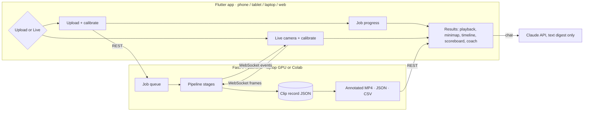
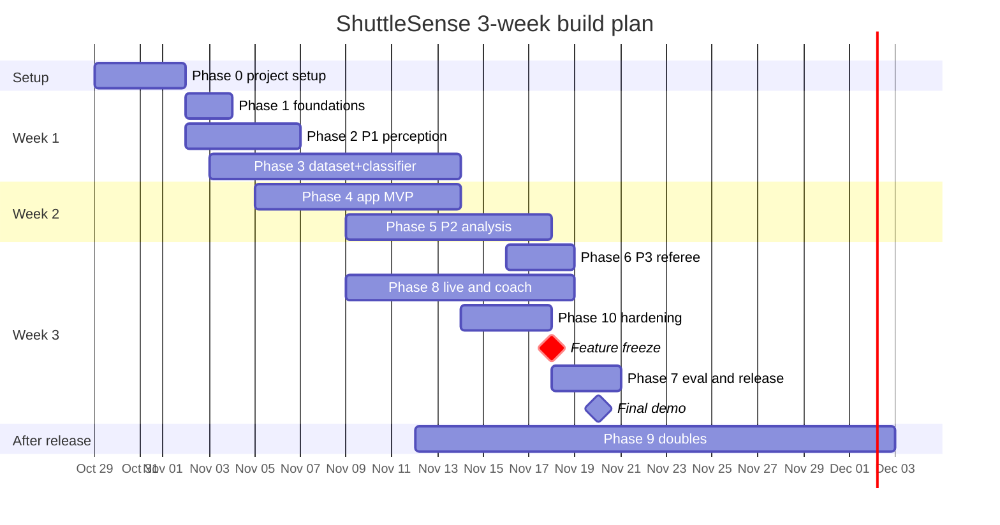

# ShuttleSense: Product Requirements Document

Version 1.3 · Nov 12, 2026 (Design principles added Nov 13; doubles service per game Nov 14) · Owner: Mist (project lead)

> **Changes from v1.2:** **doubles** moves from a non-goal into scope ([D22](DECISIONS.md), [Phase 9](phases/phase-9-doubles.md)): four players tracked, each hit credited to a partner, the doubles service order followed and four players shown in the app. Singles behaviour is unchanged. Doubles accuracy is not measured yet; it needs labelled doubles footage.

> **Changes from v1.1:** the user now picks **Upload** (offline, as before) or **Live** (camera feed processed while the rally is played). The referee layer is committed scope, not a stretch, and adds **automated in/out line calls** with a stated confidence and an uncertainty band. Session-level **coaching notes** and a **coach chat** grounded in the clip record are new. Live streaming and line calls were non-goals in v1.1; [D16–D20](DECISIONS.md) record the reversal.

> **Changes from v1.0:** the demo client is now a cross-platform **Flutter app** (phone, tablet, laptop, browser) instead of a Gradio/Streamlit page. All computer vision runs on a **Python FastAPI backend** hosted on a team laptop GPU or in Google Colab. Open questions from v1.0 are resolved in [Decisions](#decisions-resolved-open-questions). Related docs: [Architecture](ARCHITECTURE.md) · [Data format](DATA_FORMAT.md) · [API](API.md) · [Tech stack](TECH_STACK.md) · [Phases](PHASES.md) · [Setup](SETUP.md).

## Overview

ShuttleSense is a computer vision system that turns a single video of a badminton rally (singles or doubles) into coaching and match insights: where the shuttle went, which stroke each player hit, how their form looked, and how the rally played out on court. It is built in 3 weeks by a team of 6 BSCS students using pretrained models and the expert-annotated ShuttleSet dataset.

**Full title:** ShuttleSense: A Computer Vision Framework for Badminton Stroke Classification, Shuttlecock Tracking, and Match Analysis Using Deep Convolutional Neural Networks and Pose Estimation

### Problem

- Amateur and student players rarely get stroke-by-stroke feedback; coaching is expensive and match video goes unanalyzed.
- The shuttlecock is tiny, fast and often motion-blurred, so generic object detectors lose it.
- Existing badminton analytics tools target elite broadcast footage, not a phone pointed at a local court.
- Players record on their phones but review on whatever is at hand (phone at the court, tablet on the bench, laptop at home), so the results need to be viewable on all of them.

### Reference demo

The target experience comes from a short reference clip of an AI badminton system running on side-view phone footage. It showed, on one screen:

- Pose skeletons drawn on both players, with a bounding box per player
- The shuttle tracked with a trajectory trail
- A hit marker ("TAP!") at each contact
- A highlighted court outline and a side minimap of player and shuttle positions
- A status bar with rally state (in play / between rallies), shuttle speed and a stroke counter
- An automatic scoreboard that updated after each rally (for example 10:8 to 11:9)

ShuttleSense covers every one of these features and adds stroke classification and form feedback, which the reference demo did not show. Features are tiered by priority (see Scope). Since v1.2 the referee layer, live mode and coaching are committed scope (P3), built on top of the P1/P2 core.

## Goals and users

### Goals

1. Track the shuttlecock frame by frame in match video and draw its trajectory.
2. Classify each stroke into 6 classes: smash, clear, drop, net shot, lift, serve.
3. Give per-stroke form feedback from pose angles (elbow height, arm extension, contact height).
4. Map players and shuttle onto a top-down court view with estimated shuttle speed.
5. Detect rally state, keep an assisted score and give automated in/out calls with a stated confidence.
6. Deliver results in one Flutter app that adapts to phone, tablet and laptop screens, from an uploaded clip or a live camera feed.
7. Summarize each session into a few coaching cues and let the player ask questions about their own data.
8. Ship a working demo, a public GitHub repo and a written evaluation within 3 weeks.

### Non-goals (this version)

- Doubles accuracy claims before doubles footage is labelled and measured (T9.2, T9.12)
- On-device inference; phones and tablets are clients, the GPU backend does the processing
- Automatic court detection without user input
- Official or certified line calls. With one consumer camera the calls are automated estimates with a confidence value and an uncertainty band, not Hawk-Eye-level officiating; the product never labels them "official" or "certified"
- Certified, professional or medical coaching advice, including injury diagnosis (form notes and the coach chat are heuristic guidance)
- Video or frames leaving the user's backend: the coach chat sends only a text digest of the clip record to the Claude API (see [Privacy](PRIVACY.md))
- App store publishing (builds are distributed as APK, Windows zip and a web build)
- User accounts or cloud storage of videos

### Target users

| User | Need | What they use | Typical device |
| --- | --- | --- | --- |
| Student and amateur players | See which strokes they hit and how their form compares to simple rules | Stroke timeline, form feedback | Phone |
| PE instructors and club coaches | Review a rally without rewatching it frame by frame | Annotated video, rally summary | Tablet, laptop |
| Casual match organizers | Track score and rally stats for friendly games | Scoreboard, speed and stroke counts | Phone, tablet |
| Course panel and reviewers | Judge technical depth and evaluation | Metrics, README, demo | Laptop, browser |

## Scope and priorities

P1 features are the minimum shippable product and are finished by the end of Week 2. P2 builds on P1 data in Weeks 2 to 3. P3 (referee, live mode and coaching) is committed scope since v1.2; it is built on the same stage code as P1/P2 and lands in Week 3 next to Phase 6 (see [Phase 8](phases/phase-8-live-coach.md)). C-features are the client (app) features that expose the pipeline on every device.

| ID | Feature | Priority | Origin |
| --- | --- | --- | --- |
| F1 | Video upload and preprocessing (phone or broadcast footage) | P1 | Reference demo |
| F2 | Shuttlecock tracking with trajectory trail (TrackNetV3) | P1 | Original idea |
| F3 | Player detection with bounding boxes (near and far player) | P1 | Reference demo |
| F4 | Pose estimation with skeleton overlay on both players | P1 | Both |
| F5 | Hit detection with on-screen hit marker | P1 | Reference demo |
| F6 | Stroke classification (6 classes) per hit | P1 | Original idea |
| F7 | Annotated video export | P1 | Reference demo |
| C1 | Server connection screen (LAN address or tunnel URL, health check) | P1 | Flutter client |
| C2 | Upload with progress, job progress per pipeline stage | P1 | Flutter client |
| C3 | Results screen: annotated playback and stroke timeline, responsive on phone/tablet/laptop | P1 | Flutter client |
| F8 | Rule-based form feedback per stroke | P2 | Original idea |
| F9 | Manual court calibration (tap 4 corners in the app) and court outline overlay | P2 | Reference demo |
| F10 | Top-down court minimap with player and shuttle positions | P2 | Reference demo |
| F11 | Estimated shuttle speed (per stroke and peak) | P2 | Reference demo |
| F12 | Stroke counter per rally | P2 | Reference demo |
| F13 | Rally summary and stats export (JSON/CSV) | P2 | Original idea |
| C4 | Download/share of MP4, JSON and CSV from the app | P2 | Flutter client |
| F14 | Rally state detection (in play / between rallies) | P3 | Reference demo |
| F15 | Landing point and in/out estimation | P3 | Reference demo |
| F16 | Assisted scoreboard with BWF rally scoring and manual correction | P3 | Reference demo |
| F18 | Input mode selection: Upload clip or Go live, remembered per device | P3 | Live referee prompt |
| F19 | Live processing of a camera feed with incremental overlay events and a reduced-quality indicator | P3 | Reference demo |
| F20 | Line calls per landing (IN / OUT / UNCERTAIN) with margin, confidence and user override | P3 | Reference demo |
| F21 | Session coaching notes: pattern-level cues and top 3 fixes linked to timeline moments | P3 | Original idea |
| F22 | AI coach (Gemini by default, Claude optional) grounded by retrieval over the clip record, past sessions and a local badminton knowledge base: session chat with tap-to-seek citations and knowledge sources, a general coach, and a coaching report (D42) | P3 | Original idea |
| C5 | Live screen: camera preview, live calibration, start/stop, live results layout | P3 | Flutter client |
| C6 | Chat screen and session summary view | P3 | Flutter client |
| F17 | Automatic court line detection (no taps) | Future | Reference demo |

## Functional requirements

Each requirement maps to a feature ID from Scope. Acceptance criteria are what the team tests before marking it done.

### P1: Core pipeline

| Req | Description | Acceptance criteria |
| --- | --- | --- |
| FR-1 (F1) | Accept MP4/MOV/AVI uploads up to 10 minutes, 720p or 1080p, 25 to 60 fps; normalize resolution and frame rate | A 1-minute phone clip and a broadcast clip both load and produce a frame index without error |
| FR-2 (F2) | Run pretrained TrackNetV3 to output shuttle (x, y, visible) per frame; draw a fading trail of the last 8 to 15 positions | Trail follows the shuttle on sample clips; per-frame CSV saved |
| FR-3 (F3) | Detect the two players (four in doubles) and assign stable IDs (near / far, and partner slots in doubles) across the rally | Each player keeps the same ID for the full rally on test clips |
| FR-4 (F4) | Extract 2D body keypoints (COCO-17) per player per frame; draw skeletons color-coded by player | Skeletons drawn on both players; keypoints saved per frame |
| FR-5 (F5) | Detect hit frames from shuttle direction changes near a player's wrist; show a "HIT" marker for about 0.5 s | Hit detection F1 score meets the target in Success metrics |
| FR-6 (F6) | Classify each hit into smash, clear, drop, net shot, lift or serve using a pose and trajectory window around the hit; show label and confidence | Classifier meets accuracy target on the held-out ShuttleSet test split |
| FR-7 (F7) | Export an annotated MP4 (H.264) with all enabled overlays plus a per-hit table | Output video plays in the app on every target platform and in a standard player; overlays can be toggled before processing |

### P1: Client

| Req | Description | Acceptance criteria |
| --- | --- | --- |
| FR-C1 (C1) | The user enters the backend URL (e.g. `http://192.168.1.20:8000` or a `trycloudflare.com` URL) and an optional access token; the app checks `GET /health` and remembers the server | Connection succeeds from an Android phone, a tablet, the Windows app and a browser on the same Wi-Fi; a bad URL shows a clear error |
| FR-C2 (C2) | Pick a video from the gallery/files, upload it with a progress bar, start a job and show per-stage progress (tracking, pose, hits, strokes, render) | A 1-minute clip uploads and its job progress updates at least every 2 s until done or failed |
| FR-C3 (C3) | Results screen with annotated playback and a stroke timeline (time, player, stroke, confidence); tapping a row seeks the video | Layout adapts at the compact/medium/expanded breakpoints in [Architecture](ARCHITECTURE.md#responsive-layout); no overflow from 360 px to 1920 px wide |

### P2: Analysis layer

| Req | Description | Acceptance criteria |
| --- | --- | --- |
| FR-8 (F8) | Rule-based feedback per stroke: contact height vs head, elbow angle at contact, arm extension, follow-through; output one short tip per stroke | Each stroke class has at least 2 documented rules; tips show beside the stroke |
| FR-9 (F9) | The user taps 4 court corners on the first frame in the app (with zoom for precision); the backend computes a homography and draws a court outline overlay | Outline aligns with real court lines within a few pixels on test clips |
| FR-10 (F10) | Project player foot positions and shuttle ground position onto a top-down court minimap, updated per frame and synced to playback in the app | Minimap positions match visible court zones on review |
| FR-11 (F11) | Estimate shuttle speed in km/h from court-plane displacement; show current, per-stroke and peak values, labeled "estimated" | Speeds fall in a plausible range and rank smashes above drops on test clips |
| FR-12 (F12) | Count strokes per rally and show the running count | Count matches manual count on test rallies |
| FR-13 (F13) | Export rally summary: stroke distribution, peak speed, per-player stats as JSON and CSV | Files open in a spreadsheet and match the on-screen values |
| FR-C4 (C4) | Download or share the annotated MP4, summary JSON and hits CSV (share sheet on mobile, save dialog on desktop, browser download on web) | All three files save and open on each platform |

### P3: Referee layer

| Req | Description | Acceptance criteria |
| --- | --- | --- |
| FR-14 (F14) | Detect rally start (serve) and end (shuttle lost or stationary on floor for N frames); show "IN PLAY" or "BETWEEN RALLIES" | Rally boundaries match manual labels on test footage |
| FR-15 (F15) | Estimate landing point on the court plane; classify in or out with a confidence value | Clear in/out cases correct on test rallies; close calls flagged as uncertain |
| FR-16 (F16) | Award the rally to a player or pair using landing side and in/out result; apply BWF 21-point rally scoring; follow the players across a change of ends (by the rules, or marked by hand); let the user correct any point in the app, with a reason (let, fault, service fault), start from a game under way, end a match on a retirement, and undo the newest decision of any kind (D32, D33) | Scoreboard updates after each rally; a correction changes the score and is logged |

### P3: Live mode, line calls and coaching

| Req | Description | Acceptance criteria |
| --- | --- | --- |
| FR-18 (F18) | After connecting, the user chooses Upload clip or Go live; the choice is remembered | The picker appears after connect; the last choice is preselected after a restart |
| FR-19 (F19) | The app streams camera frames over a WebSocket; the backend runs the same stage code frame by frame and returns shuttle, players, rally state, hits, strokes, speed, line calls and score as events. When it falls behind it drops frames or lowers resolution and says so | Runs end to end against the fake live source in CI; provisional overlay latency and event lag are measured and reported in [Evaluation](EVALUATION.md); a live session is saved as a normal clip record and appears in History |
| FR-20 (F20) | At each landing, project the shuttle to the court plane and call IN or OUT against the singles (or doubles) lines; calls inside an uncertainty band set from homography and tracking error are UNCERTAIN; the user can confirm or override and the score follows | Each call carries `margin_cm`, `confidence` and `uncertain`; an override is logged and re-scores; precision/recall and near-line false-call rate are reported only once measured on labelled landings |
| FR-21 (F21) | Deterministic pattern notes per session ("bent hitting arm on 4 of 6 smashes") and a top-3 fix list, each linked to the timeline moments that show it | Same record gives the same notes; every note links to at least one moment; thresholds live in `pipeline.yaml` |
| FR-22 (F22) | Coach chat answers questions from the clip record only, says when the data does not show something, cites moments the app turns into seek chips, refuses injury diagnosis, and is disabled with an explanation when no API key is configured | Citations always point at real frames; no key → chat disabled, notes still work; per-session message limit enforced |

## Non-functional requirements

| Area | Requirement |
| --- | --- |
| Performance | Process a 1-minute 720p clip in under 5 minutes on a Colab T4 or the team laptop (RTX 4050) |
| Live latency | Target ≤ 300 ms from frame arrival to provisional overlay event (shuttle, players, rally state) on the RTX 4050. Hit and stroke events lag by their look-ahead and line calls by the landing rule; the synthetic benchmark measured about 0.74 s for hits and 1.73 s for line calls at p95 ([Evaluation](EVALUATION.md)). Under load the backend drops frames or lowers resolution rather than falling behind |
| Hardware | Backend runs on any machine with an NVIDIA GPU or on Colab; CPU-only mode works for short clips, slowly. Clients need no GPU |
| Platforms | One Flutter codebase builds for Android, iOS/iPadOS, Web and Windows. iOS builds require a Mac and are best-effort |
| Responsiveness | Usable from 360 px (small phone, portrait) to 1920 px (laptop) wide; touch, mouse and keyboard input |
| Network | Works on a local Wi-Fi network without internet; a tunnel URL is used only when the backend runs in Colab |
| Reproducibility | Pinned versions in `backend/requirements/*.txt` and `app/pubspec.lock`, fixed random seeds, download scripts for data and weights |
| Modularity | Each stage (tracking, pose, hits, strokes, court, scoring) is a separate module reading and writing the shared clip record, so stages can be swapped or disabled |
| Usability | Upload, tap 4 corners, process, review, download; no command line needed by end users |
| Transparency | Speed, in/out and score always labeled as estimates; each stroke label and line call shows its confidence; line calls are called "automated calls", never "official" |
| Privacy | Videos are processed on the team's own machine or the user's Colab session; uploads and outputs can be deleted from the app and are not kept by the project. The coach chat sends a text digest of the clip record (no video, frames or images) to the Claude API, only when the backend owner configured a key; details in [PRIVACY.md](PRIVACY.md) |
| Security | Optional bearer token (`SHUTTLESENSE_TOKEN`) required whenever the backend is exposed through a public tunnel |
| Licensing | Third-party model, package and dataset licenses listed in [Tech stack](TECH_STACK.md) and respected; no AGPL dependencies |

## System overview

The full architecture, module boundaries and job lifecycle are in [ARCHITECTURE.md](ARCHITECTURE.md). In short:

Every pipeline feature reads from and writes to one shared per-clip record; its schema is in [DATA_FORMAT.md](DATA_FORMAT.md) and the REST contract between app and backend is in [API.md](API.md).

### Models and methods

| Component | Method | Weights |
| --- | --- | --- |
| Shuttle tracking | TrackNetV3: heatmap CNN plus InpaintNet trajectory rectification | Pretrained on the Shuttlecock Trajectory Dataset |
| Player detection | RTMDet person detector (via rtmlib); near/far ID by court side | Pretrained (COCO) |
| Pose estimation | RTMPose (via rtmlib), COCO-17 keypoints; fallback torchvision Keypoint R-CNN | Pretrained |
| Hit detection | Rules: shuttle direction change within a set distance of a wrist keypoint | No training |
| Stroke classification | Three models over the same window of pose and shuttle features around each hit, chosen per clip: 1D CNN, LSTM, Random Forest ([D28](DECISIONS.md)); pose-only baseline for comparison | Trained by the team on the pre-extracted ShuttleSet features published with BST ([D29](DECISIONS.md)); weights committed |
| Court mapping | OpenCV homography from 4 tapped corners | No training |
| Speed | Court-plane displacement between frames times fps, smoothed | No training |
| Scoring | Landing side, in/out and BWF rally scoring rules | No training |
| Line calls | Homography projection of the landing point, signed margin to the nearest line, uncertainty band from calibration and tracking error | No training |
| Coaching notes | Rule failure rates per stroke class over a session | No training |
| Coach chat | Claude API over a compact digest of the clip record | Hosted model (Anthropic) |

### Data

- **ShuttleSet** (KDD 2023): 44 elite singles matches, 36,492 expert-annotated strokes in 18 types (the released CSVs hold 36,484, of which 1,407 are marked unknown). The team merges these into 6 classes and splits by match so no match appears in both training and test sets.
- **Shuttlecock Trajectory Dataset:** used through TrackNetV3's pretrained weights; no retraining planned.
- **Team phone footage:** 5 to 10 rallies recorded with consent and labeled by hand, used only for evaluation and the demo.

### Tech stack (summary)

| Layer | Choice |
| --- | --- |
| Client | Flutter 3.41 (Dart 3.11): Android, iOS/iPadOS, Web, Windows |
| Backend API | Python 3.11 to 3.13, FastAPI + Uvicorn |
| Deep learning | PyTorch |
| Vision | OpenCV, rtmlib (RTMDet/RTMPose, ONNX Runtime), TrackNetV3 |
| Data | NumPy, pandas, pydantic |
| Compute | Team laptop (RTX 4050) or Google Colab (T4) with cloudflared tunnel |
| Code and tasks | GitHub repo, issues, project board, GitHub Actions |
| Large files | Hugging Face Hub (weights), Google Drive (processed data) |

Versions, licenses and rationale for every choice are in [TECH_STACK.md](TECH_STACK.md).

## User flow and interface

### User flow

1. Start the backend on the laptop (or run the Colab notebook) and note its URL.
2. Open the app on a phone, tablet, laptop or browser and connect to that URL.
3. Record a rally (singles or doubles) with a phone on a tripod, ideally elevated and behind the baseline, or pick a broadcast clip.
4. Choose **Upload clip** and pick the video, or **Go live** and point the camera at the court (live mode skips steps 6 and 7 and processes while you play).
5. Tap the 4 court corners on the first frame (skippable; P2 features turn off without it).
6. Choose overlays: trail, skeletons, hit markers, stroke labels, court, speed, scoreboard.
7. Start processing and watch progress per stage.
8. Review the annotated playback, minimap, stroke timeline, line calls and form tips; confirm or override uncertain calls; read the session summary and ask the coach chat questions.
9. Download or share the annotated MP4 and the JSON/CSV summary; optionally delete the job from the server.

### Design principles

A look at courtside scoring and racket-sport analysis apps (Nov 13) set these rules for the
app's screens:

- **The score is the largest thing on the referee view,** with one large point button per
  side under it. Scoring apps are used at a glance and with one hand.
- **The app says who serves and from which court** instead of leaving it to the umpire.
- **Every automated call can be corrected,** during play and afterwards. Missing score
  correction is a common complaint about automated scoring.
- **Line calls keep one colour each** (in, out, uncertain) in light and dark, with text
  that meets 4.5:1 on them.
- **The coach view shows one cue at a time, set large,** so it can be read at arm's length
  between rallies; the detail sits below it.
- **Colour always says who:** each player or doubles partner keeps the same colour in the
  video, minimap, timeline, chart and coaching notes.

Spacing, corner radii, the touch-target size and the line-call colours are tokens in
`app/lib/core/theme/tokens.dart`.

### Screen layout

The results screen mirrors the reference demo and adapts to the screen width.

| Zone | Content | Phone (compact) | Tablet (medium) | Laptop (expanded) |
| --- | --- | --- | --- | --- |
| Main video | Annotated playback: court outline, skeletons, player boxes, shuttle trail, hit markers, stroke label with confidence | Full width, top | Left, ~65% | Left, ~60% |
| Minimap | Top-down court with both players (all four in doubles) and the shuttle | Tab below video | Right panel | Right panel |
| Status bar | Rally state, current and peak speed (estimated), stroke count | Strip under video | Under video | Under video |
| Scoreboard | Score per side (player or pair) with correction buttons (P3) | Tab below video | Right panel | Right panel |
| Stroke timeline | One row per hit: time, player, stroke, confidence, speed, form tip | Tab below video | Below video | Below video, full width |
| Downloads | Annotated MP4, rally summary JSON, per-hit CSV | Menu action | App bar action | App bar action |

## Success metrics

Targets are the team's own goals for a 3-week build, not published benchmarks. Model metrics use the held-out ShuttleSet test matches; phone-footage metrics use 5 to 10 rallies the team records and labels by hand.

| Metric | Measured on | Target |
| --- | --- | --- |
| Shuttle detection accuracy (within 4 px of label) | ShuttleSet / TrackNet test clips | ≥ 85% of visible frames |
| Hit detection F1 (within ±3 frames) | ShuttleSet test matches | ≥ 0.75 |
| Stroke classification macro accuracy, 6 classes | ShuttleSet test matches | ≥ 70% |
| Stroke classification accuracy | Team phone footage | ≥ 55%, reported separately |
| Stroke count error per rally | Team phone footage | ≤ 1 stroke on average |
| Rally boundary accuracy (P3) | Team phone footage | ≥ 80% of rallies |
| Line-call precision / recall, IN vs OUT (P3) | Labelled landings: ShuttleSet + team phone clips | Reported as measured; no target claimed before labels exist |
| Near-line false-call rate (P3) | Labelled landings within 20 cm of a line | Reported as measured |
| Live provisional overlay latency, p95 (P3) | RTX 4050, 720p, 30 fps | ≤ 300 ms |
| Processing time | 1-minute 720p clip, Colab T4 or RTX 4050 | < 5 minutes |
| App coverage | Android phone, tablet, Windows, Chrome | Full flow works on all four |
| Ablation | ShuttleSet test | Report pose-only vs pose + trajectory accuracy |

The phone-footage results are reported even if they are low: the gap between broadcast and phone accuracy is itself a finding.

## Timeline and team

Features freeze on Nov 18, two days before the final demo. The detailed task list with owners is in [PHASES.md](PHASES.md) and the per-phase files in [phases/](phases/).

The plan assumes work starts Monday, Nov 2, 2026 and ends with the demo on Friday, Nov 20; shift every date together if the start moves. Anything not stable at the freeze moves to Future work.

### Weekly goals

- [ ] Week 1: clip record and API contract frozen; TrackNetV3 producing trajectories; first clips cut; baseline classifier on a small batch; app connects to the backend on all platforms
- [ ] Week 2: all clips processed; classifier trained with pose-only vs pose + trajectory comparison; court calibration, minimap and speed working; app shows full P1 results on phone, tablet and laptop
- [ ] Week 3: referee layer, line calls, live mode and coach chat done; feature freeze; end-to-end testing on phone footage; release builds; README, results and slides done; backup demo video recorded

### Roles

| Member | Role | Owns | Picks up after main task |
| --- | --- | --- | --- |
| Mist | Project lead and integration | Repo, data format, API contract, backend job server, pipeline wiring, final merge | Code review, testing, release builds |
| Member 2 | Shuttle tracking | TrackNetV3 inference, gap filling, trail overlay | Court calibration, minimap, speed |
| Member 3 | Data pipeline A | Download and cut first half of ShuttleSet matches | Form feedback rules, rally state and scoring |
| Member 4 | Data pipeline B | Cut second half, merge 18 labels into 6 classes | Evaluation set from team footage |
| Member 5 | Pose and stroke classifier | Pose extraction, hit detection, stroke models (CNN, LSTM, Random Forest), ablation | Results tables for the write-up |
| Member 6 | Flutter app and docs | Flutter app (all screens, responsive layouts), slides | Backup demo video |

## Risks and mitigations

| Risk | Impact | Mitigation |
| --- | --- | --- |
| Domain gap: models trained on broadcast footage perform worse on side-view phone clips | High | Film demo clips elevated and behind the baseline; report phone accuracy separately; fine-tune on a small labeled set if time allows |
| Clip extraction from ShuttleSet takes longer than planned | High | Two people on the data pipeline; start with 5 matches (T3.1), add more only if on schedule |
| Similar strokes (smash vs clear, drop vs net shot) get confused | Medium | Merge to 6 classes; add shuttle trajectory features; show confidence |
| Shuttle lost during fast smashes or occlusion | Medium | Use TrackNetV3's trajectory rectification; interpolate short gaps |
| In/out calls wrong near lines | High | Uncertainty band from homography and tracking error; UNCERTAIN calls need user confirmation; overrides re-score; never labelled official |
| Live latency above budget on the laptop GPU | High | Sliding windows sized to the model; newest-frame queue; drop frames or lower resolution with a visible indicator; provisional overlay separate from delayed events |
| App camera frame rate too low on web and Windows (still captures) | Medium | Report the received fps; degrade indicator; recommend the Android app or a phone on a tripod for live sessions |
| Coach chat invents facts | Medium | Prompt built only from the clip record; citations validated against real frames server side; tested with a fake client |
| Colab GPU quota runs out | Medium | Laptop GPU is the primary backend; spread Colab jobs across team accounts; cache intermediate outputs |
| Flutter video playback differs per platform | Medium | Use media_kit (one engine on all four targets); backend always outputs H.264 MP4; test on each platform in Phase 4 |
| Phone cannot reach the laptop backend (firewall, client isolation on campus Wi-Fi) | Medium | Document Windows firewall rule; fall back to a phone hotspot or the Colab tunnel URL |
| Flutter work competes with model work for time | Medium | One owner (Member 6) for the app; screens built against a stub backend from day 1 so they do not wait for models |
| Integration breaks in Week 3 | High | Clip record and API contract frozen in Phase 1; CI on every PR; feature freeze at mid-Week 3; live mode and chat are additive and can be switched off without touching upload mode |

## Assumptions and constraints

- Singles or doubles matches, one static camera per video, court fully or mostly in frame. In doubles the user names who serves and receives first.
- Speed is a 2D court-plane approximation from one camera, so it underestimates true speed when the shuttle travels toward or away from the camera.
- Line calls project the shuttle pixel at the landing frame onto the floor plane. At 720p and 30 fps the shuttle can move tens of centimetres between frames and the far baseline spans few pixels, so calls near a line are often UNCERTAIN. That is a property of one camera, not something to tune away.
- Team of 6, 3 weeks, free-tier compute plus one laptop GPU.
- Client devices and backend are on the same network, or the backend is reachable through a tunnel.

## Ethics and privacy

- Only film people who agree to be recorded; get consent before using teammates' clips in the repo or demo.
- ShuttleSet and match videos are used for research and education under their original terms; videos are not redistributed in the repo.
- Form feedback, session notes and coach chat answers are presented as heuristic guidance, not professional coaching or injury advice. The chat refuses to diagnose injuries.
- Every dependency's license is checked before it is added (for example, Ultralytics YOLO is AGPL-3.0 and is therefore not used; TrackNetV3 is MIT).

## Decisions (resolved open questions)

| v1.0 open question | Decision | Why |
| --- | --- | --- |
| Which pose model? | rtmlib (RTMDet + RTMPose, Apache-2.0); fallback torchvision Keypoint R-CNN (BSD) | Multi-person in one pass, fast on ONNX Runtime, permissive license compatible with MIT; to be confirmed by the Phase 1 pose spike (T1.5, D6 pending) |
| Train a CNN from scratch or fine-tune? | The stroke models (1D CNN, LSTM, Random Forest) are trained from scratch; perception models are pretrained | Satisfies either course interpretation; pretrained trackers would not be retrainable in 3 weeks |
| Gradio or Streamlit for the demo? | Neither: Flutter app, so the demo runs on phone, tablet and laptop | User requirement for cross-device use; the backend still exposes a CLI for development |
| Where to share weights and data? | Hugging Face Hub for weights (scripted download), Google Drive for processed datasets | Versioned, scriptable weights; Drive is familiar and free for large data |

## Future work

- Automatic court line detection (F17)
- Doubles: measured accuracy, a doubles-trained stroke model, and re-identification across games and end changes
- On-device processing on phones and edge devices (live mode streams to the backend)
- Multi-camera line calls for close-to-line accuracy
- Fine-tuning on local amateur footage from Philippine courts
- Learned hit detector, and a transformer stroke model: the released BST weights take the same pose and shuttle sources but also need bones, both players and court positions
- App store releases and in-app recording

## References

- Wang, W.-Y., Huang, Y.-C., Ik, T.-U., Peng, W.-C. (2023). ShuttleSet: A Human-Annotated Stroke-Level Singles Dataset for Badminton Tactical Analysis. KDD 2023. [arXiv:2306.04948](https://arxiv.org/abs/2306.04948)
- Chen, Y.-J., Wang, Y.-S. (2023). TrackNetV3: Enhancing ShuttleCock Tracking with Augmentations and Trajectory Rectification. MMAsia 2023. [Paper](https://people.cs.nycu.edu.tw/~yushuen/data/TrackNetV3.pdf) · [Code](https://github.com/qaz812345/TrackNetV3)
- BST: Badminton Stroke-type Transformer for Skeleton-based Action Recognition in Racket Sports. [arXiv:2502.21085](https://arxiv.org/abs/2502.21085)
- Jiang, T. et al. (2023). RTMPose: Real-Time Multi-Person Pose Estimation based on MMPose. [arXiv:2303.07399](https://arxiv.org/abs/2303.07399) · [rtmlib](https://github.com/Tau-J/rtmlib)
- Badminton World Federation, Laws of Badminton (rally scoring to 21)
