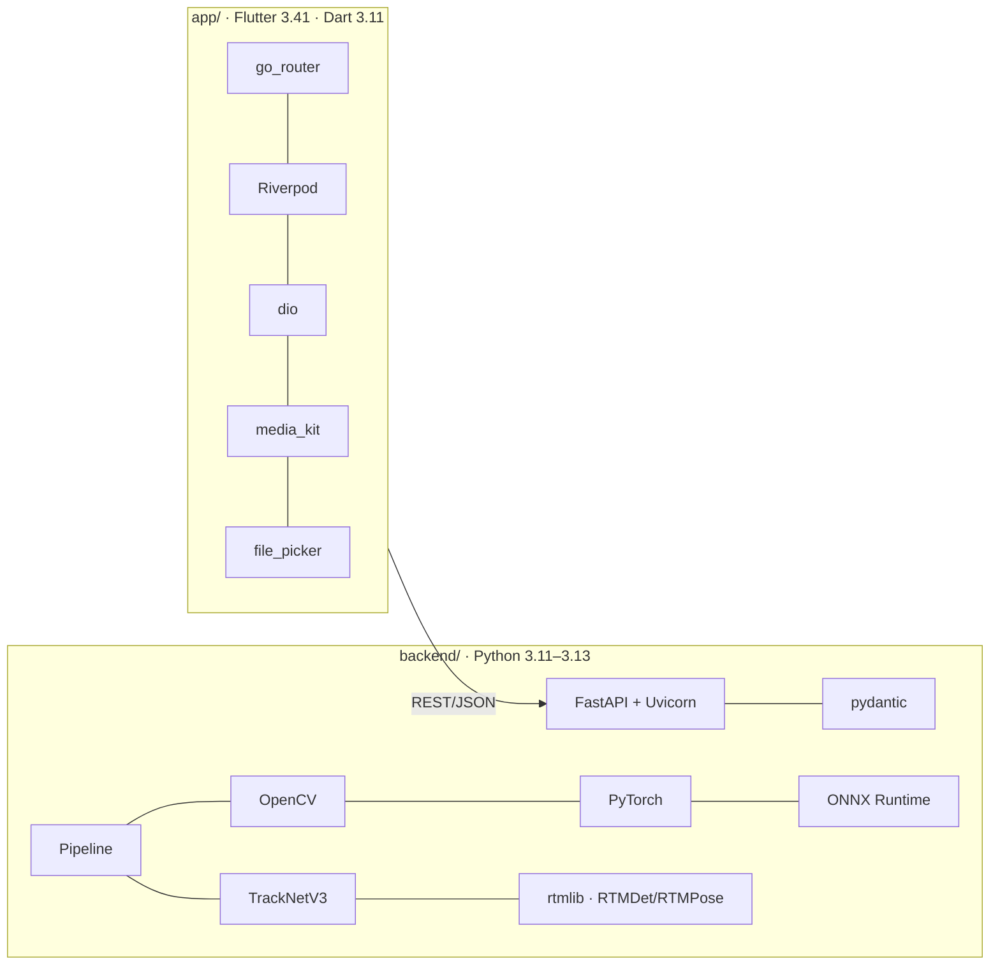

# Tech stack

What ShuttleSense uses, the version pinned, its license and why it was chosen. Exact versions are locked in `backend/requirements/*.txt` and `app/pubspec.lock`; this page explains the choices. Any new dependency is added here in the same PR, with its license checked against MIT (no AGPL or non-commercial-only code in the repo).

## Overview

## Client (app/)

| Concern | Choice | Version | License | Why |
| --- | --- | --- | --- | --- |
| Framework | Flutter | 3.41 stable | BSD-3 | One codebase for Android, iOS/iPadOS, Web and Windows; team requirement |
| Language | Dart | 3.11 | BSD-3 | Comes with Flutter |
| Design system | Material 3 | built in | BSD-3 | Adaptive components (NavigationBar/NavigationRail) and window size classes for phone/tablet/laptop |
| Routing | go_router | ^17.5 | BSD-3 | Declarative routes, deep links, web URLs, `ShellRoute` for the adaptive shell |
| State | flutter_riverpod | ^2.6 | MIT | Testable providers, easy fakes in widget tests, no codegen needed |
| HTTP | dio | ^5.11 | MIT | Upload/download progress callbacks, interceptors for the bearer token, cancel tokens |
| Video playback | media_kit, media_kit_video, media_kit_libs_video | ^1.2 / ^2.0 / ^1.0 | MIT | Same player engine on Android, iOS, Windows and Web; `video_player` lacks Windows support |
| File picking | file_picker | ^13.3 | MIT | Gallery/files on mobile, native dialogs on desktop, browser picker on web |
| Settings storage | shared_preferences | ^2.5 | BSD-3 | Persists server URL and token on every platform |
| Charts | fl_chart | ^1.3 | MIT | Stroke distribution and speed charts in the results summary |
| Sharing | share_plus | ^13.3 | BSD-3 | Share sheet for MP4/JSON/CSV on Android and iOS |
| Links / downloads | url_launcher | ^6.3 | BSD-3 | Opens download URLs in the browser on web |
| Paths | path_provider | ^2.1 | BSD-3 | Temp/download folders for saved results on mobile and desktop |
| Lints | flutter_lints | ^6.0 | BSD-3 | Standard analyzer rules, enforced in CI |

Platform notes:

- **Android:** min SDK from Flutter defaults; needs `INTERNET` permission (added) and `android:usesCleartextTraffic="true"` so it can reach `http://` LAN servers (added in the debug/profile manifests and documented for release).
- **iOS/iPadOS:** built on a Mac only; `NSAppTransportSecurity > NSAllowsLocalNetworking` and `NSLocalNetworkUsageDescription` are set so the app can reach the laptop on Wi-Fi. Photo library usage string is set for `file_picker`.
- **Web:** served by `flutter build web`; the backend's CORS setting must allow the web origin. Browsers block `http://` calls from an `https://` page, so host the web build over `http://` on the LAN or use the tunnel's `https://` URL.
- **Windows:** `flutter build windows`; media_kit ships its own libmpv. Needs Visual Studio 2022 with "Desktop development with C++" to build.

## Backend (backend/)

### API and core (requirements/base.txt — installed everywhere, including CI)

| Concern | Choice | Version | License | Why |
| --- | --- | --- | --- | --- |
| Language | Python | 3.11–3.13 (CI: 3.12) | PSF | Required by the ML ecosystem; Colab ships 3.12 |
| Web framework | FastAPI | 0.162.0 | MIT | Typed request/response models, automatic OpenAPI docs at `/docs`, background workers |
| ASGI server | Uvicorn | 0.54.0 | BSD-3 | Standard FastAPI server, runs the same on Windows and Colab |
| Validation / schema | pydantic | 2.14.1 | MIT | One definition of the clip record used by pipeline, API and tests |
| Settings | pydantic-settings | 2.16.2 | MIT | `SHUTTLESENSE_*` environment variables |
| Uploads | python-multipart | 0.0.32 | Apache-2.0 | Multipart parsing for `POST /videos` |
| Arrays | NumPy | 2.5.4 | BSD-3 | Trajectories, keypoints, features |
| Vision | opencv-python-headless | 5.0.0.93 | Apache-2.0 | Video IO, drawing overlays, homography; headless so it installs on servers/Colab |
| Tables | pandas | 3.1.0 | BSD-3 | ShuttleSet CSVs, exports |
| Config | PyYAML | 6.0.3 | MIT | `configs/*.yaml` |

### Machine learning (requirements/ml.txt — GPU host and Colab only)

| Concern | Choice | Version | License | Why |
| --- | --- | --- | --- | --- |
| Deep learning | PyTorch | 2.15.0 (CUDA wheel) | BSD-3 | TrackNetV3 is PyTorch; stroke CNN training |
| Shuttle tracking | TrackNetV3 (git submodule) | pinned commit | MIT | State of the art for tiny, blurred shuttles; pretrained weights; trajectory rectification |
| Person + pose | rtmlib (RTMDet + RTMPose) | 0.0.16 | Apache-2.0 | Multi-person, fast on ONNX Runtime, no mmcv install; COCO-17 keypoints |
| Inference runtime | onnxruntime-gpu | 1.31.1 | MIT | Runs RTMDet/RTMPose on CUDA; CPU fallback with `onnxruntime` |
| Fallback pose | torchvision Keypoint R-CNN | with torch | BSD-3 | Used only if rtmlib fails the Phase 1 spike |
| Numerics | SciPy | 1.18.1 | BSD-3 | Pulled in by the ML stack (`requirements/ml.txt`); ShuttleSense's own code does not import it (gap filling and smoothing are NumPy, see D9) |
| Weights hosting | huggingface-hub | 2.3.0 | Apache-2.0 | `scripts/download_weights.py` pulls versioned weights |
| Progress | tqdm | 4.70.1 | MIT/MPL-2.0 | Progress bars in scripts |

**Rejected:** Ultralytics YOLO / YOLO-pose (AGPL-3.0, would force the whole repo to AGPL); MediaPipe Pose (single-person, needs a separate detector and per-crop calls; kept as a documented alternative); Gradio/Streamlit (replaced by the Flutter app).

### Development (requirements/dev.txt)

| Tool | Version | Use |
| --- | --- | --- |
| pytest | 9.2.0 | Unit and API tests |
| httpx | 0.28.1 | Required by FastAPI's `TestClient` |
| ruff | 0.17.3 | Lint + format (`ruff check`, `ruff format`) |

## Infrastructure

| Concern | Choice | Notes |
| --- | --- | --- |
| Primary backend host | Team laptop, RTX 4050 (6 GB) | Phones/tablets connect over Wi-Fi to `http://<LAN-IP>:8000` |
| Fallback backend host | Google Colab, T4 | `notebooks/shuttlesense_colab.ipynb` starts the server and a cloudflared quick tunnel |
| Tunnel | cloudflared (Apache-2.0) | No account needed for quick tunnels; always set `SHUTTLESENSE_TOKEN` when used |
| Video encoding | OpenCV writer + ffmpeg (H.264, yuv420p, `+faststart`) | Plays on every Flutter target; ffmpeg is preinstalled on Colab, install on Windows via `winget install Gyan.FFmpeg` |
| Weights | Hugging Face Hub repo `shuttlesense/weights` (private until release) | TrackNetV3, InpaintNet, stroke CNN checkpoints |
| Datasets | Google Drive shared folder | ShuttleSet annotations, cut clips, feature `.npz` files |
| Source control | GitHub (`Mist10148/ShuttleSense`) | Issues + Projects board mirrors [PHASES.md](PHASES.md) |
| CI | GitHub Actions | Backend: ruff + pytest. App: analyze + test + web build |

## Version policy

- Backend: exact pins (`==`) in `requirements/*.txt`. Upgrades happen in a dedicated PR that runs the full test suite and one end-to-end clip.
- App: caret constraints in `pubspec.yaml`, exact resolution committed in `pubspec.lock`.
- TrackNetV3 submodule pinned to a commit; bump only together with re-running the tracking evaluation.
- Freeze all versions at the feature freeze (Nov 18).
