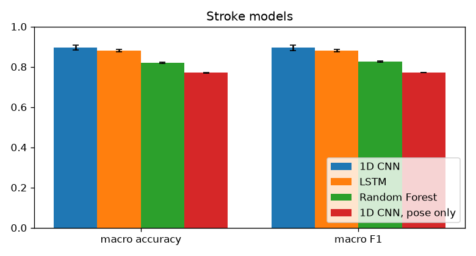

# Stroke classifier results

Test matches only, mean ± std over seeds. Generated by `scripts/make_figures.py` from the `train_stroke_classifier.py` metrics files.

The three models were trained on the pre-extracted ShuttleSet features published with BST ([D29](../DECISIONS.md)): RTMPose keypoints and TrackNetV3 shuttle positions, 30 frames per stroke, mapped to our six classes. The split is BST's, by match: 23,723 train, 3,821 validation and 3,136 test strokes. These are broadcast matches, so the numbers say nothing yet about phone footage (T7.2), and they are not on our own match split (`configs/splits.json`, T3.9). Each model was selected on the validation split and evaluated once on the test split. The project target is macro accuracy of at least 70%. Settings: `backend/configs/stroke_cnn.yaml`, `stroke_lstm.yaml` and `stroke_rf.yaml`; measured on Nov 14, 2026.

| Model | Seeds | Accuracy | Macro accuracy | Macro F1 |
| --- | --- | ---: | ---: | ---: |
| 1D CNN | 1, 2, 3 | 90.7% ± 1.3% | 89.5% ± 1.2% | 89.6% ± 1.4% |
| LSTM | 1, 2, 3 | 89.3% ± 0.4% | 88.1% ± 0.6% | 88.2% ± 0.6% |
| Random Forest | 1, 2, 3 | 83.6% ± 0.2% | 82.1% ± 0.3% | 82.6% ± 0.3% |
| 1D CNN, pose only | 1, 2, 3 | 78.2% ± 0.2% | 77.1% ± 0.1% | 77.2% ± 0.1% |

## Per-class F1

| Class | 1D CNN | LSTM | Random Forest | 1D CNN, pose only |
| --- | ---: | ---: | ---: | ---: |
| smash | 84.3% ± 1.4% | 81.6% ± 1.2% | 76.2% ± 0.7% | 72.8% ± 1.3% |
| clear | 92.1% ± 1.3% | 90.9% ± 1.2% | 85.0% ± 0.3% | 67.9% ± 0.4% |
| drop | 76.5% ± 2.8% | 74.5% ± 1.3% | 66.7% ± 0.6% | 61.4% ± 1.9% |
| net_shot | 93.4% ± 1.2% | 92.5% ± 1.0% | 87.4% ± 0.0% | 82.7% ± 0.7% |
| lift | 93.4% ± 1.1% | 92.5% ± 0.8% | 85.3% ± 0.1% | 80.7% ± 1.1% |
| serve | 97.7% ± 0.8% | 96.8% ± 1.0% | 94.7% ± 0.5% | 97.4% ± 0.0% |

Most confused (1D CNN): drop → smash 20%; smash → drop 9%; lift → net_shot 7%

Most confused (LSTM): drop → smash 21%; smash → drop 12%; lift → net_shot 6%

Most confused (Random Forest): drop → smash 27%; lift → net_shot 15%; smash → drop 11%

Most confused (1D CNN, pose only): drop → smash 21%; lift → net_shot 20%; drop → clear 18%

## Figures

