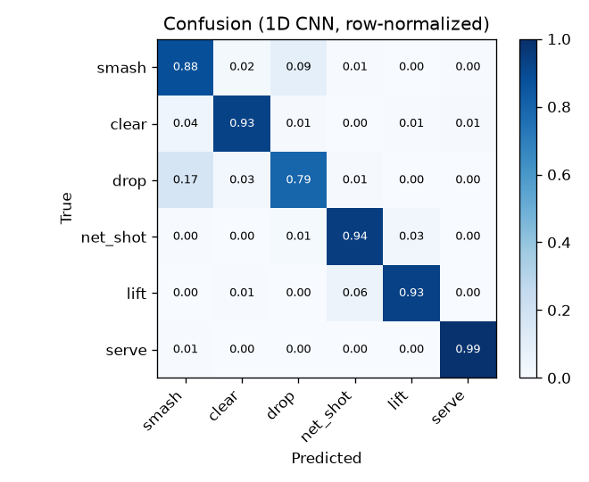
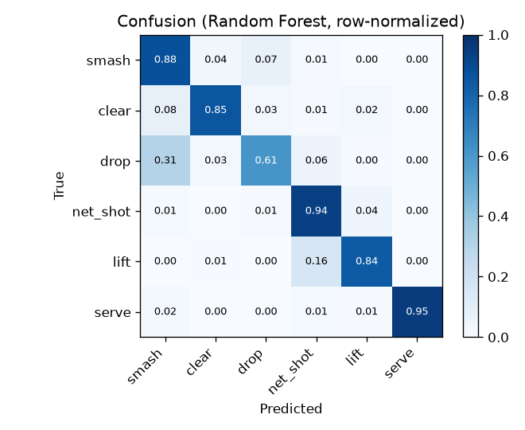
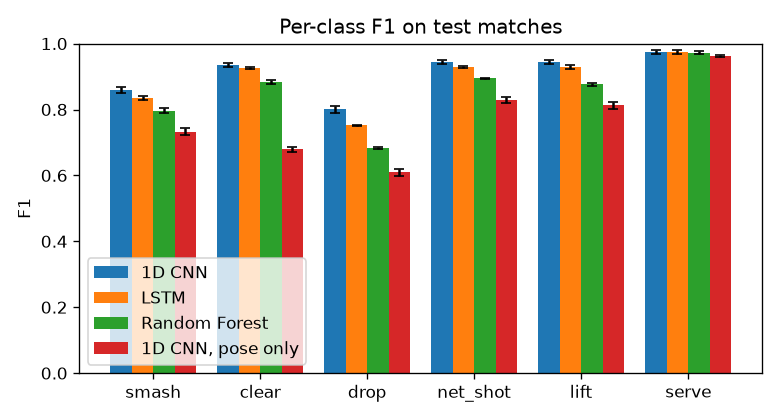

# Stroke classifier results

Test matches only, mean ± std over seeds. Generated by `scripts/make_figures.py` from the `train_stroke_classifier.py` metrics files.

The three models were trained on the pre-extracted ShuttleSet features published with BST ([D29](../DECISIONS.md)): RTMPose keypoints and TrackNetV3 shuttle positions, 30 frames per stroke, mapped to our six classes. The split is BST's, by match: 23,723 train, 3,821 validation and 3,136 test strokes. These are broadcast matches, so the numbers say nothing yet about phone footage (T7.2), and they are not on our own match split (`configs/splits.json`, T3.9). The project target is macro accuracy of at least 70%.

**This is the second evaluation on the test split.** The first (Nov 14) gave 1D CNN 89.5% ± 1.2%, LSTM 88.1% ± 0.6%, Random Forest 82.1% ± 0.3% and pose only 77.1% ± 0.1% macro accuracy. On Nov 15 the feature import was corrected ([D35](../DECISIONS.md)): the 24- and 25-frame training clips of matches 1 to 20 had been zero-padded at the end, which put the hit three frames early in 61% of the training windows; they are now resampled to 30 frames. The import fix and every setting changed with it (label smoothing 0.1 and early-stopping patience 15 for the networks, a ±4 frame shift for the LSTM; for the forest, statistics over frames that hold data, depth 18, leaf size 3 and copies shifted by one frame) were chosen on the training and validation splits only, with seeds 0 and 4, which are not reported here. The test split was then evaluated once for seeds 1, 2 and 3. Because the test split had been seen once before, read the gain over Nov 14 as an estimate, not as a clean held-out comparison. Commands: `python scripts/import_bst_features.py --src data/bst_download/extracted/dataset_npy`, then `python scripts/train_stroke_classifier.py --algorithm cnn|lstm|rf --seeds 1,2,3` and `--algorithm cnn --pose-only --seeds 1,2,3`, at commit `79cae0b`. Settings: `backend/configs/stroke_cnn.yaml`, `stroke_lstm.yaml` and `stroke_rf.yaml`; measured on Nov 15, 2026.

| Model | Seeds | Accuracy | Macro accuracy | Macro F1 |
| --- | --- | ---: | ---: | ---: |
| 1D CNN | 1, 2, 3 | 91.9% ± 0.5% | 91.2% ± 0.6% | 91.0% ± 0.6% |
| LSTM | 1, 2, 3 | 90.1% ± 0.2% | 89.0% ± 0.3% | 89.1% ± 0.1% |
| Random Forest | 1, 2, 3 | 86.2% ± 0.2% | 84.3% ± 0.2% | 85.1% ± 0.3% |
| 1D CNN, pose only | 1, 2, 3 | 78.4% ± 0.8% | 77.5% ± 0.7% | 77.1% ± 0.7% |

## Per-class F1

| Class | 1D CNN | LSTM | Random Forest | 1D CNN, pose only |
| --- | ---: | ---: | ---: | ---: |
| smash | 86.0% ± 0.9% | 83.5% ± 0.6% | 79.7% ± 0.7% | 73.3% ± 1.2% |
| clear | 93.5% ± 0.5% | 92.5% ± 0.3% | 88.3% ± 0.5% | 67.9% ± 0.7% |
| drop | 80.1% ± 1.1% | 75.2% ± 0.2% | 68.3% ± 0.4% | 60.9% ± 0.9% |
| net_shot | 94.5% ± 0.5% | 93.0% ± 0.3% | 89.5% ± 0.2% | 82.9% ± 0.9% |
| lift | 94.3% ± 0.6% | 92.9% ± 0.6% | 87.7% ± 0.5% | 81.3% ± 1.1% |
| serve | 97.5% ± 0.6% | 97.5% ± 0.5% | 97.2% ± 0.4% | 96.2% ± 0.4% |

Most confused (1D CNN): drop → smash 17%; smash → drop 9%; lift → net_shot 6%

Most confused (LSTM): drop → smash 21%; smash → drop 11%; lift → net_shot 7%

Most confused (Random Forest): drop → smash 31%; lift → net_shot 16%; clear → smash 8%

Most confused (1D CNN, pose only): drop → smash 23%; drop → clear 18%; lift → net_shot 17%

## Figures

